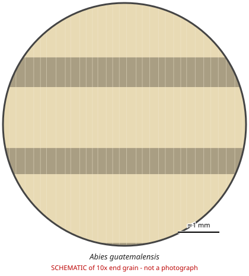

# Abies guatemalensis

**Family:** Pinaceae  
**Trade / common names:** Guatemalan fir, pinabete  
**CITES Appendix:** **I**  
**Annotation:** none — No annotation - ALL parts and derivatives are covered (including finished products).  
**Population covered:** All populations  
**First listed (approx. year in force):** 1975  
**Native range:** Highlands of southern Mexico, Guatemala, Honduras, El Salvador.

> Always confirm the live listing on [Species+](https://speciesplus.net) before seizure decisions.

## Documents needed for trade

**Appendix I:** **Export permit** from the exporting country **and** an **import permit** from the importing country (the import permit must be issued first); re-exports need a **re-export certificate**. Import must not be primarily commercial. Pre-Convention stock needs a pre-Convention certificate.

The annotation above decides which products need a document at all. Details, validity, codes and a document check: [CITES documents guide](../guides/cites-documents.md).

## 10x end-grain view

| Real photographs (reference specimens) | Schematic |
|---|---|
| See [`photos/abies-guatemalensis/`](../photos/abies-guatemalensis/) and the image links below |  |

## Key diagnostic summary

Pale, non-resinous softwood with NO resin canals and no colour difference between heartwood and sapwood. Typical 'fir' - genus level only. Mostly traded as Christmas trees/branches rather than timber.

## Macroscopic features (hand lens, 10x, freshly cut transverse surface)

| Feature | Observation |
|---|---|
| Wood type | softwood |
| Porosity | none |
| Pore size | — |
| Pore frequency | — |
| Pore arrangement | — |
| Pore contents / deposits | none noted |
| Axial parenchyma | not visible / none |
| Rays | fine |
| Ripple marks (storied structure, tangential face) | no |
| Resin canals (softwoods) | no |

**Other features:**

- Growth rings distinct; earlywood-latewood transition fairly abrupt
- No normal resin canals (traumatic canals in tangential rows possible)

## Physical characteristics

- **Heartwood:** Creamy white to pale buff; no distinct heartwood colour.
- **Sapwood:** Not distinct from heartwood.
- **Density:** ~400-450 kg/m3 (light)
- **Odour:** Faint, sometimes unpleasant when green; non-resinous.

## Look-alikes (check these before concluding)

- Other Abies spp.
- Picea spp. (spruce - but spruce HAS small resin canals)
- Tsuga spp.

## Confirming beyond the hand lens

DNA/provenance only; macroscopic ID cannot separate from other firs.

## Other image sources for 10x end-grain photographs

- [Species+ (official CITES listing & annotation)](https://speciesplus.net/species#/taxon_concepts?taxonomy=cites_eu&taxon_concept_query=Abies+guatemalensis)
- [The Wood Database (has a 10x end-grain photo per species)](https://www.wood-database.com/?s=Abies+guatemalensis)
- [InsideWood (anatomy database, NC State)](https://insidewood.lib.ncsu.edu/search)
- [CITES Timber ID repository (manuals, keys, photo atlases)](https://cites.org/eng/timber/timber-ID-repository)
- [CITESwoodID (Thünen Institute, macroscopic key with images)](https://www.thuenen.de/en/institutes/wood-research/fields-of-activity/wood-identification-and-wood-anatomy)
- [Pl@ntWood (CIRAD, macroscopic photos of tropical timbers)](https://plantwood.cirad.fr)
- [Wikimedia Commons (free-licence images)](https://commons.wikimedia.org/w/index.php?search=Abies+guatemalensis+wood&title=Special:MediaSearch&type=image)
- [GBIF (distribution)](https://www.gbif.org/species/search?q=Abies+guatemalensis)

---
[← All species](README.md) · [Field procedure](../guides/field-procedure.md) · [CITES documents](../guides/cites-documents.md) · [Feature glossary](../guides/feature-glossary.md)
