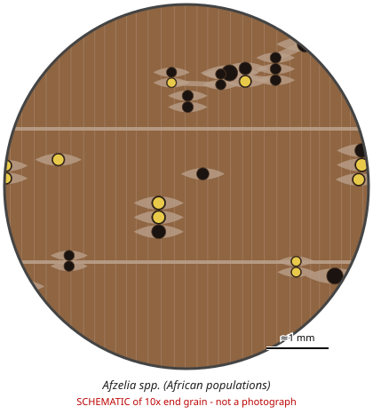

# Afzelia spp. (African populations)

**Family:** Fabaceae  
**Trade / common names:** Doussié, afzelia, pod mahogany, chanfuta, lingue, mkora  
**CITES Appendix:** **II**  
**Annotation:** #17 — Logs, sawn wood, veneer sheets, plywood and transformed wood (HS 44.09, e.g. decking, flooring strips).  
**Population covered:** Populations of Africa only (Asian merbau Intsia and Asian Afzelia xylocarpa NOT covered)  
**First listed (approx. year in force):** 2023  
**Native range:** Tropical Africa.

> Always confirm the live listing on [Species+](https://speciesplus.net) before seizure decisions.

## 10x end-grain view

| Real photographs (reference specimens) | Schematic |
|---|---|
| See [`photos/afzelia-spp/`](../photos/afzelia-spp/) and the image links below |  |

## Key diagnostic summary

Large, few pores with YELLOWISH-WHITE deposits + lozenge/confluent parenchyma + orange-brown heartwood. Proposal at CoP20 to remove Central African A. bipindensis was rejected - still listed.

## Macroscopic features (hand lens, 10x, freshly cut transverse surface)

| Feature | Observation |
|---|---|
| Wood type | hardwood |
| Porosity | diffuse |
| Pore size | large |
| Pore frequency | few |
| Pore arrangement | mixed |
| Pore contents / deposits | YELLOW to whitish deposits in pores (characteristic) |
| Axial parenchyma | aliform, confluent, marginal |
| Rays | fine |
| Ripple marks (storied structure, tangential face) | variable |
| Resin canals (softwoods) | no |

**Other features:**

- Bright yellow/white powdery deposits in vessels (afzelin) - visible as yellow dots/streaks
- Lozenge-aliform and confluent parenchyma, plus marginal bands

## Physical characteristics

- **Heartwood:** Light brown to reddish-/orange-brown, darkening.
- **Sapwood:** Pale, distinct.
- **Density:** ~700-850 kg/m3
- **Odour:** Faint, slightly leathery.

## Look-alikes (check these before concluding)

- Intsia bijuga / I. palembanica (merbau - not listed, also has yellow deposits)
- Afzelia xylocarpa (Asian, not covered)
- Pericopsis elata
- Milicia excelsa (iroko - has white deposits)

## Confirming beyond the hand lens

Separation from Intsia needs microscopy/DNA - check stated origin.

## Species included in this listing

| Taxon | Trade name | Range | Notes |
|---|---|---|---|
| *Afzelia africana* | Doussié, lingue | West Africa savanna/forest |  |
| *Afzelia bipindensis* | Doussié (Cameroon) | Central Africa |  |
| *Afzelia pachyloba* | Doussié | Central Africa |  |
| *Afzelia quanzensis* | Pod mahogany, chanfuta, mkora | East & southern Africa |  |
| *Afzelia bella, A. parviflora and other African spp.* |  |  |  |

## Image sources for 10x end-grain photographs

- [Species+ (official CITES listing & annotation)](https://speciesplus.net/species#/taxon_concepts?taxonomy=cites_eu&taxon_concept_query=Afzelia)
- [The Wood Database (has a 10x end-grain photo per species)](https://www.wood-database.com/?s=Afzelia)
- [InsideWood (anatomy database, NC State)](https://insidewood.lib.ncsu.edu/search)
- [CITES Timber ID repository (manuals, keys, photo atlases)](https://cites.org/eng/timber/timber-ID-repository)
- [CITESwoodID (Thünen Institute, macroscopic key with images)](https://www.thuenen.de/en/institutes/wood-research/fields-of-activity/wood-identification-and-wood-anatomy)
- [Pl@ntWood (CIRAD, macroscopic photos of tropical timbers)](https://plantwood.cirad.fr)
- [Wikimedia Commons (free-licence images)](https://commons.wikimedia.org/w/index.php?search=Afzelia+wood&title=Special:MediaSearch&type=image)
- [GBIF (distribution)](https://www.gbif.org/species/search?q=Afzelia)

---
[← All species](README.md) · [Field procedure](../guides/field-procedure.md) · [Feature glossary](../guides/feature-glossary.md)
