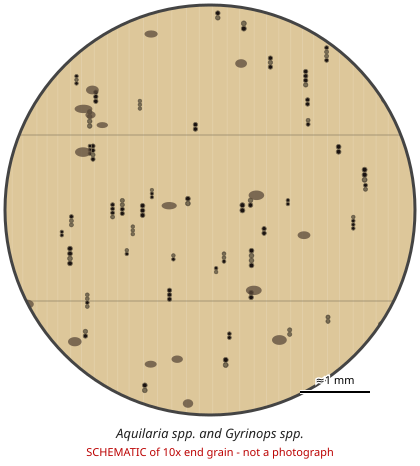

# Aquilaria spp. and Gyrinops spp.

**Family:** Thymelaeaceae  
**Trade / common names:** Agarwood, gaharu, oud, aloeswood, eaglewood, chen xiang, jinkoh  
**CITES Appendix:** **II**  
**Annotation:** #14 — All parts and derivatives except seeds/pollen, seedling cultures, fruits, leaves, exhausted agarwood powder and finished retail products (agarwood chips, oil, powder ARE covered).  
**Population covered:** All populations  
**First listed (approx. year in force):** 2005  
**Native range:** South & Southeast Asia to New Guinea.

> Always confirm the live listing on [Species+](https://speciesplus.net) before seizure decisions.

## Documents needed for trade

**Appendix II:** **Export permit** from the exporting country (or a **re-export certificate** for re-exports). CITES itself requires no import permit, but many countries (e.g. the EU) do.

The annotation above decides which products need a document at all. Details, validity, codes and a document check: [CITES documents guide](../guides/cites-documents.md).

## 10x end-grain view

| Real photographs (reference specimens) | Schematic |
|---|---|
| See [`photos/aquilaria-gyrinops/`](../photos/aquilaria-gyrinops/) and the image links below |  |

## Key diagnostic summary

Light pale wood with scattered islands of INCLUDED PHLOEM, or dark resinous chips/ 'wood' with strong fragrance. Traded as chips, powder, oil, beads, carvings - #14 covers most.

## Macroscopic features (hand lens, 10x, freshly cut transverse surface)

| Feature | Observation |
|---|---|
| Wood type | hardwood |
| Porosity | diffuse |
| Pore size | small |
| Pore frequency | moderate |
| Pore arrangement | multiples |
| Pore contents / deposits | dark resin in tissues of agarwood |
| Axial parenchyma | scanty |
| Rays | fine |
| Ripple marks (storied structure, tangential face) | no |
| Resin canals (softwoods) | no |

**Other features:**

- INCLUDED (interxylary) PHLOEM: scattered islands of soft tissue across the end grain - diagnostic of the group
- Resin accumulates in/around the included phloem islands
- Pores in radial multiples

## Physical characteristics

- **Heartwood:** Healthy wood: pale yellowish-white, very light, soft. Resinous agarwood: dark brown to black patches/streaks, heavy (may sink).
- **Sapwood:** Not distinct.
- **Density:** ~350-450 kg/m3 healthy; resinous agarwood much heavier
- **Odour:** Resin-impregnated wood: strong sweet, balsamic fragrance, especially when warmed/burned.

## Look-alikes (check these before concluding)

- Fake/impregnated agarwood (other woods soaked in oil/resin)
- Excoecaria agallocha
- Gonystylus (also Thymelaeaceae)

## Confirming beyond the hand lens

Microscopy (included phloem) for genus; chemistry (chromones) to confirm genuine agarwood.

## Species included in this listing

| Taxon | Trade name | Range | Notes |
|---|---|---|---|
| *Aquilaria malaccensis* | Gaharu | India to Indonesia | Main traded species. |
| *Aquilaria crassna* | Kalamet | Indochina |  |
| *Aquilaria sinensis* | Chen xiang | S China |  |
| *Aquilaria filaria, A. microcarpa, A. beccariana, A. subintegra and others (c. 20 spp.)* |  |  |  |
| *Gyrinops versteegii, G. walla and others (c. 10 spp.)* | Gaharu | Sri Lanka, E Indonesia, New Guinea |  |

## View 10x end-grain photographs (CITESwoodID)

Transverse section at about 10x, from verified reference specimens. Images (c) Thünen Institute - linked, not copied.

- [*Aquilaria spp., Gyrinops spp.* - 10x transverse section](https://www.delta-intkey.com/citeswood/en/www/thyaqu.htm)

## Other image sources for 10x end-grain photographs

- [Species+ (official CITES listing & annotation)](https://speciesplus.net/species#/taxon_concepts?taxonomy=cites_eu&taxon_concept_query=Aquilaria++and+Gyrinops)
- [The Wood Database (has a 10x end-grain photo per species)](https://www.wood-database.com/?s=Aquilaria++and+Gyrinops)
- [InsideWood (anatomy database, NC State)](https://insidewood.lib.ncsu.edu/search)
- [CITES Timber ID repository (manuals, keys, photo atlases)](https://cites.org/eng/timber/timber-ID-repository)
- [CITESwoodID (Thünen Institute, macroscopic key with images)](https://www.thuenen.de/en/institutes/wood-research/fields-of-activity/wood-identification-and-wood-anatomy)
- [Pl@ntWood (CIRAD, macroscopic photos of tropical timbers)](https://plantwood.cirad.fr)
- [Wikimedia Commons (free-licence images)](https://commons.wikimedia.org/w/index.php?search=Aquilaria++and+Gyrinops+wood&title=Special:MediaSearch&type=image)
- [GBIF (distribution)](https://www.gbif.org/species/search?q=Aquilaria++and+Gyrinops)

---
[← All species](README.md) · [Field procedure](../guides/field-procedure.md) · [CITES documents](../guides/cites-documents.md) · [Feature glossary](../guides/feature-glossary.md)
