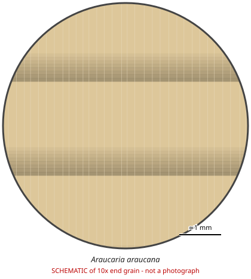

# Araucaria araucana

**Family:** Araucariaceae  
**Trade / common names:** Monkey puzzle, Chilean pine, pehuén, araucaria  
**CITES Appendix:** **I**  
**Annotation:** none — No annotation - ALL parts and derivatives are covered (including finished products).  
**Population covered:** All populations  
**First listed (approx. year in force):** 1975  
**Native range:** Andes of south-central Chile and western Argentina.

> Always confirm the live listing on [Species+](https://speciesplus.net) before seizure decisions.

## 10x end-grain view

| Real photographs (reference specimens) | Schematic |
|---|---|
| See [`photos/araucaria-araucana/`](../photos/araucaria-araucana/) and the image links below |  |

## Key diagnostic summary

Uniform, fine-textured softwood with faint growth rings and no resin canals. Separation from other Araucaria (e.g. Paraná pine A. angustifolia) needs microscopy or DNA.

## Macroscopic features (hand lens, 10x, freshly cut transverse surface)

| Feature | Observation |
|---|---|
| Wood type | softwood |
| Porosity | none |
| Pore size | — |
| Pore frequency | — |
| Pore arrangement | — |
| Pore contents / deposits | none noted |
| Axial parenchyma | not visible / none |
| Rays | fine |
| Ripple marks (storied structure, tangential face) | no |
| Resin canals (softwoods) | no |

**Other features:**

- Growth rings indistinct to faint; gradual transition
- Very uniform, fine texture
- Resin-filled ray cells may appear as tiny dark specks

## Physical characteristics

- **Heartwood:** Pale yellowish to light brown, sometimes with a pinkish tinge.
- **Sapwood:** Not clearly distinct.
- **Density:** ~500-600 kg/m3
- **Odour:** None distinctive.

## Look-alikes (check these before concluding)

- Araucaria angustifolia (Paraná pine)
- Agathis spp. (kauri)

## Confirming beyond the hand lens

Microscopy (araucarioid pitting) for genus; DNA for species.

## View 10x end-grain photographs (CITESwoodID)

Transverse section at about 10x, from verified reference specimens. Images (c) Thünen Institute - linked, not copied.

- [*Araucaria araucana* - 10x transverse section](https://www.delta-intkey.com/citeswood/en/www/araara.htm)

## Other image sources for 10x end-grain photographs

- [Species+ (official CITES listing & annotation)](https://speciesplus.net/species#/taxon_concepts?taxonomy=cites_eu&taxon_concept_query=Araucaria+araucana)
- [The Wood Database (has a 10x end-grain photo per species)](https://www.wood-database.com/?s=Araucaria+araucana)
- [InsideWood (anatomy database, NC State)](https://insidewood.lib.ncsu.edu/search)
- [CITES Timber ID repository (manuals, keys, photo atlases)](https://cites.org/eng/timber/timber-ID-repository)
- [CITESwoodID (Thünen Institute, macroscopic key with images)](https://www.thuenen.de/en/institutes/wood-research/fields-of-activity/wood-identification-and-wood-anatomy)
- [Pl@ntWood (CIRAD, macroscopic photos of tropical timbers)](https://plantwood.cirad.fr)
- [Wikimedia Commons (free-licence images)](https://commons.wikimedia.org/w/index.php?search=Araucaria+araucana+wood&title=Special:MediaSearch&type=image)
- [GBIF (distribution)](https://www.gbif.org/species/search?q=Araucaria+araucana)

---
[← All species](README.md) · [Field procedure](../guides/field-procedure.md) · [Feature glossary](../guides/feature-glossary.md)
