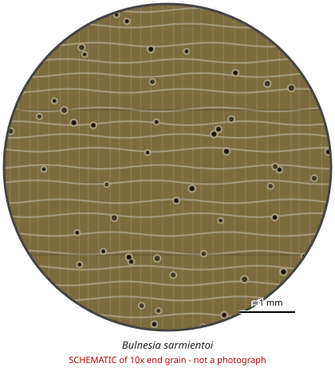

# Bulnesia sarmientoi

**Family:** Zygophyllaceae  
**Trade / common names:** Argentine lignum vitae, palo santo (Gran Chaco), verawood (trade), guaiac wood  
**CITES Appendix:** **II**  
**Annotation:** #11 — Logs, sawn wood, veneer sheets, plywood, powder and extracts (finished products containing extracts as ingredients are exempt).  
**Population covered:** All populations  
**First listed (approx. year in force):** 2010  
**Native range:** Gran Chaco: Paraguay, Argentina, Bolivia.

> Always confirm the live listing on [Species+](https://speciesplus.net) before seizure decisions.

## 10x end-grain view

| Real photographs (reference specimens) | Schematic |
|---|---|
| See [`photos/bulnesia-sarmientoi/`](../photos/bulnesia-sarmientoi/) and the image links below |  |

## Key diagnostic summary

Green-olive, oily, fragrant, very heavy wood with small solitary pores and very fine ripple marks. Do not confuse the trade name 'palo santo' with Bursera graveolens (not listed).

## Macroscopic features (hand lens, 10x, freshly cut transverse surface)

| Feature | Observation |
|---|---|
| Wood type | hardwood |
| Porosity | diffuse |
| Pore size | small |
| Pore frequency | moderate |
| Pore arrangement | solitary |
| Pore contents / deposits | resin |
| Axial parenchyma | vasicentric, banded |
| Rays | fine |
| Ripple marks (storied structure, tangential face) | yes |
| Resin canals (softwoods) | no |

**Other features:**

- Very fine, regular ripple marks
- Heavily interlocked grain
- Traded as wood, sawdust, guaiac oil

## Physical characteristics

- **Heartwood:** Olive-green to brown, darkening; oily.
- **Sapwood:** Yellowish.
- **Density:** ~950-1,100 kg/m3
- **Odour:** Pleasant, incense/rose-like (guaiac wood oil) - strong when sanded or burned.

## Look-alikes (check these before concluding)

- Guaiacum spp.
- Bulnesia arborea (verawood - not listed)
- Bursera graveolens (palo santo sticks)

## Confirming beyond the hand lens

DNA/MS.

## Image sources for 10x end-grain photographs

- [Species+ (official CITES listing & annotation)](https://speciesplus.net/species#/taxon_concepts?taxonomy=cites_eu&taxon_concept_query=Bulnesia+sarmientoi)
- [The Wood Database (has a 10x end-grain photo per species)](https://www.wood-database.com/?s=Bulnesia+sarmientoi)
- [InsideWood (anatomy database, NC State)](https://insidewood.lib.ncsu.edu/search)
- [CITES Timber ID repository (manuals, keys, photo atlases)](https://cites.org/eng/timber/timber-ID-repository)
- [CITESwoodID (Thünen Institute, macroscopic key with images)](https://www.thuenen.de/en/institutes/wood-research/fields-of-activity/wood-identification-and-wood-anatomy)
- [Pl@ntWood (CIRAD, macroscopic photos of tropical timbers)](https://plantwood.cirad.fr)
- [Wikimedia Commons (free-licence images)](https://commons.wikimedia.org/w/index.php?search=Bulnesia+sarmientoi+wood&title=Special:MediaSearch&type=image)
- [GBIF (distribution)](https://www.gbif.org/species/search?q=Bulnesia+sarmientoi)

---
[← All species](README.md) · [Field procedure](../guides/field-procedure.md) · [Feature glossary](../guides/feature-glossary.md)
