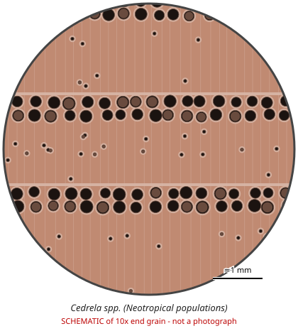

# Cedrela spp. (Neotropical populations)

**Family:** Meliaceae  
**Trade / common names:** Spanish cedar, cigar-box cedar, cedro, cedro rosado  
**CITES Appendix:** **II**  
**Annotation:** #6 — Logs, sawn wood, veneer sheets and plywood.  
**Population covered:** Neotropical populations only  
**First listed (approx. year in force):** 2020  
**Native range:** Mexico & Caribbean to northern Argentina.

> Always confirm the live listing on [Species+](https://speciesplus.net) before seizure decisions.

## Documents needed for trade

**Appendix II:** **Export permit** from the exporting country (or a **re-export certificate** for re-exports). CITES itself requires no import permit, but many countries (e.g. the EU) do.

The annotation above decides which products need a document at all. Details, validity, codes and a document check: [CITES documents guide](../guides/cites-documents.md).

## 10x end-grain view

| Real photographs (reference specimens) | Schematic |
|---|---|
| See [`photos/cedrela-spp/`](../photos/cedrela-spp/) and the image links below |  |

## Key diagnostic summary

Light, soft, aromatic reddish wood that is ring/semi-ring porous with marginal parenchyma - the scent plus ring porosity separates it from Swietenia.

## Macroscopic features (hand lens, 10x, freshly cut transverse surface)

| Feature | Observation |
|---|---|
| Wood type | hardwood |
| Porosity | ring |
| Pore size | large |
| Pore frequency | moderate |
| Pore arrangement | mixed |
| Pore contents / deposits | dark red gum in some pores |
| Axial parenchyma | marginal, vasicentric |
| Rays | fine |
| Ripple marks (storied structure, tangential face) | no |
| Resin canals (softwoods) | no |

**Other features:**

- Ring-porous to semi-ring-porous: large earlywood pores in a row, smaller latewood pores
- Marginal parenchyma band with the earlywood pores
- Soft, light; aromatic

## Physical characteristics

- **Heartwood:** Light pinkish to reddish-brown; may exude resin/gum.
- **Sapwood:** Pinkish-white.
- **Density:** ~400-550 kg/m3 (light)
- **Odour:** Strong, characteristic spicy-cedar scent (cigar boxes) - key field feature.

## Look-alikes (check these before concluding)

- Toona spp. (Asian/Australian red cedar - not listed)
- Swietenia spp.
- Carapa spp.
- Cedrela plantations outside the Neotropics (Africa) - not covered

## Confirming beyond the hand lens

Toona vs Cedrela: microscopy/DNA.

## Species included in this listing

| Taxon | Trade name | Range | Notes |
|---|---|---|---|
| *Cedrela odorata* | Spanish cedar, cedro amargo | Mexico to Argentina, Caribbean | Main traded species. |
| *Cedrela fissilis* | Cedro, cedro rosa | Costa Rica to Argentina |  |
| *Cedrela montana* | Cedro de montaña | Andes |  |
| *Cedrela angustifolia, C. lilloi, C. salvadorensis, C. tonduzii, C. saltensis and others (c. 17 spp.)* | Cedro | Neotropics | All covered at genus level. |
| *Cedrela angustifolia (= C. lilloi)* | Cedro | Andes - App. III #5 (some countries) |  |
| *Cedrela oaxacensis* | Cedro | Mexico |  |
| *Cedrela tonduzii* | Cedro dulce | Central America |  |

## View 10x end-grain photographs (CITESwoodID)

Transverse section at about 10x, from verified reference specimens. Images (c) Thünen Institute - linked, not copied.

- [*Cedrela spp.* - 10x transverse section](https://www.delta-intkey.com/citeswood/en/www/melceod.htm)

## Other image sources for 10x end-grain photographs

- [Species+ (official CITES listing & annotation)](https://speciesplus.net/species#/taxon_concepts?taxonomy=cites_eu&taxon_concept_query=Cedrela)
- [The Wood Database (has a 10x end-grain photo per species)](https://www.wood-database.com/?s=Cedrela)
- [InsideWood (anatomy database, NC State)](https://insidewood.lib.ncsu.edu/search)
- [CITES Timber ID repository (manuals, keys, photo atlases)](https://cites.org/eng/timber/timber-ID-repository)
- [CITESwoodID (Thünen Institute, macroscopic key with images)](https://www.thuenen.de/en/institutes/wood-research/fields-of-activity/wood-identification-and-wood-anatomy)
- [Pl@ntWood (CIRAD, macroscopic photos of tropical timbers)](https://plantwood.cirad.fr)
- [Wikimedia Commons (free-licence images)](https://commons.wikimedia.org/w/index.php?search=Cedrela+wood&title=Special:MediaSearch&type=image)
- [GBIF (distribution)](https://www.gbif.org/species/search?q=Cedrela)

---
[← All species](README.md) · [Field procedure](../guides/field-procedure.md) · [CITES documents](../guides/cites-documents.md) · [Feature glossary](../guides/feature-glossary.md)
