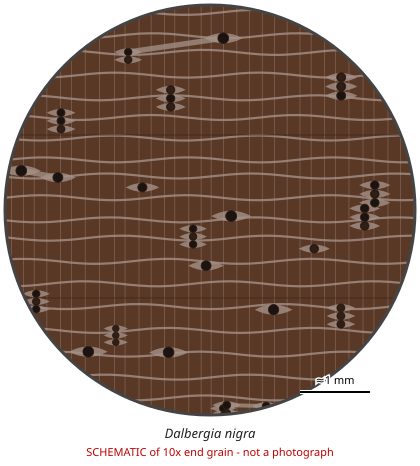

# Dalbergia nigra

**Family:** Fabaceae  
**Trade / common names:** Brazilian rosewood, Rio rosewood, Bahia rosewood, jacarandá-da-bahia, palissandre de Rio  
**CITES Appendix:** **I**  
**Annotation:** none — No annotation - ALL parts and derivatives are covered (including finished products).  
**Population covered:** All populations  
**First listed (approx. year in force):** 1992  
**Native range:** Atlantic coastal forest of eastern Brazil (Bahia to Minas Gerais / Espírito Santo).

> Always confirm the live listing on [Species+](https://speciesplus.net) before seizure decisions.

## 10x end-grain view

| Real photographs (reference specimens) | Schematic |
|---|---|
| See [`photos/dalbergia-nigra/`](../photos/dalbergia-nigra/) and the image links below |  |

## Key diagnostic summary

Dark heartwood with black streaks + rose scent + medium pores (few, solitary/short multiples) + banded/aliform parenchyma + very fine rays. Cannot be separated reliably from other Dalbergia (esp. D. spruceana, D. latifolia) by hand lens alone.

## Macroscopic features (hand lens, 10x, freshly cut transverse surface)

| Feature | Observation |
|---|---|
| Wood type | hardwood |
| Porosity | diffuse |
| Pore size | medium |
| Pore frequency | few |
| Pore arrangement | mixed |
| Pore contents / deposits | dark red-brown gum in some pores |
| Axial parenchyma | aliform, confluent, banded |
| Rays | fine |
| Ripple marks (storied structure, tangential face) | variable |
| Resin canals (softwoods) | no |

**Other features:**

- Parenchyma forms fine wavy tangential bands and lozenge-aliform patches around pores

## Physical characteristics

- **Heartwood:** Dark chocolate-brown to purplish/reddish brown with irregular black streaks (spider-web figure); oily feel.
- **Sapwood:** Pale yellowish-white, sharply demarcated.
- **Density:** ~830-900 kg/m3 (heavy)
- **Odour:** Distinct sweet, rose-like scent when freshly cut.

## Look-alikes (check these before concluding)

- Dalbergia spruceana (Amazon rosewood)
- Dalbergia latifolia (Indian rosewood)
- Machaerium scleroxylon (Santos rosewood / pau ferro)
- Dalbergia baronii / D. maritima (Madagascar)

## Confirming beyond the hand lens

Fluorescence of ethanol extract, DART-TOF mass spectrometry and DNA have been used to separate D. nigra from look-alikes; macroscopic ID = genus level only.

## Image sources for 10x end-grain photographs

- [Species+ (official CITES listing & annotation)](https://speciesplus.net/species#/taxon_concepts?taxonomy=cites_eu&taxon_concept_query=Dalbergia+nigra)
- [The Wood Database (has a 10x end-grain photo per species)](https://www.wood-database.com/?s=Dalbergia+nigra)
- [InsideWood (anatomy database, NC State)](https://insidewood.lib.ncsu.edu/search)
- [CITES Timber ID repository (manuals, keys, photo atlases)](https://cites.org/eng/timber/timber-ID-repository)
- [CITESwoodID (Thünen Institute, macroscopic key with images)](https://www.thuenen.de/en/institutes/wood-research/fields-of-activity/wood-identification-and-wood-anatomy)
- [Pl@ntWood (CIRAD, macroscopic photos of tropical timbers)](https://plantwood.cirad.fr)
- [Wikimedia Commons (free-licence images)](https://commons.wikimedia.org/w/index.php?search=Dalbergia+nigra+wood&title=Special:MediaSearch&type=image)
- [GBIF (distribution)](https://www.gbif.org/species/search?q=Dalbergia+nigra)

---
[← All species](README.md) · [Field procedure](../guides/field-procedure.md) · [Feature glossary](../guides/feature-glossary.md)
