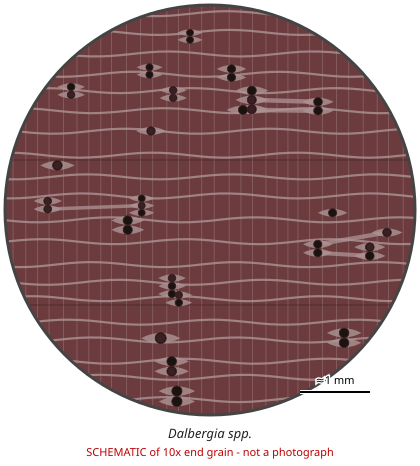

# Dalbergia spp.

**Family:** Fabaceae  
**Trade / common names:** Rosewoods, palisanders, blackwoods, hongmu (part)  
**CITES Appendix:** **II**  
**Annotation:** #15 — All parts and derivatives except (a) leaves, flowers, pollen, fruits, seeds; (b) finished products up to 10 kg wood of listed species per shipment; (c) finished musical instruments, parts and accessories; (d) D. cochinchinensis (covered by #4); (e) Dalbergia spp. from Mexico (covered by #6).  
**Population covered:** All species except D. nigra (App. I). D. cochinchinensis = #4; Mexican populations = #6.  
**First listed (approx. year in force):** 2017  
**Native range:** Pantropical: Central & South America, Africa, Madagascar, South & Southeast Asia (c. 250-300 species).

> Always confirm the live listing on [Species+](https://speciesplus.net) before seizure decisions.

## Documents needed for trade

**Appendix II:** **Export permit** from the exporting country (or a **re-export certificate** for re-exports). CITES itself requires no import permit, but many countries (e.g. the EU) do.

The annotation above decides which products need a document at all. Details, validity, codes and a document check: [CITES documents guide](../guides/cites-documents.md).

## 10x end-grain view

| Real photographs (reference specimens) | Schematic |
|---|---|
| See [`photos/dalbergia-spp/`](../photos/dalbergia-spp/) and the image links below |  |

## Key diagnostic summary

GENUS LEVEL: diffuse-porous, few medium/large pores, fine banded + aliform parenchyma, storied rays (ripple marks), dark often fragrant heartwood. Treat any wood matching this pattern as SUSPECT Dalbergia (CITES App II) until proven otherwise.

## Macroscopic features (hand lens, 10x, freshly cut transverse surface)

| Feature | Observation |
|---|---|
| Wood type | hardwood |
| Porosity | diffuse |
| Pore size | medium |
| Pore frequency | few |
| Pore arrangement | mixed |
| Pore contents / deposits | red-brown to black gum in some pores |
| Axial parenchyma | aliform, confluent, banded |
| Rays | fine |
| Ripple marks (storied structure, tangential face) | yes |
| Resin canals (softwoods) | no |

**Other features:**

- Rays and parenchyma storied: ripple marks often visible on tangential face
- Fine, regularly spaced parenchyma bands (sometimes wavy) between pores
- Rays very fine - barely visible even at 10x

## Physical characteristics

- **Heartwood:** Very variable: purple-brown, red-orange, chocolate, nearly black; often streaked.
- **Sapwood:** Pale, sharply demarcated.
- **Density:** ~750-1,300 kg/m3 (medium-heavy to very heavy)
- **Odour:** Many species fragrant (rose, spicy, sweet) when cut or sanded.

## Look-alikes (check these before concluding)

- Machaerium spp. (pau ferro, Bolivian rosewood - NOT listed)
- Pterocarpus spp.
- Millettia laurentii (wenge)
- Swartzia spp.
- Diospyros spp. (ebony)
- Bobgunnia
- Microberlinia (zebrawood)

## Confirming beyond the hand lens

DART-TOF mass spectrometry, NIR spectroscopy and DNA barcoding are used to reach species level; macroscopic = genus/group.

## Species included in this listing

| Taxon | Trade name | Range | Notes |
|---|---|---|---|
| *Dalbergia latifolia* | Indian rosewood, sonokeling | India, Indonesia (plantations) | Purple-brown with darker streaks; medium-coarse texture; ~830 kg/m3. |
| *Dalbergia sissoo* | Sheesham, shisham | Indian subcontinent | Golden to medium brown; lighter, less figured. Widely traded as furniture (#15 10-kg rule applies to finished goods). |
| *Dalbergia retusa* | Cocobolo | Pacific Central America | Orange-red to purplish with black lines, very oily, ~1,100 kg/m3, causes skin sensitisation. |
| *Dalbergia granadillo* | Granadillo, cocobolo (Mexico) | Mexico | Similar to D. retusa; Mexican populations under annotation #6. |
| *Dalbergia stevensonii* | Honduran rosewood | Belize, Guatemala | Pinkish-brown to purplish, very dense (~1,050), xylophone bars. |
| *Dalbergia tucurensis* | Central American rosewood | Guatemala, Nicaragua, Honduras | Previously App III; now covered by the genus listing. |
| *Dalbergia cochinchinensis* | Siamese rosewood, Thailand rosewood, hongmu | Thailand, Laos, Cambodia, Vietnam | Red to purple-brown with black stripes; very dense (~1,090); annotation #4 (all parts). |
| *Dalbergia oliveri (incl. D. bariensis)* | Burmese rosewood, tamalan | Myanmar, Thailand, Indochina | Orange/red-brown with darker stripes; hongmu trade. |
| *Dalbergia odorifera* | Huanghuali, fragrant rosewood | Hainan (China) | Golden to reddish-brown, strongly fragrant; very high value. |
| *Dalbergia melanoxylon* | African blackwood, mpingo | East & southern Africa | Black-purple, extremely dense (~1,270), very fine texture; clarinets, oboes. |
| *Dalbergia baronii, D. maritima, D. louvelii and other Malagasy spp.* | Bois de rose, Madagascar rosewood, palissandre | Madagascar | Red to purple; trade banned by Madagascar export ban + CITES zero-quota guidance. ~48 Malagasy species. |
| *Dalbergia cearensis* | Kingwood | NE Brazil | Violet-brown with black stripes; small billets. |
| *Dalbergia decipularis* | Tulipwood | NE Brazil | Cream to pink-salmon striped; small billets. |
| *Dalbergia spruceana* | Amazon rosewood | Amazon basin | Main look-alike of D. nigra. |
| *Dalbergia frutescens* | Brazilian tulipwood/ jacarandá-rosa | Brazil |  |
| *All other Dalbergia species* |  | Pantropical | Full list: CITES Dalbergia checklist (Kew) and Species+. |

## View 10x end-grain photographs (CITESwoodID)

Transverse section at about 10x, from verified reference specimens. Images (c) Thünen Institute - linked, not copied.

- [*Dalbergia melanoxylon* - 10x transverse section](https://www.delta-intkey.com/citeswood/en/www/fabdamel.htm)
- [*Dalbergia baronii* - 10x transverse section](https://www.delta-intkey.com/citeswood/en/www/fabdabar.htm)
- [*Dalbergia louvelii, D. maritima* - 10x transverse section](https://www.delta-intkey.com/citeswood/en/www/fabdamar.htm)
- [*Dalbergia madagascariensis* - 10x transverse section](https://www.delta-intkey.com/citeswood/en/www/fabdamad.htm)
- [*Dalbergia greveana* - 10x transverse section](https://www.delta-intkey.com/citeswood/en/www/fabdagrv.htm)
- [*Dalbergia latifolia* - 10x transverse section](https://www.delta-intkey.com/citeswood/en/www/fabdala.htm)
- [*Dalbergia sissoo* - 10x transverse section](https://www.delta-intkey.com/citeswood/en/www/fabdasis.htm)
- [*Dalbergia retusa, D. granadillo* - 10x transverse section](https://www.delta-intkey.com/citeswood/en/www/fabdare.htm)
- [*Dalbergia stevensonii* - 10x transverse section](https://www.delta-intkey.com/citeswood/en/www/fabdast.htm)
- [*Dalbergia tucurensis* - 10x transverse section](https://www.delta-intkey.com/citeswood/en/www/fabdatuc.htm)
- [*Dalbergia cochinchinensis* - 10x transverse section](https://www.delta-intkey.com/citeswood/en/www/fabdaco.htm)
- [*Dalbergia oliveri* - 10x transverse section](https://www.delta-intkey.com/citeswood/en/www/fabdaoli.htm)
- [*Dalbergia bariensis* - 10x transverse section](https://www.delta-intkey.com/citeswood/en/www/fabfabri.htm)
- [*Dalbergia odorifera* - 10x transverse section](https://www.delta-intkey.com/citeswood/en/www/fabfaodo.htm)
- [*Dalbergia cearensis* - 10x transverse section](https://www.delta-intkey.com/citeswood/en/www/fabdace.htm)
- [*Dalbergia decipularis* - 10x transverse section](https://www.delta-intkey.com/citeswood/en/www/fabdadec.htm)
- [*Dalbergia spruceana* - 10x transverse section](https://www.delta-intkey.com/citeswood/en/www/fabdasp.htm)
- [*Dalbergia congestiflora* - 10x transverse section](https://www.delta-intkey.com/citeswood/en/www/fabfacon.htm)
- [*Dalbergia palo-escrito* - 10x transverse section](https://www.delta-intkey.com/citeswood/en/www/fabfaesc.htm)

## Other image sources for 10x end-grain photographs

- [Species+ (official CITES listing & annotation)](https://speciesplus.net/species#/taxon_concepts?taxonomy=cites_eu&taxon_concept_query=Dalbergia)
- [The Wood Database (has a 10x end-grain photo per species)](https://www.wood-database.com/?s=Dalbergia)
- [InsideWood (anatomy database, NC State)](https://insidewood.lib.ncsu.edu/search)
- [CITES Timber ID repository (manuals, keys, photo atlases)](https://cites.org/eng/timber/timber-ID-repository)
- [CITESwoodID (Thünen Institute, macroscopic key with images)](https://www.thuenen.de/en/institutes/wood-research/fields-of-activity/wood-identification-and-wood-anatomy)
- [Pl@ntWood (CIRAD, macroscopic photos of tropical timbers)](https://plantwood.cirad.fr)
- [Wikimedia Commons (free-licence images)](https://commons.wikimedia.org/w/index.php?search=Dalbergia+wood&title=Special:MediaSearch&type=image)
- [GBIF (distribution)](https://www.gbif.org/species/search?q=Dalbergia)

---
[← All species](README.md) · [Field procedure](../guides/field-procedure.md) · [CITES documents](../guides/cites-documents.md) · [Feature glossary](../guides/feature-glossary.md)
