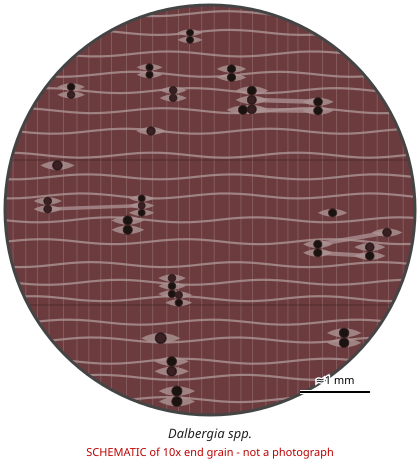

# Dalbergia spp.

**Family:** Fabaceae  
**Trade / common names:** Rosewoods, palisanders, blackwoods, hongmu (part)  
**CITES Appendix:** **II**  
**Annotation:** #15 — All parts and derivatives except (a) leaves, flowers, pollen, fruits, seeds; (b) finished products up to 10 kg wood of listed species per shipment; (c) finished musical instruments, parts and accessories; (d) D. cochinchinensis (covered by #4); (e) Dalbergia spp. from Mexico (covered by #6).  
**Population covered:** All species except D. nigra (App. I). D. cochinchinensis = #4; Mexican populations = #6.  
**First listed (approx. year in force):** 2017  
**Native range:** Pantropical: Central & South America, Africa, Madagascar, South & Southeast Asia (c. 250-300 species).

> Always confirm the live listing on [Species+](https://speciesplus.net) before seizure decisions.

## Documents needed for trade

**Appendix II:** **Export permit** from the exporting country (or a **re-export certificate** for re-exports). CITES itself requires no import permit, but many countries (e.g. the EU) do.

The annotation above decides which products need a document at all. Details, validity, codes and a document check: [CITES documents guide](../guides/cites-documents.md).

## End-grain view

Schematic drawing (not a photograph): 

## Key diagnostic summary

GENUS LEVEL: diffuse-porous, few medium/large pores, fine banded + aliform parenchyma, storied rays (ripple marks), dark often fragrant heartwood. Treat any wood matching this pattern as SUSPECT Dalbergia (CITES App II) until proven otherwise.

## Macroscopic features (hand lens, 10x, freshly cut transverse surface)

| Feature | Observation |
|---|---|
| Wood type | hardwood |
| Porosity | diffuse |
| Pore size | medium |
| Pore frequency | few |
| Pore arrangement | mixed |
| Pore contents / deposits | red-brown to black gum in some pores |
| Axial parenchyma | aliform, confluent, banded |
| Rays | fine |
| Ripple marks (storied structure, tangential face) | yes |
| Resin canals (softwoods) | no |

**Other features:**

- Rays and parenchyma storied: ripple marks often visible on tangential face
- Fine, regularly spaced parenchyma bands (sometimes wavy) between pores
- Rays very fine - barely visible even at 10x

## Physical characteristics

- **Heartwood:** Very variable: purple-brown, red-orange, chocolate, nearly black; often streaked.
- **Sapwood:** Pale, sharply demarcated.
- **Density:** ~750-1,300 kg/m3 (medium-heavy to very heavy)
- **Odour:** Many species fragrant (rose, spicy, sweet) when cut or sanded.

## Look-alikes (check these before concluding)

- Machaerium spp. (pau ferro, Bolivian rosewood - NOT listed)
- Pterocarpus spp.
- Millettia laurentii (wenge)
- Swartzia spp.
- Diospyros spp. (ebony)
- Bobgunnia
- Microberlinia (zebrawood)

## Confirming beyond the hand lens

DART-TOF mass spectrometry, NIR spectroscopy and DNA barcoding are used to reach species level; macroscopic = genus/group.

## Listed species covered by this entry (287)

From the Species+ checklist.

| Taxon | Appendix | Annotation | Trade name | Native distribution |
|---|---|---|---|---|
| *Dalbergia abrahamii* | II | #15 |  | Madagascar |
| *Dalbergia acariaeantha* | II | #15 |  | United Republic of Tanzania |
| *Dalbergia acuta* | II | #15 |  | Brazil |
| *Dalbergia acutifoliolata* | II | #15 |  | Zambia |
| *Dalbergia adamii* | II | #15 |  | Liberia, Senegal |
| *Dalbergia adiantifolia* | II | #15 |  | Gabon |
| *Dalbergia afzeliana* | II | #15 |  | Angola, Cameroon, Central African Republic, Democratic Republic of the Congo, Gabon, Ghana, Guinea, Guinea Bissau, Liberia, Nigeria, Sierra Leone, Togo |
| *Dalbergia agudeloi* | II | #15 |  | El Salvador, Guatemala, Honduras, Nicaragua |
| *Dalbergia albertisii* | II | #15 |  | Indonesia, Papua New Guinea, Solomon Islands |
| *Dalbergia albiflora* | II | #15 |  | Côte d'Ivoire, Guinea, Liberia, Nigeria, Sierra Leone |
| *Dalbergia amazonica* | II | #15 |  | Brazil, Colombia, Guyana, Venezuela (Bolivarian Republic of) |
| *Dalbergia ambongoensis* | II | #15 |  | Madagascar |
| *Dalbergia andapensis* | II | #15 |  | Madagascar |
| *Dalbergia antsirananae* | II | #15 |  | Madagascar |
| *Dalbergia arbutifolia* | II | #15 |  | Democratic Republic of the Congo, Malawi, Mozambique, United Republic of Tanzania, Zambia, Zimbabwe |
| *Dalbergia armata* | II | #15 |  | Eswatini, Mozambique, South Africa, United Republic of Tanzania |
| *Dalbergia assamica* | II | #15 |  | Bangladesh, Bhutan, Cambodia, China, India, Lao People's Democratic Republic, Myanmar, Thailand, Viet Nam |
| *Dalbergia atropurpurea* | II | #15 |  | Bolivia (Plurinational State of), Brazil, Colombia, French Guiana [FR], Guyana, Suriname, Venezuela (Bolivarian Republic of) |
| *Dalbergia aurea* | II | #15 |  | Madagascar |
| *Dalbergia bakeri* | II | #15 |  | Angola, Democratic Republic of the Congo, Equatorial Guinea, Gabon |
| *Dalbergia baronii* | II | #15 | Bois de rose, Madagascar rosewood, palissandre | Madagascar |
| *Dalbergia bathiei* | II | #15 |  | Madagascar |
| *Dalbergia beccarii* | II | #15 |  | Brunei Darussalam, Indonesia, Malaysia, Papua New Guinea, Solomon Islands |
| *Dalbergia bemarivensis* | II | #15 |  | Madagascar |
| *Dalbergia benthamiana* | II | #15 |  | Philippines |
| *Dalbergia benthamii* | II | #15 |  | China, Viet Nam |
| *Dalbergia berteroi* | II | #15 |  | Cuba, Dominican Republic, Haiti, Jamaica |
| *Dalbergia bintuluensis* | II | #15 |  | Brunei Darussalam, Indonesia, Malaysia |
| *Dalbergia boehmii* | II | #15 |  | Angola, Cameroon, Central African Republic, Democratic Republic of the Congo, Ethiopia, Guinea, Guinea Bissau, Kenya, Malawi, Mozambique, Senegal, Sudan, United Republic of Tanzania, Zambia, Zimbabwe |
| *Dalbergia bojeri* | II | #15 |  | Madagascar |
| *Dalbergia borneensis* | II | #15 |  | Brunei Darussalam, Indonesia, Malaysia |
| *Dalbergia bosseri* | II | #15 |  | Madagascar |
| *Dalbergia brachystachya* | II | #15 |  | Madagascar |
| *Dalbergia bracteolata* | II | #15 |  | Kenya, Madagascar, Mozambique, United Republic of Tanzania |
| *Dalbergia brasiliensis* | II | #15 |  | Brazil |
| *Dalbergia brownei* | II | #15 |  | Belize, Brazil, Cayman Islands (United Kingdom), Colombia, Costa Rica, Cuba, Dominican Republic, Ecuador, French Guiana [FR], Guyana, Haiti, Jamaica, Mexico, Nicaragua, Panama, Suriname |
| *Dalbergia calcarea* | II | #15 |  | Lao People's Democratic Republic |
| *Dalbergia calderonii* | II | #15 |  | El Salvador, Guatemala, Honduras, Mexico, Nicaragua |
| *Dalbergia calycina* | II | #15 |  | Belize, Costa Rica, El Salvador, Guatemala, Honduras, Mexico, Nicaragua |
| *Dalbergia cana* | II | #15 |  | Lao People's Democratic Republic, Myanmar, Thailand |
| *Dalbergia candenatensis* | II | #15 |  | Australia, Bangladesh, Brunei Darussalam, Cambodia, China, Fiji, India, Indonesia, Malaysia, Myanmar, Papua New Guinea, Philippines, Singapore, Solomon Islands, Sri Lanka, Thailand, Viet Nam |
| *Dalbergia capuronii* | II | #15 |  | Madagascar |
| *Dalbergia carringtoniana* | II | #15 |  | Angola |
| *Dalbergia catingicola* | II | #15 |  | Brazil |
| *Dalbergia cearensis* | II | #15 | Kingwood | Brazil |
| *Dalbergia chapelieri* | II | #15 |  | Madagascar |
| *Dalbergia chermezonii* | II | #15 |  | Madagascar |
| *Dalbergia chlorocarpa* | II | #15 |  | Madagascar |
| *Dalbergia chontalensis* | II | #15 |  | El Salvador, Guatemala, Nicaragua |
| *Dalbergia clarkei* | II | #15 |  | India |
| *Dalbergia cochinchinensis* | II | #15 | Siamese rosewood, Thailand rosewood, hongmu | Cambodia, Lao People's Democratic Republic, Thailand, Viet Nam |
| *Dalbergia commiphoroides* | II | #15 |  | Ethiopia, Kenya, Somalia |
| *Dalbergia comorensis* | II | #15 |  | Comoros |
| *Dalbergia confertiflora* | II | #15 |  | India |
| *Dalbergia congesta* | II | #15 |  | India |
| *Dalbergia congestiflora* | II | #15 |  | El Salvador, Mexico |
| *Dalbergia coromandeliana* | II | #15 |  | India |
| *Dalbergia crispa* | II | #15 |  | Equatorial Guinea, Liberia, Nigeria, Senegal, Sierra Leone |
| *Dalbergia cubilquitzensis* | II | #15 |  | Belize, Costa Rica, Guatemala, Honduras, Mexico, Nicaragua |
| *Dalbergia cuiabensis* | II | #15 |  | Bolivia (Plurinational State of), Brazil |
| *Dalbergia cultrata* | II | #15 |  | Cambodia, China, India, Lao People's Democratic Republic, Myanmar, Thailand, Viet Nam |
| *Dalbergia cumingiana* | II | #15 |  | Philippines |
| *Dalbergia curtisii* | II | #15 |  | Indonesia, Lao People's Democratic Republic, Malaysia, Thailand, Viet Nam |
| *Dalbergia dalzielii* | II | #15 |  | Cameroon, Gabon, Nigeria, Togo |
| *Dalbergia darienensis* | II | #15 |  | Colombia, Panama |
| *Dalbergia davidii* | II | #15 |  | Madagascar |
| *Dalbergia debilis* | II | #15 |  | Peru |
| *Dalbergia decipularis* | II | #15 | Tulipwood | Brazil |
| *Dalbergia delphinensis* | II | #15 |  | Madagascar |
| *Dalbergia densa* | II | #15 |  | Australia, Indonesia, Papua New Guinea, Philippines |
| *Dalbergia densicoma* | II | #15 |  | Madagascar |
| *Dalbergia densiflora* | II | #15 |  | Brazil |
| *Dalbergia dialoides* | II | #15 |  | Viet Nam |
| *Dalbergia discolor* | II | #15 |  | Indonesia, Malaysia, Philippines, Thailand |
| *Dalbergia duarensis* | II | #15 |  | India |
| *Dalbergia dyeriana* | II | #15 |  | China |
| *Dalbergia ealaensis* | II | #15 |  | Angola, Cameroon, Democratic Republic of the Congo, Gabon |
| *Dalbergia ecastaphyllum* | II | #15 |  | Angola, Antigua and Barbuda, Bahamas, Barbados, Belize, Benin, Brazil, Cameroon, Cayman Islands (United Kingdom), Colombia, Congo, Costa Rica, Côte d'Ivoire, Cuba, Dominica, Dominican Republic, Equatorial Guinea, French Guiana [FR], Gambia, Ghana, Grenada, Guadeloupe, Guatemala, Guinea, Guinea Bissau, Guyana, Haiti, Honduras, India, Jamaica, Liberia, Martinique, Mauritius, Mexico, Montserrat (United Kingdom), Nicaragua, Nigeria, Panama, Paraguay, Peru, Puerto Rico, Saint-Barthélemy, Saint Lucia, Saint Vincent and the Grenadines, Sao Tome and Principe, Senegal, Sierra Leone, Suriname, Togo, Trinidad and Tobago, United States of America, Venezuela (Bolivarian Republic of), Virgin Islands of the USA |
| *Dalbergia elegans* | II | #15 |  | Brazil |
| *Dalbergia emirnensis* | II | #15 |  | Madagascar |
| *Dalbergia enneaphylla* | II | #15 |  | Venezuela (Bolivarian Republic of) |
| *Dalbergia entadoides* | II | #15 |  | Cambodia, Lao People's Democratic Republic, Thailand, Viet Nam |
| *Dalbergia eremicola* | II | #15 |  | Kenya, Somalia |
| *Dalbergia ernest-ulei* | II | #15 |  | Brazil |
| *Dalbergia erubescens* | II | #15 |  | Madagascar |
| *Dalbergia ferruginea* | II | #15 |  | Australia, Indonesia, Malaysia, Micronesia (Federated States of), Palau, Papua New Guinea, Philippines, Solomon Islands |
| *Dalbergia fischeri* | II | #15 |  | Malawi, Mozambique, United Republic of Tanzania, Zambia, Zimbabwe |
| *Dalbergia florifera* | II | #15 |  | Angola, Central African Republic, Democratic Republic of the Congo |
| *Dalbergia foliolosa* | II | #15 |  | Bolivia (Plurinational State of), Brazil, Venezuela (Bolivarian Republic of) |
| *Dalbergia foliosa* | II | #15 |  | Lao People's Democratic Republic, Myanmar, Thailand, Viet Nam |
| *Dalbergia forbesii* | II | #15 |  | Indonesia, Lao People's Democratic Republic, Thailand |
| *Dalbergia fouilloyana* | II | #15 |  | Gabon |
| *Dalbergia frutescens* | II | #15 | Brazilian tulipwood/ jacarandá-rosa | Argentina, Bolivia (Plurinational State of), Brazil, Colombia, Costa Rica, Ecuador, Guyana, Paraguay, Peru, Venezuela (Bolivarian Republic of) |
| *Dalbergia gardneriana* | II | #15 |  | India |
| *Dalbergia gautieri* | II | #15 |  | Madagascar |
| *Dalbergia gentilii* | II | #15 |  | Democratic Republic of the Congo |
| *Dalbergia gilbertii* | II | #15 |  | Democratic Republic of the Congo |
| *Dalbergia gilletii* | II | #15 |  | Angola, Cameroon, Central African Republic, Congo, Democratic Republic of the Congo, Gabon, Guinea, Guinea Bissau, Nigeria, Senegal, Sierra Leone, Togo |
| *Dalbergia glaberrima* | II | #15 |  | Madagascar |
| *Dalbergia glabra* | II | #15 |  | Belize, Costa Rica, El Salvador, Guatemala, Honduras, Mexico, Nicaragua |
| *Dalbergia glandulosa* | II | #15 |  | Brazil |
| *Dalbergia glaucescens* | II | #15 |  | Brazil |
| *Dalbergia glaucocarpa* | II | #15 |  | Madagascar |
| *Dalbergia glaziovii* | II | #15 |  | Brazil |
| *Dalbergia glomerata* | II | #15 |  | Costa Rica, Guatemala, Honduras, Mexico |
| *Dalbergia glomeriflora* | II | #15 |  | Myanmar, Thailand |
| *Dalbergia godefroyi* | II | #15 |  | Cambodia, Lao People's Democratic Republic, Thailand |
| *Dalbergia gossweileri* | II | #15 |  | Angola, Cameroon, Equatorial Guinea, Gabon |
| *Dalbergia gracilis* | II | #15 |  | Bolivia (Plurinational State of), Brazil, Peru |
| *Dalbergia granadillo* | II | #15 | Granadillo, cocobolo (Mexico) | El Salvador, Guatemala, Mexico, Nicaragua |
| *Dalbergia grandibracteata* | II | #15 |  | Angola, Cameroon, Congo, Democratic Republic of the Congo, Guinea |
| *Dalbergia grandistipula* | II | #15 |  | Brazil |
| *Dalbergia greveana* | II | #15 |  | Madagascar |
| *Dalbergia guttembergii* | II | #15 |  | Brazil |
| *Dalbergia hainanensis* | II | #15 |  | China |
| *Dalbergia hancei* | II | #15 |  | China, Thailand, Viet Nam |
| *Dalbergia havilandii* | II | #15 |  | Brunei Darussalam, Malaysia, Singapore |
| *Dalbergia henryana* | II | #15 |  | China |
| *Dalbergia hepperi* | II | #15 |  | Liberia, Sierra Leone |
| *Dalbergia heudelotii* | II | #15 |  | Côte d'Ivoire, Democratic Republic of the Congo, Equatorial Guinea, Gabon, Ghana, Guinea, Liberia, Nigeria, Senegal, Sierra Leone |
| *Dalbergia hiemalis* | II | #15 |  | Brazil |
| *Dalbergia hildebrandtii* | II | #15 |  | Madagascar |
| *Dalbergia hirticalyx* | II | #15 |  | Madagascar |
| *Dalbergia horrida* | II | #15 |  | India, Lao People's Democratic Republic, Thailand, Viet Nam |
| *Dalbergia hortensis* | II | #15 |  | Brazil |
| *Dalbergia hoseana* | II | #15 |  | Malaysia |
| *Dalbergia hosokawae* | II | #15 |  | Palau |
| *Dalbergia hostilis* | II | #15 |  | Angola, Benin, Cameroon, Central African Republic, Congo, Côte d'Ivoire, Democratic Republic of the Congo, Equatorial Guinea, Gabon, Ghana, Guinea, Guinea Bissau, Liberia, Nigeria, Sierra Leone, Togo |
| *Dalbergia hullettii* | II | #15 |  | Indonesia, Malaysia, Singapore |
| *Dalbergia humbertii* | II | #15 |  | Madagascar |
| *Dalbergia hupeana* | II | #15 |  | China, Lao People's Democratic Republic, Viet Nam |
| *Dalbergia hygrophila* | II | #15 |  | Brazil, Colombia, Peru, Venezuela (Bolivarian Republic of) |
| *Dalbergia intermedia* | II | #15 |  | Brazil, Colombia, Guyana, Venezuela (Bolivarian Republic of) |
| *Dalbergia inundata* | II | #15 |  | Brazil, Colombia, Guyana, Peru, Suriname, Venezuela (Bolivarian Republic of) |
| *Dalbergia iquitosensis* | II | #15 |  | Brazil, Peru |
| *Dalbergia jaherii* | II | #15 |  | Indonesia |
| *Dalbergia johorensis* | II | #15 |  | Malaysia |
| *Dalbergia junghuhnii* | II | #15 |  | Indonesia, Malaysia, Singapore, Thailand |
| *Dalbergia karatrae* | II | #15 |  | Madagascar |
| *Dalbergia kingiana* | II | #15 |  | China, Myanmar, Thailand |
| *Dalbergia kunstleri* | II | #15 |  | Brunei Darussalam, Indonesia, Malaysia |
| *Dalbergia lacei* | II | #15 |  | Myanmar, Thailand |
| *Dalbergia lactea* | II | #15 |  | Benin, Burundi, Cameroon, Democratic Republic of the Congo, Equatorial Guinea, Ethiopia, Gabon, Kenya, Malawi, Mozambique, Nigeria, Rwanda, Sudan, Uganda, United Republic of Tanzania, Zambia, Zimbabwe |
| *Dalbergia lanceolaria* | II | #15 |  | Bangladesh, Cambodia, India, Lao People's Democratic Republic, Myanmar, Pakistan, Sri Lanka, Thailand, Viet Nam |
| *Dalbergia lancistipula* | II | #15 |  | Equatorial Guinea, Gabon |
| *Dalbergia lastoursvillensis* | II | #15 |  | Gabon |
| *Dalbergia lateriflora* | II | #15 |  | Brazil |
| *Dalbergia latifolia* | II | #15 | Indian rosewood, sonokeling | India, Malaysia, Nepal |
| *Dalbergia laxiflora* | II | #15 |  | Democratic Republic of the Congo |
| *Dalbergia leandrii* | II | #15 |  | Madagascar |
| *Dalbergia lemurica* | II | #15 |  | Madagascar |
| *Dalbergia librevillensis* | II | #15 |  | Gabon |
| *Dalbergia longepedunculata* | II | #15 |  | Honduras, Mexico |
| *Dalbergia louisii* | II | #15 |  | Benin, Cameroon, Congo, Democratic Republic of the Congo, Gabon, Nigeria |
| *Dalbergia louvelii* | II | #15 |  | Madagascar |
| *Dalbergia luteola* | II | #15 |  | Guatemala, Mexico |
| *Dalbergia macrosperma* | II | #15 |  | Angola |
| *Dalbergia madagascariensis* | II | #15 |  | Madagascar |
| *Dalbergia malabarica* | II | #15 |  | India |
| *Dalbergia manongarivensis* | II | #15 |  | Madagascar |
| *Dalbergia maritima* | II | #15 |  | Madagascar |
| *Dalbergia martinii* | II | #15 |  | Namibia, Zambia, Zimbabwe |
| *Dalbergia matthewii* | II | #15 |  | India |
| *Dalbergia mayumbensis* | II | #15 |  | Angola, Côte d'Ivoire, Guinea, Guinea Bissau, Liberia, Senegal, Sierra Leone, Togo, United Republic of Tanzania, Zambia |
| *Dalbergia melanocardium* | II | #15 |  | Belize, Costa Rica, El Salvador, Guatemala, Honduras, Mexico, Nicaragua |
| *Dalbergia melanoxylon* | II | #15 | African blackwood, mpingo | Angola, Botswana, Burkina Faso, Burundi, Cameroon, Central African Republic, Chad, Côte d'Ivoire, Democratic Republic of the Congo, Eritrea, Eswatini, Ethiopia, Kenya, Malawi, Mali, Mozambique, Namibia, Niger, Nigeria, Senegal, South Africa, South Sudan, Sudan, Uganda, United Republic of Tanzania, Zambia, Zimbabwe |
| *Dalbergia menoeides* | II | #15 |  | Indonesia, Malaysia, Thailand |
| *Dalbergia micheliana* | II | #15 |  | Angola, Congo, Democratic Republic of the Congo, Equatorial Guinea, Gabon |
| *Dalbergia microphylla* | II | #15 |  | Ethiopia, Kenya, Somalia, United Republic of Tanzania |
| *Dalbergia millettii* | II | #15 |  | Bhutan, China, India, Myanmar |
| *Dalbergia mimosella* | II | #15 |  | Indonesia, Malaysia, Philippines, Singapore |
| *Dalbergia mimosoides* | II | #15 |  | China, India |
| *Dalbergia minutiflora* | II | #15 |  | Indonesia |
| *Dalbergia miscolobium* | II | #15 |  | Bolivia (Plurinational State of), Brazil, Paraguay |
| *Dalbergia modesta* | II | #15 |  | Mexico |
| *Dalbergia monetaria* | II | #15 |  | Belize, Bolivia (Plurinational State of), Brazil, Colombia, Costa Rica, Côte d'Ivoire, Cuba, Dominican Republic, Ecuador, French Guiana [FR], Ghana, Guadeloupe, Guatemala, Guinea Bissau, Guyana, Haiti, Honduras, Jamaica, Liberia, Martinique, Mexico, Nicaragua, Panama, Peru, Puerto Rico, Saint Lucia, Saint Vincent and the Grenadines, Senegal, Sierra Leone, Suriname, Trinidad and Tobago, Venezuela (Bolivarian Republic of) |
| *Dalbergia monophylla* | II | #15 |  | Brazil |
| *Dalbergia monticola* | II | #15 |  | Madagascar |
| *Dalbergia multijuga* | II | #15 |  | South Africa |
| *Dalbergia negrensis* | II | #15 |  | Brazil |
| *Dalbergia nemoralis* | II | #15 |  | Madagascar |
| *Dalbergia neoperrieri* | II | #15 |  | Madagascar |
| *Dalbergia nervosa* | II | #15 |  | Cameroon, Gabon |
| *Dalbergia ngounyensis* | II | #15 |  | Democratic Republic of the Congo, Gabon, Sierra Leone |
| *Dalbergia nigrescens* | II | #15 |  | Cambodia, Lao People's Democratic Republic, Myanmar, Thailand, Viet Nam |
| *Dalbergia nitidula* | II | #15 |  | Angola, Burundi, Democratic Republic of the Congo, Malawi, Mozambique, Rwanda, South Africa, Uganda, United Republic of Tanzania, Zambia, Zimbabwe |
| *Dalbergia normandii* | II | #15 |  | Madagascar |
| *Dalbergia obcordata* | II | #15 |  | Madagascar |
| *Dalbergia obliquifoliolata* | II | #15 |  | Gabon |
| *Dalbergia oblongifolia* | II | #15 |  | Côte d'Ivoire, Ghana, Guinea Bissau, Liberia, Senegal, Sierra Leone |
| *Dalbergia obovata* | II | #15 |  | Mozambique, South Africa, United Republic of Tanzania |
| *Dalbergia obtusa* | II | #15 |  | Madagascar |
| *Dalbergia obtusifolia* | II | #15 |  | China, Myanmar, Thailand |
| *Dalbergia occulta* | II | #15 |  | Madagascar |
| *Dalbergia odorifera* | II | #15 | Huanghuali, fragrant rosewood | China |
| *Dalbergia oligophylla* | II | #15 |  | Cameroon, Equatorial Guinea, Gabon, Nigeria, Sierra Leone |
| *Dalbergia oliveri* | II | #15 | Burmese rosewood, tamalan | Cambodia, India, Lao People's Democratic Republic, Malaysia, Myanmar, Thailand, Viet Nam |
| *Dalbergia orientalis* | II | #15 |  | Madagascar |
| *Dalbergia oronjiae* | II | #15 |  | Madagascar |
| *Dalbergia ovata* | II | #15 |  | Bangladesh, Lao People's Democratic Republic, Myanmar, Thailand, Viet Nam |
| *Dalbergia pachycarpa* | II | #15 |  | Angola, Cameroon, Congo, Democratic Republic of the Congo |
| *Dalbergia palo-escrito* | II | #15 |  | Mexico |
| *Dalbergia parviflora* | II | #15 |  | Brunei Darussalam, Indonesia, Lao People's Democratic Republic, Malaysia, Myanmar, Singapore, Thailand |
| *Dalbergia peguensis* | II | #15 |  | Myanmar |
| *Dalbergia peltieri* | II | #15 |  | Madagascar |
| *Dalbergia pervillei* | II | #15 |  | Madagascar |
| *Dalbergia pilosa* | II | #15 |  | Malaysia |
| *Dalbergia pinatubensis* | II | #15 |  | Philippines |
| *Dalbergia pinnata* | II | #15 |  | Bangladesh, Bhutan, China, India, Indonesia, Lao People's Democratic Republic, Malaysia, Myanmar, Nepal, Philippines, Thailand, Viet Nam |
| *Dalbergia polyadelpha* | II | #15 |  | China, Viet Nam |
| *Dalbergia poolii* | II | #15 |  |  |
| *Dalbergia prainii* | II | #15 |  | Myanmar |
| *Dalbergia pseudo-ovata* | II | #15 |  | Myanmar |
| *Dalbergia pseudobaronii* | II | #15 |  | Madagascar |
| *Dalbergia pseudomaritima* | II | #15 |  | Madagascar |
| *Dalbergia pseudosissoo* | II | #15 |  | India, Malaysia, Sri Lanka, Thailand |
| *Dalbergia pseudoviguieri* | II | #15 |  | Madagascar |
| *Dalbergia purpurascens* | II | #15 |  | Madagascar |
| *Dalbergia rajeryi* | II | #15 |  | Madagascar |
| *Dalbergia rakotovaoi* | II | #15 |  | Madagascar |
| *Dalbergia ramosii* | II | #15 |  | Philippines |
| *Dalbergia razakamalalae* | II | #15 |  | Madagascar |
| *Dalbergia reniformis* | II | #15 |  | Bangladesh, India, Myanmar |
| *Dalbergia reticulata* | II | #15 |  | Philippines |
| *Dalbergia retusa* | II | #15 | Cocobolo | Belize, Costa Rica, El Salvador, Guatemala, Honduras, Mexico, Nicaragua, Panama |
| *Dalbergia revoluta* | II | #15 |  | Brazil, Peru, Venezuela (Bolivarian Republic of) |
| *Dalbergia rhachiflexa* | II | #15 |  | Mexico |
| *Dalbergia richardsii* | II | #15 |  | Malaysia |
| *Dalbergia riedelii* | II | #15 |  | Bolivia (Plurinational State of), Brazil, Colombia, Ecuador, French Guiana [FR], Guyana, Peru, Suriname, Venezuela (Bolivarian Republic of) |
| *Dalbergia rimosa* | II | #15 |  | Bangladesh, Bhutan, China, India, Indonesia, Lao People's Democratic Republic, Malaysia, Myanmar, Philippines, Thailand, Viet Nam |
| *Dalbergia riparia* | II | #15 |  | Bolivia (Plurinational State of), Brazil, Costa Rica, Ecuador, Peru |
| *Dalbergia rostrata* | II | #15 |  | India, Indonesia, Malaysia, Philippines, Singapore, Sri Lanka, Thailand |
| *Dalbergia rubiginosa* | II | #15 |  | China, India |
| *Dalbergia ruddiae* | II | #15 |  | Costa Rica, Mexico |
| *Dalbergia rufa* | II | #15 |  | Angola, Cameroon, Democratic Republic of the Congo, Equatorial Guinea, Gabon, Guinea, Guinea Bissau, Liberia, Nigeria, Senegal, Sierra Leone |
| *Dalbergia rugosa* | II | #15 |  | Liberia, Sierra Leone |
| *Dalbergia salvanaturae* | II | #15 |  | El Salvador |
| *Dalbergia sambavensis* | II | #15 |  | Madagascar |
| *Dalbergia sampaioana* | II | #15 |  | Brazil |
| *Dalbergia sandakanensis* | II | #15 |  | Indonesia, Malaysia |
| *Dalbergia sapinii* | II | #15 |  | Democratic Republic of the Congo |
| *Dalbergia saxatilis* | II | #15 |  | Angola, Cameroon, Côte d'Ivoire, Democratic Republic of the Congo, Equatorial Guinea, Gabon, Ghana, Guinea, Guinea Bissau, Liberia, Nigeria, Senegal, Sierra Leone, Togo |
| *Dalbergia scorpioides* | II | #15 |  | Madagascar |
| *Dalbergia scortechinii* | II | #15 |  | Indonesia, Malaysia |
| *Dalbergia semiapplanata* | II | #15 |  | Cameroon, Equatorial Guinea, Gabon |
| *Dalbergia sericea* | II | #15 |  | Bhutan, China, Myanmar, Nepal, Viet Nam |
| *Dalbergia setifera* | II | #15 |  | Benin, Côte d'Ivoire, Ghana |
| *Dalbergia simpsonii* | II | #15 |  | Peru |
| *Dalbergia sissoides* | II | #15 |  | India, Indonesia |
| *Dalbergia sissoo* | II | #15 | Sheesham, shisham | Afghanistan, Bangladesh, Bhutan, Haiti, India, Iran (Islamic Republic of), Iraq, Malaysia, Myanmar, Nepal, Pakistan, Philippines, South Africa, Taiwan,  Province of China |
| *Dalbergia soafarae* | II | #15 |  | Madagascar |
| *Dalbergia spinosa* | II | #15 |  | Bangladesh, India, Myanmar, Sri Lanka |
| *Dalbergia spruceana* | II | #15 | Amazon rosewood | Bolivia (Plurinational State of), Brazil, Peru, Venezuela (Bolivarian Republic of) |
| *Dalbergia stenopetala* | II | #15 |  | Cameroon, Equatorial Guinea, Gabon |
| *Dalbergia stenophylla* | II | #15 |  | China, Thailand, Viet Nam |
| *Dalbergia stercoracea* | II | #15 |  | Indonesia, Malaysia, Singapore |
| *Dalbergia stevensonii* | II | #15 | Honduran rosewood | Belize, Guatemala, Mexico |
| *Dalbergia stipulacea* | II | #15 |  | Bangladesh, Bhutan, Cambodia, China, India, Indonesia, Lao People's Democratic Republic, Malaysia, Myanmar, Nepal, Papua New Guinea, Philippines, Solomon Islands, Thailand, Viet Nam |
| *Dalbergia suaresensis* | II | #15 |  | Madagascar |
| *Dalbergia subcymosa* | II | #15 |  | Bolivia (Plurinational State of), Brazil, French Guiana [FR], Guyana, Peru, Suriname, Venezuela (Bolivarian Republic of) |
| *Dalbergia suthepensis* | II | #15 |  | Thailand |
| *Dalbergia tabascana* | II | #15 |  | Belize, Guatemala, Mexico |
| *Dalbergia teijsmannii* | II | #15 |  | Indonesia |
| *Dalbergia teixeirae* | II | #15 |  | Angola |
| *Dalbergia thomsonii* | II | #15 |  | India |
| *Dalbergia thorelii* | II | #15 |  | Cambodia, Lao People's Democratic Republic, Thailand |
| *Dalbergia tilarana* | II | #15 |  | Costa Rica, Mexico, Nicaragua, Panama |
| *Dalbergia tinnevelliensis* | II | #15 |  | India |
| *Dalbergia tonkinensis* | II | #15 |  | China, Viet Nam |
| *Dalbergia trichocarpa* | II | #15 |  | Madagascar |
| *Dalbergia tricolor* | II | #15 |  | Madagascar |
| *Dalbergia tsaratananensis* | II | #15 |  | Madagascar |
| *Dalbergia tsiandalana* | II | #15 |  | Madagascar |
| *Dalbergia tsoi* | II | #15 |  | China |
| *Dalbergia tucurensis* | II | #15 | Central American rosewood | Belize, Costa Rica, El Salvador, Guatemala, Honduras, Mexico, Nicaragua |
| *Dalbergia uarandensis* | II | #15 |  | Somalia |
| *Dalbergia urschii* | II | #15 |  | Madagascar |
| *Dalbergia vacciniifolia* | II | #15 |  | Kenya, United Republic of Tanzania |
| *Dalbergia velutina* | II | #15 |  | Bangladesh, Cambodia, China, India, Indonesia, Lao People's Democratic Republic, Malaysia, Myanmar, Philippines, Singapore, Thailand, Viet Nam |
| *Dalbergia vietnamensis* | II | #15 |  | Cambodia, Viet Nam |
| *Dalbergia viguieri* | II | #15 |  | Madagascar |
| *Dalbergia villosa* | II | #15 |  | Bolivia (Plurinational State of), Brazil |
| *Dalbergia volubilis* | II | #15 |  | Bangladesh, China, India, Lao People's Democratic Republic, Myanmar, Nepal, Sri Lanka, Thailand, Viet Nam |
| *Dalbergia wattii* | II | #15 |  | India |
| *Dalbergia xerophila* | II | #15 |  | Madagascar |
| *Dalbergia xylocarpa* | II | #15 |  | Angola, Cameroon, Democratic Republic of the Congo, Equatorial Guinea, Gabon |
| *Dalbergia yunnanensis* | II | #15 |  | China |

## View 10x end-grain photographs (CITESwoodID)

Transverse section at about 10x, from verified reference specimens. Images (c) Thünen Institute - linked, not copied.

- [*Dalbergia melanoxylon* - 10x transverse section](https://www.delta-intkey.com/citeswood/en/www/fabdamel.htm)
- [*Dalbergia baronii* - 10x transverse section](https://www.delta-intkey.com/citeswood/en/www/fabdabar.htm)
- [*Dalbergia louvelii, D. maritima* - 10x transverse section](https://www.delta-intkey.com/citeswood/en/www/fabdamar.htm)
- [*Dalbergia madagascariensis* - 10x transverse section](https://www.delta-intkey.com/citeswood/en/www/fabdamad.htm)
- [*Dalbergia greveana* - 10x transverse section](https://www.delta-intkey.com/citeswood/en/www/fabdagrv.htm)
- [*Dalbergia latifolia* - 10x transverse section](https://www.delta-intkey.com/citeswood/en/www/fabdala.htm)
- [*Dalbergia sissoo* - 10x transverse section](https://www.delta-intkey.com/citeswood/en/www/fabdasis.htm)
- [*Dalbergia retusa, D. granadillo* - 10x transverse section](https://www.delta-intkey.com/citeswood/en/www/fabdare.htm)
- [*Dalbergia stevensonii* - 10x transverse section](https://www.delta-intkey.com/citeswood/en/www/fabdast.htm)
- [*Dalbergia tucurensis* - 10x transverse section](https://www.delta-intkey.com/citeswood/en/www/fabdatuc.htm)
- [*Dalbergia cochinchinensis* - 10x transverse section](https://www.delta-intkey.com/citeswood/en/www/fabdaco.htm)
- [*Dalbergia oliveri* - 10x transverse section](https://www.delta-intkey.com/citeswood/en/www/fabdaoli.htm)
- [*Dalbergia bariensis* - 10x transverse section](https://www.delta-intkey.com/citeswood/en/www/fabfabri.htm)
- [*Dalbergia odorifera* - 10x transverse section](https://www.delta-intkey.com/citeswood/en/www/fabfaodo.htm)
- [*Dalbergia cearensis* - 10x transverse section](https://www.delta-intkey.com/citeswood/en/www/fabdace.htm)
- [*Dalbergia decipularis* - 10x transverse section](https://www.delta-intkey.com/citeswood/en/www/fabdadec.htm)
- [*Dalbergia spruceana* - 10x transverse section](https://www.delta-intkey.com/citeswood/en/www/fabdasp.htm)
- [*Dalbergia congestiflora* - 10x transverse section](https://www.delta-intkey.com/citeswood/en/www/fabfacon.htm)
- [*Dalbergia palo-escrito* - 10x transverse section](https://www.delta-intkey.com/citeswood/en/www/fabfaesc.htm)

## Other image sources for 10x end-grain photographs

- [Species+ (official CITES listing & annotation)](https://speciesplus.net/species#/taxon_concepts?taxonomy=cites_eu&taxon_concept_query=Dalbergia)
- [The Wood Database (has a 10x end-grain photo per species)](https://www.wood-database.com/?s=Dalbergia)
- [InsideWood (anatomy database, NC State)](https://insidewood.lib.ncsu.edu/search)
- [CITES Timber ID repository (manuals, keys, photo atlases)](https://cites.org/eng/timber/timber-ID-repository)
- [CITESwoodID (Thünen Institute, macroscopic key with images)](https://www.thuenen.de/en/institutes/wood-research/fields-of-activity/wood-identification-and-wood-anatomy)
- [Pl@ntWood (CIRAD, macroscopic photos of tropical timbers)](https://plantwood.cirad.fr)
- [Wikimedia Commons (free-licence images)](https://commons.wikimedia.org/w/index.php?search=Dalbergia+wood&title=Special:MediaSearch&type=image)
- [GBIF (distribution)](https://www.gbif.org/species/search?q=Dalbergia)

---
[← All species](README.md) · [Field procedure](../guides/field-procedure.md) · [CITES documents](../guides/cites-documents.md) · [Feature glossary](../guides/feature-glossary.md)
