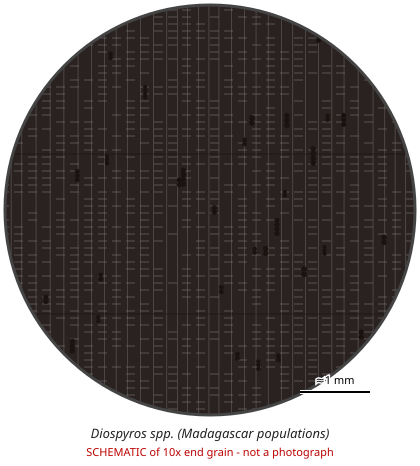

# Diospyros spp. (Madagascar populations)

**Family:** Ebenaceae  
**Trade / common names:** Madagascar ebony, ébène, hazomainty  
**CITES Appendix:** **II**  
**Annotation:** #5 — Logs, sawn wood and veneer sheets.  
**Population covered:** Populations of Madagascar only  
**First listed (approx. year in force):** 2013  
**Native range:** Madagascar (c. 100+ endemic species).

> Always confirm the live listing on [Species+](https://speciesplus.net) before seizure decisions.

## 10x end-grain view

| Real photographs (reference specimens) | Schematic |
|---|---|
| See [`photos/diospyros-madagascar/`](../photos/diospyros-madagascar/) and the image links below |  |

## Key diagnostic summary

Jet black, very heavy fine-textured wood; small pores in short radial multiples; fine reticulate parenchyma lines. Origin is decisive (only Madagascar listed).

## Macroscopic features (hand lens, 10x, freshly cut transverse surface)

| Feature | Observation |
|---|---|
| Wood type | hardwood |
| Porosity | diffuse |
| Pore size | small |
| Pore frequency | few |
| Pore arrangement | multiples |
| Pore contents / deposits | black deposits in pores |
| Axial parenchyma | diffuse, reticulate |
| Rays | fine |
| Ripple marks (storied structure, tangential face) | variable |
| Resin canals (softwoods) | no |

**Other features:**

- Very fine, close tangential lines of parenchyma (reticulate) hard to see in black wood - wet the surface or view sapwood
- Pores small, radial multiples of 2-4
- Rays very fine

## Physical characteristics

- **Heartwood:** Jet black, sometimes with grey/brown streaks.
- **Sapwood:** Pale greyish, distinct.
- **Density:** ~900-1,200 kg/m3
- **Odour:** None (slight acrid smell when worked).

## Look-alikes (check these before concluding)

- Diospyros crassiflora (Gabon ebony - not listed)
- Diospyros celebica (macassar)
- Dalbergia melanoxylon
- Dyed/ blackened woods

## Confirming beyond the hand lens

DNA/provenance; macroscopic ID = Diospyros genus only.

## Species included in this listing

| Taxon | Trade name | Range | Notes |
|---|---|---|---|
| *Diospyros perrieri, D. aculeata, D. gracilipes and c. 80+ other Malagasy spp.* | Ebony | Madagascar | Madagascar export ban + CITES zero export quota. |

## Image sources for 10x end-grain photographs

- [Species+ (official CITES listing & annotation)](https://speciesplus.net/species#/taxon_concepts?taxonomy=cites_eu&taxon_concept_query=Diospyros)
- [The Wood Database (has a 10x end-grain photo per species)](https://www.wood-database.com/?s=Diospyros)
- [InsideWood (anatomy database, NC State)](https://insidewood.lib.ncsu.edu/search)
- [CITES Timber ID repository (manuals, keys, photo atlases)](https://cites.org/eng/timber/timber-ID-repository)
- [CITESwoodID (Thünen Institute, macroscopic key with images)](https://www.thuenen.de/en/institutes/wood-research/fields-of-activity/wood-identification-and-wood-anatomy)
- [Pl@ntWood (CIRAD, macroscopic photos of tropical timbers)](https://plantwood.cirad.fr)
- [Wikimedia Commons (free-licence images)](https://commons.wikimedia.org/w/index.php?search=Diospyros+wood&title=Special:MediaSearch&type=image)
- [GBIF (distribution)](https://www.gbif.org/species/search?q=Diospyros)

---
[← All species](README.md) · [Field procedure](../guides/field-procedure.md) · [Feature glossary](../guides/feature-glossary.md)
