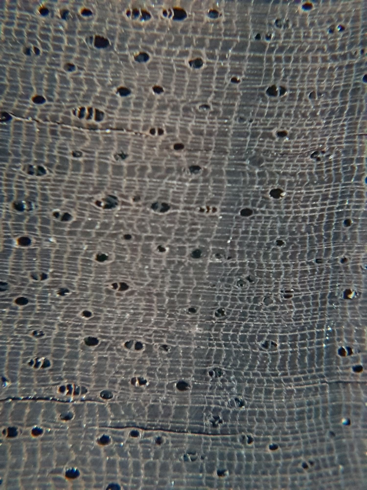
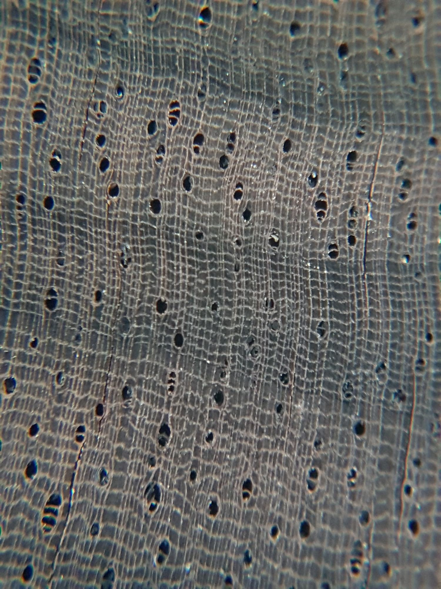
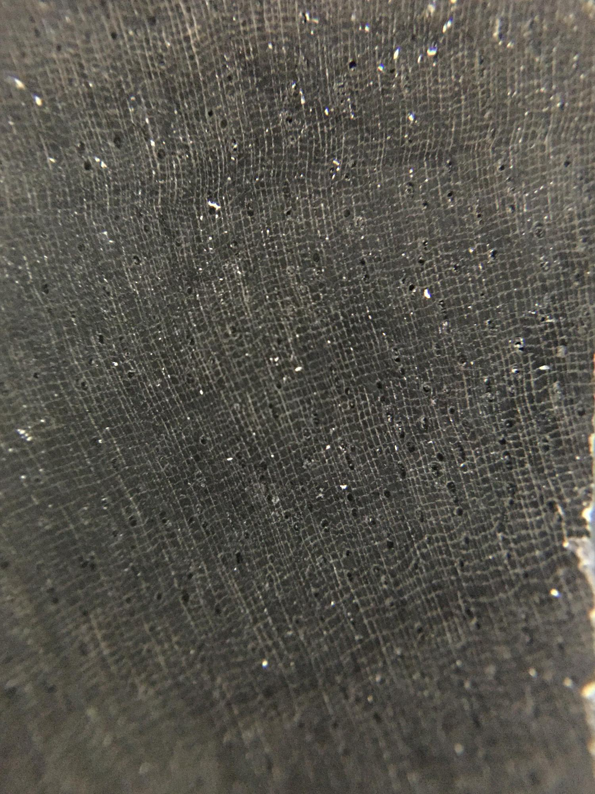
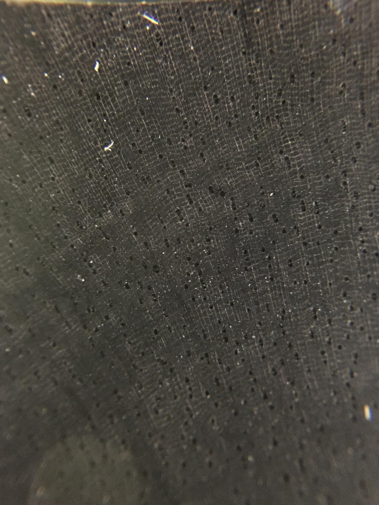
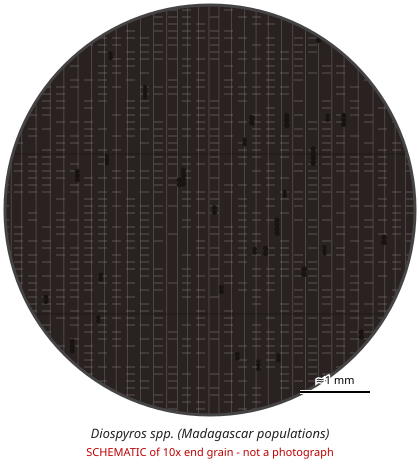

# Diospyros spp. (Madagascar populations)

**Family:** Ebenaceae  
**Trade / common names:** Madagascar ebony, ébène, hazomainty  
**CITES Appendix:** **II**  
**Annotation:** #5 — Logs, sawn wood and veneer sheets.  
**Population covered:** Populations of Madagascar only  
**First listed (approx. year in force):** 2013  
**Native range:** Madagascar (c. 100+ endemic species).

> Always confirm the live listing on [Species+](https://speciesplus.net) before seizure decisions.

## Documents needed for trade

**Appendix II:** **Export permit** from the exporting country (or a **re-export certificate** for re-exports). CITES itself requires no import permit, but many countries (e.g. the EU) do.

The annotation above decides which products need a document at all. Details, validity, codes and a document check: [CITES documents guide](../guides/cites-documents.md).

## End-grain view

  
*Diospyros sp. (set 1)* - transverse (end grain), phone camera + 24x macro lens. GOIMAI, CC BY-SA 4.0.

  
*Diospyros sp. (set 1)* - transverse (end grain), phone camera + 24x macro lens. GOIMAI, CC BY-SA 4.0.

  
*Diospyros sp. (set 3)* - transverse (end grain), phone camera + 24x macro lens. GOIMAI, CC BY-SA 4.0.

  
*Diospyros sp. (set 3)* - transverse (end grain), phone camera + 24x macro lens. GOIMAI, CC BY-SA 4.0.

Schematic drawing (not a photograph): 

## Key diagnostic summary

Jet black, very heavy fine-textured wood; small pores in short radial multiples; fine reticulate parenchyma lines. Origin is decisive (only Madagascar listed).

## Macroscopic features (hand lens, 10x, freshly cut transverse surface)

| Feature | Observation |
|---|---|
| Wood type | hardwood |
| Porosity | diffuse |
| Pore size | small |
| Pore frequency | few |
| Pore arrangement | multiples |
| Pore contents / deposits | black deposits in pores |
| Axial parenchyma | diffuse, reticulate |
| Rays | fine |
| Ripple marks (storied structure, tangential face) | variable |
| Resin canals (softwoods) | no |

**Other features:**

- Very fine, close tangential lines of parenchyma (reticulate) hard to see in black wood - wet the surface or view sapwood
- Pores small, radial multiples of 2-4
- Rays very fine

## Physical characteristics

- **Heartwood:** Jet black, sometimes with grey/brown streaks.
- **Sapwood:** Pale greyish, distinct.
- **Density:** ~900-1,200 kg/m3
- **Odour:** None (slight acrid smell when worked).

## Look-alikes (check these before concluding)

- Diospyros crassiflora (Gabon ebony - not listed)
- Diospyros celebica (macassar)
- Dalbergia melanoxylon
- Dyed/ blackened woods

## Confirming beyond the hand lens

DNA/provenance; macroscopic ID = Diospyros genus only.

## Listed species covered by this entry (120)

From the Species+ checklist.

| Taxon | Appendix | Annotation | Trade name | Native distribution |
|---|---|---|---|---|
| *Diospyros aculeata* | II | #5 |  | Madagascar |
| *Diospyros ambanjensis* | II | #5 |  | Madagascar |
| *Diospyros amborelloides* | II | #5 |  | Madagascar |
| *Diospyros analamerensis* | II | #5 |  | Madagascar |
| *Diospyros andohahelensis* | II | #5 |  | Madagascar |
| *Diospyros anosivolensis* | II | #5 |  | Madagascar |
| *Diospyros antakaranae* | II | #5 |  | Madagascar |
| *Diospyros antongilensis* | II | #5 |  | Madagascar |
| *Diospyros antsirananae* | II | #5 |  | Madagascar |
| *Diospyros arenicola* | II | #5 |  | Madagascar |
| *Diospyros bardotiae* | II | #5 |  | Madagascar |
| *Diospyros baroniana* | II | #5 |  | Madagascar |
| *Diospyros baronii* | II | #5 |  | Madagascar |
| *Diospyros beberonnii* | II | #5 |  | Madagascar |
| *Diospyros bemarivensis* | II | #5 |  | Madagascar |
| *Diospyros bernieriana* | II | #5 |  | Madagascar |
| *Diospyros bezofensis* | II | #5 |  | Madagascar |
| *Diospyros boinensis* | II | #5 |  | Madagascar |
| *Diospyros boivinii* | II | #5 |  | Madagascar |
| *Diospyros calophylla* | II | #5 |  | Madagascar |
| *Diospyros chitoniophora* | II | #5 |  | Madagascar |
| *Diospyros cinnamomoides* | II | #5 |  | Madagascar |
| *Diospyros clusiifolia* | II | #5 |  | Madagascar |
| *Diospyros comorensis* | II | #5 |  | Madagascar |
| *Diospyros coursiana* | II | #5 |  | Madagascar |
| *Diospyros crassifolia* | II | #5 |  | Madagascar |
| *Diospyros crassipedicellata* | II | #5 |  | Madagascar |
| *Diospyros cupulifera* | II | #5 |  | Madagascar |
| *Diospyros danguyana* | II | #5 |  | Madagascar |
| *Diospyros decaryana* | II | #5 |  | Madagascar |
| *Diospyros decaryoides* | II | #5 |  | Madagascar |
| *Diospyros dicorypheoides* | II | #5 |  | Madagascar |
| *Diospyros ebenifera* | II | #5 |  | Madagascar |
| *Diospyros erinacea* | II | #5 |  | Madagascar |
| *Diospyros erythrosperma* | II | #5 |  | Madagascar |
| *Diospyros falyi* | II | #5 |  | Madagascar |
| *Diospyros filipes* | II | #5 |  | Madagascar |
| *Diospyros fuscovelutina* | II | #5 |  | Madagascar |
| *Diospyros geayana* | II | #5 |  | Madagascar |
| *Diospyros gracilipes* | II | #5 |  | Madagascar |
| *Diospyros grandiflora* | II | #5 |  | Madagascar |
| *Diospyros greveana* | II | #5 |  | Madagascar |
| *Diospyros haplostylis* | II | #5 |  | Madagascar |
| *Diospyros hazomainty* | II | #5 |  | Madagascar |
| *Diospyros heterosepala* | II | #5 |  | Madagascar |
| *Diospyros humbertiana* | II | #5 |  | Madagascar |
| *Diospyros implexicalyx* | II | #5 |  | Madagascar |
| *Diospyros ketsensis* | II | #5 |  | Madagascar |
| *Diospyros laevis* | II | #5 |  | Madagascar |
| *Diospyros lanceolata* | II | #5 |  | Madagascar |
| *Diospyros latispathulata* | II | #5 |  | Madagascar |
| *Diospyros leucocalyx* | II | #5 |  | Madagascar |
| *Diospyros littoralis* | II | #5 |  | Madagascar |
| *Diospyros lokohensis* | II | #5 |  | Madagascar |
| *Diospyros louvelii* | II | #5 |  | Madagascar |
| *Diospyros lowryi* | II | #5 |  | Madagascar |
| *Diospyros maculata* | II | #5 |  | Madagascar |
| *Diospyros madagascariensis* | II | #5 |  | Madagascar |
| *Diospyros madecassa* | II | #5 |  | Madagascar |
| *Diospyros malandy* | II | #5 |  | Madagascar |
| *Diospyros manampetsae* | II | #5 |  | Madagascar |
| *Diospyros mandenensis* | II | #5 |  | Madagascar |
| *Diospyros mangorensis* | II | #5 |  | Madagascar |
| *Diospyros mapingo* | II | #5 |  | Madagascar |
| *Diospyros masoalensis* | II | #5 |  | Madagascar |
| *Diospyros mcphersonii* | II | #5 |  | Madagascar |
| *Diospyros meeusiana* | II | #5 |  | Madagascar |
| *Diospyros melanocarpa* | II | #5 |  | Madagascar |
| *Diospyros microrhombus* | II | #5 |  | Madagascar |
| *Diospyros mimusops* | II | #5 |  | Madagascar |
| *Diospyros myriophylla* | II | #5 |  | Madagascar |
| *Diospyros myrtifolia* | II | #5 |  | Madagascar |
| *Diospyros nidiformis* | II | #5 |  | Madagascar |
| *Diospyros obducta* | II | #5 |  | Madagascar |
| *Diospyros occlusa* | II | #5 |  | Madagascar |
| *Diospyros olacinoides* | II | #5 |  | Madagascar |
| *Diospyros olivieri* | II | #5 |  | Madagascar |
| *Diospyros orbicularis* | II | #5 |  | Madagascar |
| *Diospyros parifolia* | II | #5 |  | Madagascar |
| *Diospyros parvifolia* | II | #5 |  | Madagascar |
| *Diospyros perglauca* | II | #5 |  | Madagascar |
| *Diospyros perreticulata* | II | #5 |  | Madagascar |
| *Diospyros perrieri* | II | #5 | Ebony | Madagascar |
| *Diospyros pervilleana* | II | #5 |  | Madagascar |
| *Diospyros pervillei* | II | #5 |  | Madagascar |
| *Diospyros platycalyx* | II | #5 |  | Madagascar |
| *Diospyros plicaticalyx* | II | #5 |  | Madagascar |
| *Diospyros pruinosa* | II | #5 |  | Madagascar |
| *Diospyros pubiramulis* | II | #5 |  | Madagascar |
| *Diospyros quadrangularis* | II | #5 |  | Madagascar |
| *Diospyros quercina* | II | #5 |  | Madagascar |
| *Diospyros rakotovaoi* | II | #5 |  | Madagascar |
| *Diospyros ramisonii* | II | #5 |  | Madagascar |
| *Diospyros ranirisonii* | II | #5 |  | Madagascar |
| *Diospyros retusa* | II | #5 |  | Madagascar |
| *Diospyros rubripetiolata* | II | #5 |  | Madagascar |
| *Diospyros sakalavarum* | II | #5 |  | Madagascar |
| *Diospyros sclerophylla* | II | #5 |  | Madagascar |
| *Diospyros sennenii* | II | #5 |  | Madagascar |
| *Diospyros sphaerosepala* | II | #5 |  | Madagascar |
| *Diospyros squamosa* | II | #5 |  | Madagascar |
| *Diospyros stenocarpa* | II | #5 |  | Madagascar |
| *Diospyros subacuta* | II | #5 |  | Madagascar |
| *Diospyros subenervis* | II | #5 |  | Madagascar |
| *Diospyros subfalciformis* | II | #5 |  | Madagascar |
| *Diospyros subsessilifolia* | II | #5 |  | Madagascar |
| *Diospyros subtrinervis* | II | #5 |  | Madagascar |
| *Diospyros taikintana* | II | #5 |  | Madagascar |
| *Diospyros tampinensis* | II | #5 |  | Madagascar |
| *Diospyros tampolensis* | II | #5 |  | Madagascar |
| *Diospyros tetraceros* | II | #5 |  | Madagascar |
| *Diospyros tetrapoda* | II | #5 |  | Madagascar |
| *Diospyros thouarsii* | II | #5 |  | Madagascar |
| *Diospyros torquata* | II | #5 |  | Madagascar |
| *Diospyros toxicaria* | II | #5 |  | Madagascar |
| *Diospyros tropophylla* | II | #5 |  | Madagascar |
| *Diospyros ultima* | II | #5 |  | Madagascar |
| *Diospyros urschii* | II | #5 |  | Madagascar |
| *Diospyros velutipes* | II | #5 |  | Madagascar |
| *Diospyros vescoi* | II | #5 |  | Madagascar |

## View 10x end-grain photographs (CITESwoodID)

Transverse section at about 10x, from verified reference specimens. Images (c) Thünen Institute - linked, not copied.

- [*Diospyros spp. (Madagascar)* - 10x transverse section](https://www.delta-intkey.com/citeswood/en/www/ebedispp.htm)

## Other image sources for 10x end-grain photographs

- [Species+ (official CITES listing & annotation)](https://speciesplus.net/species#/taxon_concepts?taxonomy=cites_eu&taxon_concept_query=Diospyros)
- [The Wood Database (has a 10x end-grain photo per species)](https://www.wood-database.com/?s=Diospyros)
- [InsideWood (anatomy database, NC State)](https://insidewood.lib.ncsu.edu/search)
- [CITES Timber ID repository (manuals, keys, photo atlases)](https://cites.org/eng/timber/timber-ID-repository)
- [CITESwoodID (Thünen Institute, macroscopic key with images)](https://www.thuenen.de/en/institutes/wood-research/fields-of-activity/wood-identification-and-wood-anatomy)
- [Pl@ntWood (CIRAD, macroscopic photos of tropical timbers)](https://plantwood.cirad.fr)
- [Wikimedia Commons (free-licence images)](https://commons.wikimedia.org/w/index.php?search=Diospyros+wood&title=Special:MediaSearch&type=image)
- [GBIF (distribution)](https://www.gbif.org/species/search?q=Diospyros)

---
[← All species](README.md) · [Field procedure](../guides/field-procedure.md) · [CITES documents](../guides/cites-documents.md) · [Feature glossary](../guides/feature-glossary.md)
