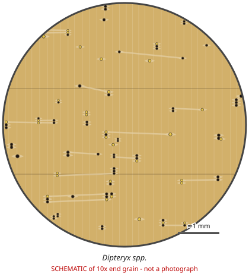

# Dipteryx spp.

**Family:** Fabaceae  
**Trade / common names:** Cumaru, shihuahuaco, Brazilian teak, tonka bean tree, almendro (D. oleifera)  
**CITES Appendix:** **II**  
**Annotation:** #17 — Logs, sawn wood, veneer sheets, plywood and transformed wood (HS 44.09, e.g. decking, flooring strips).  
**Population covered:** All populations  
**First listed (approx. year in force):** 2024  
**Native range:** Central America, Amazon basin, Cerrado.

> Always confirm the live listing on [Species+](https://speciesplus.net) before seizure decisions.

## Documents needed for trade

**Appendix II:** **Export permit** from the exporting country (or a **re-export certificate** for re-exports). CITES itself requires no import permit, but many countries (e.g. the EU) do.

The annotation above decides which products need a document at all. Details, validity, codes and a document check: [CITES documents guide](../guides/cites-documents.md).

## End-grain view

Schematic drawing (not a photograph): 

## Key diagnostic summary

Very heavy brown wood with storied structure and winged-aliform parenchyma; coumarin (vanilla) scent; NO yellow lapachol powder (separates from ipê).

## Macroscopic features (hand lens, 10x, freshly cut transverse surface)

| Feature | Observation |
|---|---|
| Wood type | hardwood |
| Porosity | diffuse |
| Pore size | small |
| Pore frequency | moderate |
| Pore arrangement | mixed |
| Pore contents / deposits | occasional yellowish/brown deposits |
| Axial parenchyma | aliform, confluent |
| Rays | fine |
| Ripple marks (storied structure, tangential face) | yes |
| Resin canals (softwoods) | no |

**Other features:**

- Lozenge/winged-aliform parenchyma, short confluent bands
- Extremely fine regular ripple marks
- Waxy/oily feel

## Physical characteristics

- **Heartwood:** Medium yellowish- to reddish-brown, sometimes purplish streaks; darkens.
- **Sapwood:** Pale, distinct.
- **Density:** ~1,000-1,100 kg/m3
- **Odour:** Faint vanilla/cinnamon (coumarin) scent when worked.

## Look-alikes (check these before concluding)

- Handroanthus (ipê)
- Hymenaea courbaril (jatoba)
- Pericopsis elata
- Diplotropis purpurea

## Confirming beyond the hand lens

DNA/MS.

## Listed species covered by this entry (12)

From the Species+ checklist.

| Taxon | Appendix | Annotation | Trade name | Native distribution |
|---|---|---|---|---|
| *Dipteryx alata* | II | #17 | Baru, cumaru | Bolivia (Plurinational State of), Brazil, Paraguay |
| *Dipteryx charapilla* | II | #17 |  | Brazil, Peru |
| *Dipteryx ferrea* | II | #17 |  | Bolivia (Plurinational State of), Brazil, Peru |
| *Dipteryx hermetopascoaliana* | II | #17 |  | Brazil |
| *Dipteryx lacunifera* | II | #17 |  | Brazil |
| *Dipteryx magnifica* | II | #17 |  | Brazil, Colombia, Venezuela (Bolivarian Republic of) |
| *Dipteryx micrantha* | II | #17 | Shihuahuaco | Bolivia (Plurinational State of), Brazil, Colombia, Ecuador, Peru |
| *Dipteryx odorata* | II | #17 | Cumaru, tonka | Bolivia (Plurinational State of), Brazil, French Guiana [FR], Guyana, Suriname, Venezuela (Bolivarian Republic of) |
| *Dipteryx oleifera* | II | #17 | Almendro | Colombia, Costa Rica, Nicaragua, Panama |
| *Dipteryx polyphylla* | II | #17 |  | Brazil, Colombia |
| *Dipteryx punctata* | II | #17 |  | Brazil, Colombia, French Guiana [FR], Guyana, Suriname, Venezuela (Bolivarian Republic of) |
| *Dipteryx rosea* | II | #17 |  | Brazil, Colombia, Peru, Venezuela (Bolivarian Republic of) |

## View 10x end-grain photographs (CITESwoodID)

Transverse section at about 10x, from verified reference specimens. Images (c) Thünen Institute - linked, not copied.

- [*Dipteryx spp.* - 10x transverse section](https://www.delta-intkey.com/citeswood/en/www/fabdipol.htm)

## Other image sources for 10x end-grain photographs

- [Species+ (official CITES listing & annotation)](https://speciesplus.net/species#/taxon_concepts?taxonomy=cites_eu&taxon_concept_query=Dipteryx)
- [The Wood Database (has a 10x end-grain photo per species)](https://www.wood-database.com/?s=Dipteryx)
- [InsideWood (anatomy database, NC State)](https://insidewood.lib.ncsu.edu/search)
- [CITES Timber ID repository (manuals, keys, photo atlases)](https://cites.org/eng/timber/timber-ID-repository)
- [CITESwoodID (Thünen Institute, macroscopic key with images)](https://www.thuenen.de/en/institutes/wood-research/fields-of-activity/wood-identification-and-wood-anatomy)
- [Pl@ntWood (CIRAD, macroscopic photos of tropical timbers)](https://plantwood.cirad.fr)
- [Wikimedia Commons (free-licence images)](https://commons.wikimedia.org/w/index.php?search=Dipteryx+wood&title=Special:MediaSearch&type=image)
- [GBIF (distribution)](https://www.gbif.org/species/search?q=Dipteryx)

---
[← All species](README.md) · [Field procedure](../guides/field-procedure.md) · [CITES documents](../guides/cites-documents.md) · [Feature glossary](../guides/feature-glossary.md)
