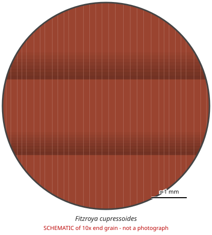

# Fitzroya cupressoides

**Family:** Cupressaceae  
**Trade / common names:** Alerce, Patagonian cypress, lahuán  
**CITES Appendix:** **I**  
**Annotation:** none — No annotation - ALL parts and derivatives are covered (including finished products).  
**Population covered:** All populations  
**First listed (approx. year in force):** 1975  
**Native range:** Coastal and Andean ranges of southern Chile and adjacent Argentina.

> Always confirm the live listing on [Species+](https://speciesplus.net) before seizure decisions.

## 10x end-grain view

| Real photographs (reference specimens) | Schematic |
|---|---|
| See [`photos/fitzroya-cupressoides/`](../photos/fitzroya-cupressoides/) and the image links below |  |

## Key diagnostic summary

Reddish non-resin-canal softwood with very narrow regular growth rings and cedar scent. Typical shingles, roof tiles, furniture of old-growth origin.

## Macroscopic features (hand lens, 10x, freshly cut transverse surface)

| Feature | Observation |
|---|---|
| Wood type | softwood |
| Porosity | none |
| Pore size | — |
| Pore frequency | — |
| Pore arrangement | — |
| Pore contents / deposits | none noted |
| Axial parenchyma | not visible / none |
| Rays | fine |
| Ripple marks (storied structure, tangential face) | no |
| Resin canals (softwoods) | no |

**Other features:**

- Growth rings distinct, often extremely narrow (old trees > 1,000 years)
- Gradual earlywood-latewood transition
- Axial parenchyma (resinous) sometimes visible as dark dots

## Physical characteristics

- **Heartwood:** Reddish-brown to dark red-brown; old-growth wood often with very narrow, regular rings.
- **Sapwood:** Narrow, pale yellowish.
- **Density:** ~420-500 kg/m3
- **Odour:** Mild cedar-like scent.

## Look-alikes (check these before concluding)

- Pilgerodendron uviferum
- Sequoia sempervirens (redwood)
- Thuja plicata (western red cedar)

## Confirming beyond the hand lens

Microscopy of cross-field pitting; DNA.

## View 10x end-grain photographs (CITESwoodID)

Transverse section at about 10x, from verified reference specimens. Images (c) Thünen Institute - linked, not copied.

- [*Fitzroya cupressoides* - 10x transverse section](https://www.delta-intkey.com/citeswood/en/www/cupficu.htm)

## Other image sources for 10x end-grain photographs

- [Species+ (official CITES listing & annotation)](https://speciesplus.net/species#/taxon_concepts?taxonomy=cites_eu&taxon_concept_query=Fitzroya+cupressoides)
- [The Wood Database (has a 10x end-grain photo per species)](https://www.wood-database.com/?s=Fitzroya+cupressoides)
- [InsideWood (anatomy database, NC State)](https://insidewood.lib.ncsu.edu/search)
- [CITES Timber ID repository (manuals, keys, photo atlases)](https://cites.org/eng/timber/timber-ID-repository)
- [CITESwoodID (Thünen Institute, macroscopic key with images)](https://www.thuenen.de/en/institutes/wood-research/fields-of-activity/wood-identification-and-wood-anatomy)
- [Pl@ntWood (CIRAD, macroscopic photos of tropical timbers)](https://plantwood.cirad.fr)
- [Wikimedia Commons (free-licence images)](https://commons.wikimedia.org/w/index.php?search=Fitzroya+cupressoides+wood&title=Special:MediaSearch&type=image)
- [GBIF (distribution)](https://www.gbif.org/species/search?q=Fitzroya+cupressoides)

---
[← All species](README.md) · [Field procedure](../guides/field-procedure.md) · [Feature glossary](../guides/feature-glossary.md)
