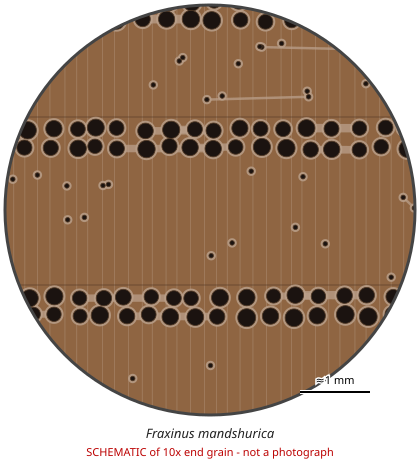

# Fraxinus mandshurica

**Family:** Oleaceae  
**Trade / common names:** Manchurian ash, tamo (figured), Japanese ash (yachidamo)  
**CITES Appendix:** **III**  
**Annotation:** #5 — Logs, sawn wood and veneer sheets.  
**Population covered:** Population of the Russian Federation (listed by Russia)  
**First listed (approx. year in force):** 2014  
**Native range:** Russian Far East, NE China, Korea, Japan.

> Always confirm the live listing on [Species+](https://speciesplus.net) before seizure decisions.

## 10x end-grain view

| Real photographs (reference specimens) | Schematic |
|---|---|
| See [`photos/fraxinus-mandshurica/`](../photos/fraxinus-mandshurica/) and the image links below |  |

## Key diagnostic summary

Ring-porous ash: large earlywood pores, latewood pores with vasicentric/confluent parenchyma, fine rays. Separation from other ashes needs DNA/origin.

## Macroscopic features (hand lens, 10x, freshly cut transverse surface)

| Feature | Observation |
|---|---|
| Wood type | hardwood |
| Porosity | ring |
| Pore size | large |
| Pore frequency | moderate |
| Pore arrangement | mixed |
| Pore contents / deposits | none noted |
| Axial parenchyma | vasicentric, confluent |
| Rays | fine |
| Ripple marks (storied structure, tangential face) | no |
| Resin canals (softwoods) | no |

**Other features:**

- Ring porous: large earlywood pores in 2-4 rows
- Latewood pores small, solitary or pairs, surrounded by parenchyma - becoming confluent towards ring end
- Rays fine (NOT broad - separates from oak)

## Physical characteristics

- **Heartwood:** Light greyish-brown to light brown.
- **Sapwood:** Whitish, not always distinct.
- **Density:** ~600-700 kg/m3
- **Odour:** None.

## Look-alikes (check these before concluding)

- Fraxinus excelsior (European ash)
- Fraxinus americana (white ash)
- Fraxinus chinensis/ F. rhynchophylla
- Castanea (chestnut)

## Confirming beyond the hand lens

DNA, isotopes.

## View 10x end-grain photographs (CITESwoodID)

Transverse section at about 10x, from verified reference specimens. Images (c) Thünen Institute - linked, not copied.

- [*Fraxinus mandshurica* - 10x transverse section](https://www.delta-intkey.com/citeswood/en/www/oleframa.htm)

## Other image sources for 10x end-grain photographs

- [Species+ (official CITES listing & annotation)](https://speciesplus.net/species#/taxon_concepts?taxonomy=cites_eu&taxon_concept_query=Fraxinus+mandshurica)
- [The Wood Database (has a 10x end-grain photo per species)](https://www.wood-database.com/?s=Fraxinus+mandshurica)
- [InsideWood (anatomy database, NC State)](https://insidewood.lib.ncsu.edu/search)
- [CITES Timber ID repository (manuals, keys, photo atlases)](https://cites.org/eng/timber/timber-ID-repository)
- [CITESwoodID (Thünen Institute, macroscopic key with images)](https://www.thuenen.de/en/institutes/wood-research/fields-of-activity/wood-identification-and-wood-anatomy)
- [Pl@ntWood (CIRAD, macroscopic photos of tropical timbers)](https://plantwood.cirad.fr)
- [Wikimedia Commons (free-licence images)](https://commons.wikimedia.org/w/index.php?search=Fraxinus+mandshurica+wood&title=Special:MediaSearch&type=image)
- [GBIF (distribution)](https://www.gbif.org/species/search?q=Fraxinus+mandshurica)

---
[← All species](README.md) · [Field procedure](../guides/field-procedure.md) · [Feature glossary](../guides/feature-glossary.md)
