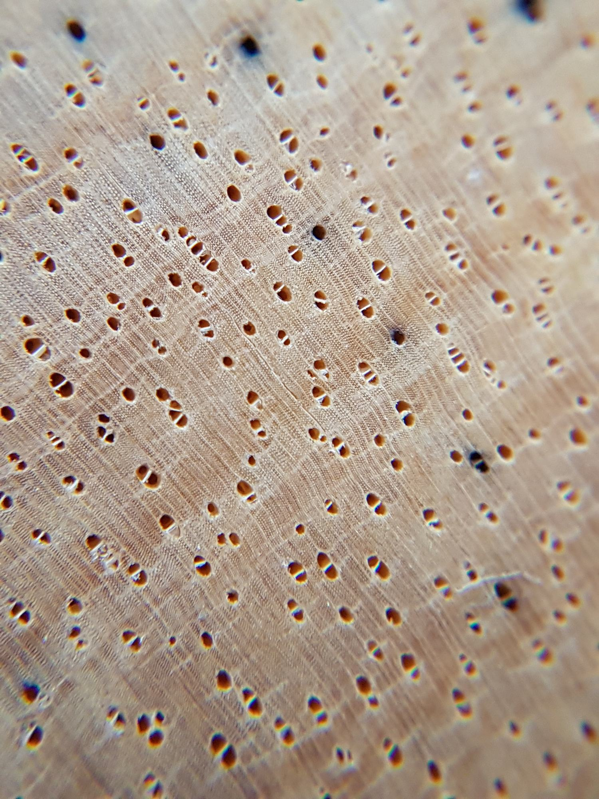
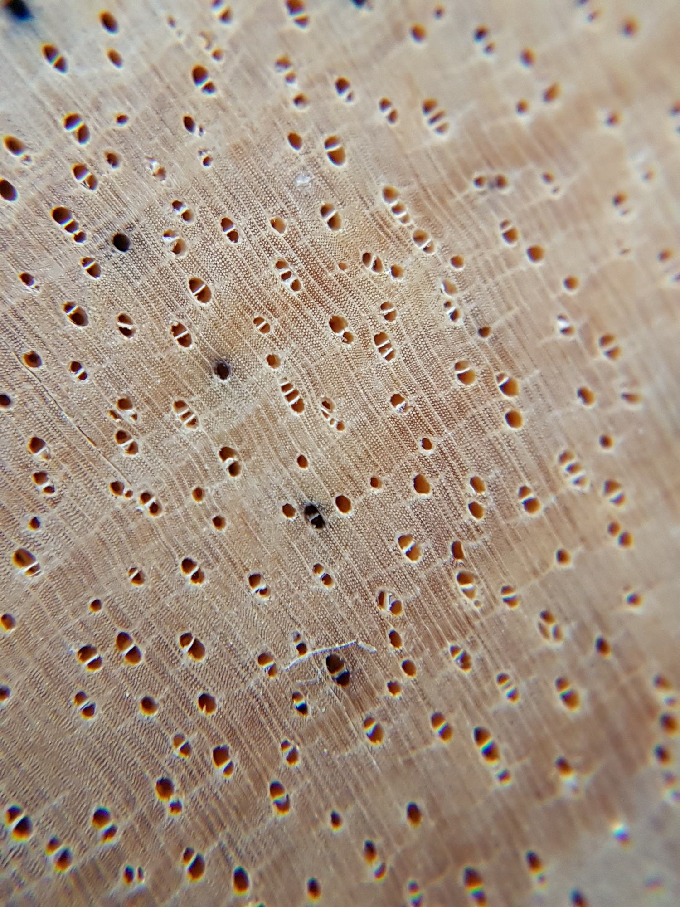
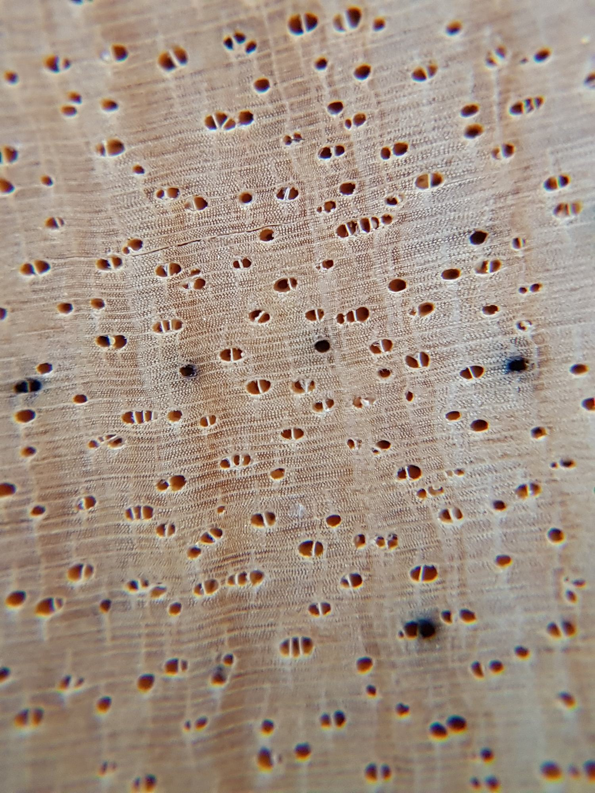
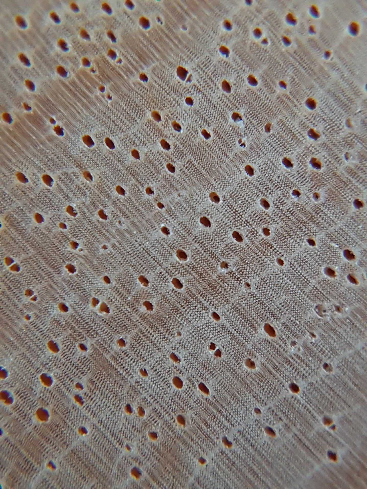
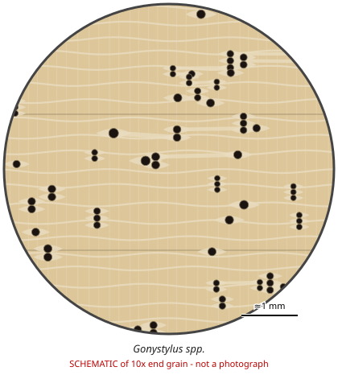

# Gonystylus spp.

**Family:** Thymelaeaceae  
**Trade / common names:** Ramin, melawis, lanutan-bagyo  
**CITES Appendix:** **II**  
**Annotation:** #4 — All parts and derivatives except seeds, spores and pollen, in-vitro seedling/tissue cultures, cut flowers of artificially propagated plants and a few plant-specific items (certain Vanilla, Cactaceae, Opuntia/Selenicereus stems, finished Euphorbia antisyphilitica products). For timber: logs, sawn wood, veneer, plywood, chips AND finished products ARE covered.  
**Population covered:** All populations  
**First listed (approx. year in force):** 2004  
**Native range:** Peat-swamp forests of Malaysia, Indonesia (Sumatra, Borneo), Philippines, Pacific (c. 30 spp.).

> Always confirm the live listing on [Species+](https://speciesplus.net) before seizure decisions.

## Documents needed for trade

**Appendix II:** **Export permit** from the exporting country (or a **re-export certificate** for re-exports). CITES itself requires no import permit, but many countries (e.g. the EU) do.

The annotation above decides which products need a document at all. Details, validity, codes and a document check: [CITES documents guide](../guides/cites-documents.md).

## End-grain view

  
*Gonystylus bancanus* - transverse (end grain), phone camera + 24x macro lens. GOIMAI, CC BY-SA 4.0.

  
*Gonystylus bancanus* - transverse (end grain), phone camera + 24x macro lens. GOIMAI, CC BY-SA 4.0.

  
*Gonystylus bancanus* - transverse (end grain), phone camera + 24x macro lens. GOIMAI, CC BY-SA 4.0.

  
*Gonystylus sp.* - transverse (end grain), phone camera + 24x macro lens. GOIMAI, CC BY-SA 4.0.

Schematic drawing (not a photograph): 

## Key diagnostic summary

Featureless pale wood used for dowels/mouldings with distinct winged-aliform to confluent parenchyma under the lens. Annotation #4 covers finished products.

## Macroscopic features (hand lens, 10x, freshly cut transverse surface)

| Feature | Observation |
|---|---|
| Wood type | hardwood |
| Porosity | diffuse |
| Pore size | medium |
| Pore frequency | moderate |
| Pore arrangement | mixed |
| Pore contents / deposits | none noted |
| Axial parenchyma | aliform, confluent, banded |
| Rays | fine |
| Ripple marks (storied structure, tangential face) | no |
| Resin canals (softwoods) | no |

**Other features:**

- Long-winged aliform parenchyma often joining into wavy confluent bands
- Uniform pale colour - typical products: mouldings, dowels, picture frames, blinds, billiard cues, rulers
- Bark contains irritant fibres

## Physical characteristics

- **Heartwood:** Uniform pale straw to creamy white (no heartwood colour).
- **Sapwood:** Not distinct.
- **Density:** ~550-700 kg/m3
- **Odour:** Unpleasant when fresh; none dry.

## Look-alikes (check these before concluding)

- Alstonia (pulai)
- Dyera (jelutong)
- Fagus (beech)
- Tilia (basswood)
- Koompassia/ Paraserianthes

## Confirming beyond the hand lens

Microscopy; DNA.

## Listed species covered by this entry (39)

From the Species+ checklist.

| Taxon | Appendix | Annotation | Trade name | Native distribution |
|---|---|---|---|---|
| *Gonystylus acuminatus* | II | #4 |  | Indonesia, Malaysia |
| *Gonystylus affinis* | II | #4 |  | Brunei Darussalam |
| *Gonystylus areolatus* | II | #4 |  | Indonesia, Malaysia |
| *Gonystylus augescens* | II | #4 |  | Indonesia, Malaysia |
| *Gonystylus bancanus* | II | #4 | Ramin telur | Brunei Darussalam, Indonesia, Malaysia |
| *Gonystylus beccarianus* | II | #4 |  | Indonesia |
| *Gonystylus borneensis* | II | #4 |  | Brunei Darussalam, Indonesia, Malaysia |
| *Gonystylus brunnescens* | II | #4 |  | Brunei Darussalam, Indonesia, Malaysia |
| *Gonystylus calophylloides* | II | #4 |  | Malaysia |
| *Gonystylus calophyllus* | II | #4 |  | Indonesia, Malaysia |
| *Gonystylus confusus* | II | #4 |  | Indonesia, Malaysia, Singapore |
| *Gonystylus consanguineus* | II | #4 |  | Indonesia, Malaysia |
| *Gonystylus costalis* | II | #4 |  | Indonesia, Malaysia |
| *Gonystylus decipiens* | II | #4 |  | Indonesia, Malaysia |
| *Gonystylus eximius* | II | #4 |  | Malaysia |
| *Gonystylus forbesii* | II | #4 |  | Indonesia, Malaysia |
| *Gonystylus glaucescens* | II | #4 |  | Indonesia |
| *Gonystylus hackenbergii* | II | #4 |  | Indonesia |
| *Gonystylus keithii* | II | #4 |  | Brunei Darussalam, Indonesia, Malaysia |
| *Gonystylus lucidulus* | II | #4 |  | Brunei Darussalam, Indonesia, Malaysia |
| *Gonystylus macrocarpus* | II | #4 |  | Solomon Islands |
| *Gonystylus macrophyllus* | II | #4 |  | Brunei Darussalam, India, Indonesia, Malaysia, Papua New Guinea, Solomon Islands |
| *Gonystylus maingayi* | II | #4 |  | Brunei Darussalam, Indonesia, Malaysia, Singapore |
| *Gonystylus micranthus* | II | #4 |  | Indonesia, Malaysia |
| *Gonystylus miquelianus* | II | #4 |  | Malaysia |
| *Gonystylus nervosus* | II | #4 |  | Indonesia, Malaysia |
| *Gonystylus nobilis* | II | #4 |  | Indonesia, Malaysia |
| *Gonystylus obovatus* | II | #4 |  | Philippines |
| *Gonystylus othmanii* | II | #4 |  | Malaysia |
| *Gonystylus pendulus* | II | #4 |  | Indonesia, Malaysia |
| *Gonystylus philippinensis* | II | #4 |  | Philippines |
| *Gonystylus pluricornis* | II | #4 |  | Indonesia |
| *Gonystylus punctatus* | II | #4 |  | Fiji |
| *Gonystylus reticulatus* | II | #4 |  | Philippines |
| *Gonystylus spectabilis* | II | #4 |  | Brunei Darussalam, Indonesia, Malaysia |
| *Gonystylus stenosepalus* | II | #4 |  | Indonesia, Malaysia |
| *Gonystylus velutinus* | II | #4 |  | Brunei Darussalam, Malaysia |
| *Gonystylus warburgianus* | II | #4 |  | Indonesia |
| *Gonystylus xylocarpus* | II | #4 |  | Brunei Darussalam, Indonesia, Malaysia |

## View 10x end-grain photographs (CITESwoodID)

Transverse section at about 10x, from verified reference specimens. Images (c) Thünen Institute - linked, not copied.

- [*Gonystylus spp.* - 10x transverse section](https://www.delta-intkey.com/citeswood/en/www/thygony.htm)

## Other image sources for 10x end-grain photographs

- [Species+ (official CITES listing & annotation)](https://speciesplus.net/species#/taxon_concepts?taxonomy=cites_eu&taxon_concept_query=Gonystylus)
- [The Wood Database (has a 10x end-grain photo per species)](https://www.wood-database.com/?s=Gonystylus)
- [InsideWood (anatomy database, NC State)](https://insidewood.lib.ncsu.edu/search)
- [CITES Timber ID repository (manuals, keys, photo atlases)](https://cites.org/eng/timber/timber-ID-repository)
- [CITESwoodID (Thünen Institute, macroscopic key with images)](https://www.thuenen.de/en/institutes/wood-research/fields-of-activity/wood-identification-and-wood-anatomy)
- [Pl@ntWood (CIRAD, macroscopic photos of tropical timbers)](https://plantwood.cirad.fr)
- [Wikimedia Commons (free-licence images)](https://commons.wikimedia.org/w/index.php?search=Gonystylus+wood&title=Special:MediaSearch&type=image)
- [GBIF (distribution)](https://www.gbif.org/species/search?q=Gonystylus)

---
[← All species](README.md) · [Field procedure](../guides/field-procedure.md) · [CITES documents](../guides/cites-documents.md) · [Feature glossary](../guides/feature-glossary.md)
