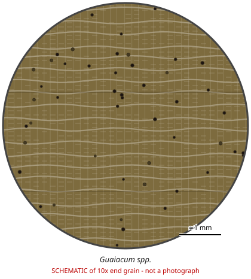

# Guaiacum spp.

**Family:** Zygophyllaceae  
**Trade / common names:** Lignum vitae, guayacán, gaïac  
**CITES Appendix:** **II**  
**Annotation:** #2 — All parts and derivatives except seeds and pollen, and finished products packaged and ready for retail trade.  
**Population covered:** All populations  
**First listed (approx. year in force):** 2003  
**Native range:** Caribbean, Mexico, Central America, northern South America.

> Always confirm the live listing on [Species+](https://speciesplus.net) before seizure decisions.

## Documents needed for trade

**Appendix II:** **Export permit** from the exporting country (or a **re-export certificate** for re-exports). CITES itself requires no import permit, but many countries (e.g. the EU) do.

The annotation above decides which products need a document at all. Details, validity, codes and a document check: [CITES documents guide](../guides/cites-documents.md).

## 10x end-grain view

| Real photographs (reference specimens) | Schematic |
|---|---|
| See [`photos/guaiacum-spp/`](../photos/guaiacum-spp/) and the image links below |  |

## Key diagnostic summary

Extremely heavy, oily, green-brown wood with tiny solitary pores and very fine ripple marks. Traded as bearings, mallets, carvings.

## Macroscopic features (hand lens, 10x, freshly cut transverse surface)

| Feature | Observation |
|---|---|
| Wood type | hardwood |
| Porosity | diffuse |
| Pore size | small |
| Pore frequency | moderate |
| Pore arrangement | solitary |
| Pore contents / deposits | resin |
| Axial parenchyma | diffuse, banded |
| Rays | fine |
| Ripple marks (storied structure, tangential face) | yes |
| Resin canals (softwoods) | no |

**Other features:**

- Very fine storied rays (ripple marks)
- Strongly interlocked grain
- Resin (guaiacin) turns blue/green with oxidisers

## Physical characteristics

- **Heartwood:** Dark greenish-brown to almost black; very oily/ waxy.
- **Sapwood:** Pale yellow, sharply demarcated.
- **Density:** ~1,200-1,350 kg/m3 (one of the heaviest woods)
- **Odour:** Mild perfumed scent when worked.

## Look-alikes (check these before concluding)

- Bulnesia spp.
- Handroanthus (ipê)
- Diospyros

## Confirming beyond the hand lens

Microscopy/DNA.

## Species included in this listing

| Taxon | Trade name | Range | Notes |
|---|---|---|---|
| *Guaiacum officinale* | Lignum vitae | Caribbean, N South America |  |
| *Guaiacum sanctum* | Holywood lignum vitae | Florida keys, Caribbean, Mexico, Central America |  |
| *Guaiacum coulteri, G. unijugum and others* |  | Mexico |  |

## View 10x end-grain photographs (CITESwoodID)

Transverse section at about 10x, from verified reference specimens. Images (c) Thünen Institute - linked, not copied.

- [*Guaiacum spp.* - 10x transverse section](https://www.delta-intkey.com/citeswood/en/www/zygguai.htm)

## Other image sources for 10x end-grain photographs

- [Species+ (official CITES listing & annotation)](https://speciesplus.net/species#/taxon_concepts?taxonomy=cites_eu&taxon_concept_query=Guaiacum)
- [The Wood Database (has a 10x end-grain photo per species)](https://www.wood-database.com/?s=Guaiacum)
- [InsideWood (anatomy database, NC State)](https://insidewood.lib.ncsu.edu/search)
- [CITES Timber ID repository (manuals, keys, photo atlases)](https://cites.org/eng/timber/timber-ID-repository)
- [CITESwoodID (Thünen Institute, macroscopic key with images)](https://www.thuenen.de/en/institutes/wood-research/fields-of-activity/wood-identification-and-wood-anatomy)
- [Pl@ntWood (CIRAD, macroscopic photos of tropical timbers)](https://plantwood.cirad.fr)
- [Wikimedia Commons (free-licence images)](https://commons.wikimedia.org/w/index.php?search=Guaiacum+wood&title=Special:MediaSearch&type=image)
- [GBIF (distribution)](https://www.gbif.org/species/search?q=Guaiacum)

---
[← All species](README.md) · [Field procedure](../guides/field-procedure.md) · [CITES documents](../guides/cites-documents.md) · [Feature glossary](../guides/feature-glossary.md)
