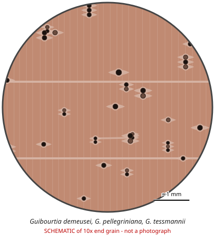

# Guibourtia demeusei, G. pellegriniana, G. tessmannii

**Family:** Fabaceae  
**Trade / common names:** Bubinga, kevazingo (rotary veneer), African rosewood, essingang  
**CITES Appendix:** **II**  
**Annotation:** #15 — All parts and derivatives except (a) leaves, flowers, pollen, fruits, seeds; (b) finished products up to 10 kg wood of listed species per shipment; (c) finished musical instruments, parts and accessories; (d) D. cochinchinensis (covered by #4); (e) Dalbergia spp. from Mexico (covered by #6).  
**Population covered:** All populations of the three species  
**First listed (approx. year in force):** 2017  
**Native range:** Central Africa: Cameroon, Gabon, Equatorial Guinea, Rep. Congo, DR Congo.

> Always confirm the live listing on [Species+](https://speciesplus.net) before seizure decisions.

## Documents needed for trade

**Appendix II:** **Export permit** from the exporting country (or a **re-export certificate** for re-exports). CITES itself requires no import permit, but many countries (e.g. the EU) do.

The annotation above decides which products need a document at all. Details, validity, codes and a document check: [CITES documents guide](../guides/cites-documents.md).

## 10x end-grain view

| Real photographs (reference specimens) | Schematic |
|---|---|
| See [`photos/guibourtia-bubinga/`](../photos/guibourtia-bubinga/) and the image links below |  |

## Key diagnostic summary

Pinkish-red, purple-veined heartwood; medium pores often gum-filled; aliform-confluent parenchyma; NO ripple marks (helps separate from Dalbergia and Pterocarpus). Three listed species cannot be separated from each other or from unlisted Guibourtia (e.g. G. ehie - ovangkol) by hand lens.

## Macroscopic features (hand lens, 10x, freshly cut transverse surface)

| Feature | Observation |
|---|---|
| Wood type | hardwood |
| Porosity | diffuse |
| Pore size | medium |
| Pore frequency | few |
| Pore arrangement | mixed |
| Pore contents / deposits | reddish-brown gum common in pores |
| Axial parenchyma | vasicentric, aliform, confluent, marginal |
| Rays | fine |
| Ripple marks (storied structure, tangential face) | no |
| Resin canals (softwoods) | no |

**Other features:**

- Gum (resin) streaks; occasional axial intercellular canals
- Interlocked/ wavy grain

## Physical characteristics

- **Heartwood:** Pinkish-red to reddish-brown with darker purple or red veins; figured (pommele, waterfall).
- **Sapwood:** Pale straw, distinct.
- **Density:** ~800-900 kg/m3
- **Odour:** Unpleasant when wet/green, none when dry.

## Look-alikes (check these before concluding)

- Guibourtia ehie (ovangkol/shedua - not listed)
- Guibourtia coleosperma (Rhodesian copalwood)
- Dalbergia spp.
- Pterocarpus soyauxii

## Confirming beyond the hand lens

DNA/mass spec for species.

## Species included in this listing

| Taxon | Trade name | Range | Notes |
|---|---|---|---|
| *Guibourtia demeusei* | Bubinga | Cameroon to DR Congo |  |
| *Guibourtia pellegriniana* | Bubinga | Gabon, Equatorial Guinea, Cameroon |  |
| *Guibourtia tessmannii* | Bubinga, kevazingo | Cameroon, Gabon, Equatorial Guinea | Main source of kevazingo veneer and 'bubinga' slabs. |

## View 10x end-grain photographs (CITESwoodID)

Transverse section at about 10x, from verified reference specimens. Images (c) Thünen Institute - linked, not copied.

- [*Guibourtia demeusei, G. pellegriniana, G. tessmannii* - 10x transverse section](https://www.delta-intkey.com/citeswood/en/www/caesguib.htm)

## Other image sources for 10x end-grain photographs

- [Species+ (official CITES listing & annotation)](https://speciesplus.net/species#/taxon_concepts?taxonomy=cites_eu&taxon_concept_query=Guibourtia+demeusei)
- [The Wood Database (has a 10x end-grain photo per species)](https://www.wood-database.com/?s=Guibourtia+demeusei)
- [InsideWood (anatomy database, NC State)](https://insidewood.lib.ncsu.edu/search)
- [CITES Timber ID repository (manuals, keys, photo atlases)](https://cites.org/eng/timber/timber-ID-repository)
- [CITESwoodID (Thünen Institute, macroscopic key with images)](https://www.thuenen.de/en/institutes/wood-research/fields-of-activity/wood-identification-and-wood-anatomy)
- [Pl@ntWood (CIRAD, macroscopic photos of tropical timbers)](https://plantwood.cirad.fr)
- [Wikimedia Commons (free-licence images)](https://commons.wikimedia.org/w/index.php?search=Guibourtia+demeusei+wood&title=Special:MediaSearch&type=image)
- [GBIF (distribution)](https://www.gbif.org/species/search?q=Guibourtia+demeusei)

---
[← All species](README.md) · [Field procedure](../guides/field-procedure.md) · [CITES documents](../guides/cites-documents.md) · [Feature glossary](../guides/feature-glossary.md)
