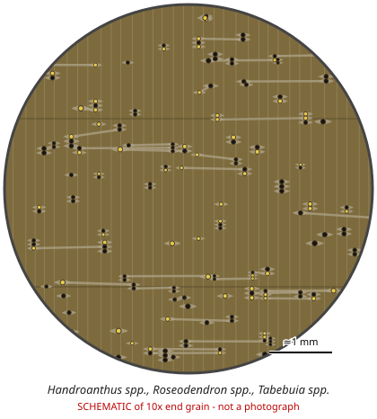

# Handroanthus spp., Roseodendron spp., Tabebuia spp.

**Family:** Bignoniaceae  
**Trade / common names:** Ipê, ipe, lapacho, Brazilian walnut, trumpet tree, guayacán, primavera (Roseodendron)  
**CITES Appendix:** **II**  
**Annotation:** #17 — Logs, sawn wood, veneer sheets, plywood and transformed wood (HS 44.09, e.g. decking, flooring strips).  
**Population covered:** All populations  
**First listed (approx. year in force):** 2024  
**Native range:** Mexico & Caribbean to Argentina (Handroanthus mostly Amazon/Cerrado).

> Always confirm the live listing on [Species+](https://speciesplus.net) before seizure decisions.

## Documents needed for trade

**Appendix II:** **Export permit** from the exporting country (or a **re-export certificate** for re-exports). CITES itself requires no import permit, but many countries (e.g. the EU) do.

The annotation above decides which products need a document at all. Details, validity, codes and a document check: [CITES documents guide](../guides/cites-documents.md).

## End-grain view

Schematic drawing (not a photograph): 

## Key diagnostic summary

Very heavy olive-brown wood, small numerous pores with YELLOW deposits that turn red with alkali, storied structure. Common products: decking (HS 4409) - covered by #17.

## Macroscopic features (hand lens, 10x, freshly cut transverse surface)

| Feature | Observation |
|---|---|
| Wood type | hardwood |
| Porosity | diffuse |
| Pore size | small |
| Pore frequency | many |
| Pore arrangement | mixed |
| Pore contents / deposits | YELLOW powder (lapachol) in pores - Handroanthus |
| Axial parenchyma | aliform, confluent |
| Rays | fine |
| Ripple marks (storied structure, tangential face) | yes |
| Resin canals (softwoods) | no |

**Other features:**

- Pores small, numerous, many filled with yellow lapachol
- Winged-aliform parenchyma, often confluent
- Very regular ripple marks (storied rays + parenchyma)
- Field test: a drop of ammonia/alkali (e.g. 10% NaOH) on the yellow deposits turns RED (lapachol test)

## Physical characteristics

- **Heartwood:** Olive-brown to dark brown with greenish/yellowish cast (Handroanthus); Roseodendron & many Tabebuia much paler.
- **Sapwood:** Yellowish-white.
- **Density:** ~950-1,150 kg/m3 for Handroanthus (sinks); Tabebuia/Roseodendron lighter
- **Odour:** None; fine dust is irritant (lapachol).

## Look-alikes (check these before concluding)

- Dipteryx spp. (cumaru - no yellow powder, vanilla scent)
- Tabebuia lighter species
- Diplotropis/ sucupira
- Manilkara (massaranduba - red, no ripple marks)
- Hymenaea (jatoba)

## Confirming beyond the hand lens

Lapachol spot test (field); DNA/MS for species.

## Listed species covered by this entry (113)

From the Species+ checklist.

| Taxon | Appendix | Annotation | Trade name | Native distribution |
|---|---|---|---|---|
| *Handroanthus albus* | II | #17 |  | Argentina, Brazil, Paraguay |
| *Handroanthus arianeae* | II | #17 |  | Brazil |
| *Handroanthus barbatus* | II | #17 |  | Bolivia (Plurinational State of), Brazil, Colombia, Venezuela (Bolivarian Republic of) |
| *Handroanthus billbergii* | II | #17 |  | Aruba, Bonaire,  Saint Eustatius and Saba, Brazil, Colombia, Cuba, Curaçao, Dominican Republic, Ecuador, Haiti, Peru, Venezuela (Bolivarian Republic of) |
| *Handroanthus botelhensis* | II | #17 |  | Brazil |
| *Handroanthus bureavii* | II | #17 |  | Brazil |
| *Handroanthus capitatus* | II | #17 |  | Belize, Bolivia (Plurinational State of), Brazil, Colombia, French Guiana [FR], Grenada, Guyana, Peru, Suriname, Trinidad and Tobago, Venezuela (Bolivarian Republic of) |
| *Handroanthus catarinensis* | II | #17 |  | Brazil |
| *Handroanthus chrysanthus* | II | #17 |  | Anguilla (United Kingdom), Argentina, Belize, Bolivia (Plurinational State of), Brazil, Colombia, Costa Rica, Ecuador, El Salvador, Grenada, Guatemala, Guyana, Honduras, Jamaica, Mexico, Nicaragua, Panama, Paraguay, Peru, Trinidad and Tobago, Venezuela (Bolivarian Republic of) |
| *Handroanthus chrysotrichus* | II | #17 | Ipê, guayacán | Argentina, Brazil |
| *Handroanthus coralibe* | II | #17 |  | Colombia |
| *Handroanthus coronatus* | II | #17 |  | Brazil |
| *Handroanthus cristatus* | II | #17 |  | Brazil |
| *Handroanthus diamantinensis* | II | #17 |  | Brazil |
| *Handroanthus floccosus* | II | #17 |  | Guyana |
| *Handroanthus grandiflorus* | II | #17 |  | Brazil |
| *Handroanthus guayacan* | II | #17 |  | Belize, Colombia, Costa Rica, Ecuador, El Salvador, Guatemala, Honduras, Mexico, Nicaragua, Panama, Peru, Venezuela (Bolivarian Republic of) |
| *Handroanthus heptaphyllus* | II | #17 |  | Argentina, Bolivia (Plurinational State of), Brazil, Paraguay, Uruguay, Venezuela (Bolivarian Republic of) |
| *Handroanthus impetiginosus* | II | #17 | Ipê roxo, lapacho, pink ipê | Argentina, Belize, Bolivia (Plurinational State of), Brazil, Chile, Colombia, Costa Rica, Ecuador, El Salvador, French Guiana [FR], Guatemala, Guyana, Honduras, Mexico, Nicaragua, Panama, Paraguay, Peru, Suriname, Uruguay, Venezuela (Bolivarian Republic of) |
| *Handroanthus incanus* | II | #17 |  | Bolivia (Plurinational State of), Brazil, Colombia, Ecuador, Peru, Venezuela (Bolivarian Republic of) |
| *Handroanthus lapacho* | II | #17 |  | Argentina, Bolivia (Plurinational State of) |
| *Handroanthus obscurus* | II | #17 |  | Brazil, Colombia, Guyana, Peru, Venezuela (Bolivarian Republic of) |
| *Handroanthus ochraceus* | II | #17 |  | Argentina, Belize, Bolivia (Plurinational State of), Brazil, British Virgin Islands (United Kingdom), Chile, Colombia, Costa Rica, Ecuador, El Salvador, French Guiana [FR], Guatemala, Guyana, Honduras, Jamaica, Mexico, Montserrat (United Kingdom), Nicaragua, Panama, Paraguay, Peru, Suriname, Trinidad and Tobago, Uruguay, Venezuela (Bolivarian Republic of), Virgin Islands of the USA |
| *Handroanthus parviflorus* | II | #17 |  | Brazil |
| *Handroanthus pedicellatus* | II | #17 |  | Brazil, Peru |
| *Handroanthus pulcherrimus* | II | #17 |  | Argentina, Brazil, Paraguay |
| *Handroanthus pumilus* | II | #17 |  | Brazil |
| *Handroanthus riodocensis* | II | #17 |  | Brazil |
| *Handroanthus selachidentatus* | II | #17 |  | Bolivia (Plurinational State of), Brazil |
| *Handroanthus serratifolius* | II | #17 | Ipê amarelo, yellow ipê | Bolivia (Plurinational State of), Brazil, Colombia, Ecuador, French Guiana [FR], Guyana, Jamaica, Peru, Suriname, Trinidad and Tobago, Venezuela (Bolivarian Republic of) |
| *Handroanthus speciosus* | II | #17 |  | Brazil |
| *Handroanthus spongiosus* | II | #17 |  | Brazil |
| *Handroanthus subtilis* | II | #17 |  | French Guiana [FR], Guyana, Venezuela (Bolivarian Republic of) |
| *Handroanthus uleanus* | II | #17 |  | Bolivia (Plurinational State of), Brazil, Colombia, Guyana, Venezuela (Bolivarian Republic of) |
| *Handroanthus umbellatus* | II | #17 |  | Brazil, Venezuela (Bolivarian Republic of) |
| *Roseodendron chryseum* | II | #17 |  | Colombia, Venezuela (Bolivarian Republic of) |
| *Roseodendron donnell-smithii* | II | #17 | Primavera, white mahogany | Colombia, Ecuador, El Salvador, Guatemala, Honduras, Mexico, Puerto Rico, Venezuela (Bolivarian Republic of) |
| *Tabebuia acrophylla* | II | #17 |  | Dominican Republic, Haiti |
| *Tabebuia angustata* | II | #17 |  | Cuba, Jamaica |
| *Tabebuia arimaoensis* | II | #17 |  | Cuba |
| *Tabebuia aurea* | II | #17 |  | Argentina, Bolivia (Plurinational State of), Brazil, Paraguay, Peru, Suriname, Venezuela (Bolivarian Republic of) |
| *Tabebuia bahamensis* | II | #17 |  | Bahamas, Cuba, Turks and Caicos Islands (United Kingdom) |
| *Tabebuia berteroi* | II | #17 |  | Cuba, Dominican Republic, Haiti |
| *Tabebuia bibracteolata* | II | #17 |  | Cuba |
| *Tabebuia brooksiana* | II | #17 |  | Cuba |
| *Tabebuia buchii* | II | #17 |  | Haiti |
| *Tabebuia bullata* | II | #17 |  | Dominican Republic |
| *Tabebuia calcicola* | II | #17 |  | Cuba, Haiti, Jamaica |
| *Tabebuia caleticana* | II | #17 |  | Cuba |
| *Tabebuia cassinoides* | II | #17 |  | Brazil |
| *Tabebuia clementis* | II | #17 |  | Cuba |
| *Tabebuia conferta* | II | #17 |  | Haiti |
| *Tabebuia crispiflora* | II | #17 |  | Cuba, Dominican Republic |
| *Tabebuia del-riscoi* | II | #17 |  | Cuba |
| *Tabebuia densifolia* | II | #17 |  | Cuba, Dominican Republic, Haiti |
| *Tabebuia domingensis* | II | #17 |  | Dominican Republic |
| *Tabebuia dubia* | II | #17 |  | Cuba |
| *Tabebuia elegans* | II | #17 |  | Cuba |
| *Tabebuia elliptica* | II | #17 |  | Bolivia (Plurinational State of), Brazil |
| *Tabebuia elongata* | II | #17 |  | Cuba |
| *Tabebuia fluviatilis* | II | #17 |  | Brazil, French Guiana [FR], Guyana, Suriname, Venezuela (Bolivarian Republic of) |
| *Tabebuia gemmiflora* | II | #17 |  | Brazil |
| *Tabebuia glaucescens* | II | #17 |  | Cuba |
| *Tabebuia gracilipes* | II | #17 |  | Cuba |
| *Tabebuia haemantha* | II | #17 |  | Puerto Rico |
| *Tabebuia heterophylla* | II | #17 |  | Anguilla (United Kingdom), Antigua and Barbuda, Bahamas, Barbados, British Virgin Islands (United Kingdom), Cayman Islands (United Kingdom), Cuba, Dominica, Dominican Republic, Grenada, Guadeloupe, Haiti, Jamaica, Martinique, Montserrat (United Kingdom), Puerto Rico, Saint Kitts and Nevis, Saint Lucia, Saint-Martin, Saint Vincent and the Grenadines, Trinidad and Tobago, United States of America, Virgin Islands of the USA |
| *Tabebuia hypoleuca* | II | #17 |  | Cuba |
| *Tabebuia inaequipes* | II | #17 |  | Cuba |
| *Tabebuia insignis* | II | #17 |  | Bolivia (Plurinational State of), Brazil, Colombia, French Guiana [FR], Guyana, Peru, Suriname, Venezuela (Bolivarian Republic of) |
| *Tabebuia jackiana* | II | #17 |  | Cuba |
| *Tabebuia jaucoensis* | II | #17 |  | Cuba |
| *Tabebuia karsoana* | II | #17 |  | Puerto Rico |
| *Tabebuia lepidophylla* | II | #17 |  | Cuba |
| *Tabebuia lepidota* | II | #17 |  | Anguilla (United Kingdom), Antigua and Barbuda, Bahamas, British Virgin Islands (United Kingdom), Cuba, Guyana, Haiti, Saint-Martin |
| *Tabebuia leptoneura* | II | #17 |  | Cuba |
| *Tabebuia linearis* | II | #17 |  | Cuba |
| *Tabebuia maxonii* | II | #17 |  | Dominican Republic |
| *Tabebuia microphylla* | II | #17 |  | Cuba, Dominican Republic, Haiti |
| *Tabebuia moaensis* | II | #17 |  | Cuba |
| *Tabebuia multinervis* | II | #17 |  | Haiti |
| *Tabebuia myrtifolia* | II | #17 |  | Cuba, Dominican Republic, Haiti |
| *Tabebuia nodosa* | II | #17 |  | Argentina, Bolivia (Plurinational State of), Brazil, Paraguay |
| *Tabebuia obovata* | II | #17 |  | Cuba, Dominican Republic, Haiti |
| *Tabebuia obtusifolia* | II | #17 |  | Brazil |
| *Tabebuia ophiolithica* | II | #17 |  | Dominican Republic |
| *Tabebuia orinocensis* | II | #17 |  | Colombia, Venezuela (Bolivarian Republic of) |
| *Tabebuia ovatifolia* | II | #17 |  | Brazil |
| *Tabebuia pallida* | II | #17 |  | Anguilla (United Kingdom), Barbados, Dominica, Grenada, Guadeloupe, Martinique, Montserrat (United Kingdom), Puerto Rico, Saint Lucia, Saint Vincent and the Grenadines |
| *Tabebuia palustris* | II | #17 |  | Colombia, Costa Rica, Ecuador, Panama |
| *Tabebuia paniculata* | II | #17 |  |  |
| *Tabebuia perelegans* | II | #17 |  | Cuba |
| *Tabebuia pilosa* | II | #17 |  | Brazil, Colombia, Venezuela (Bolivarian Republic of) |
| *Tabebuia pinetorum* | II | #17 |  | Cuba |
| *Tabebuia platyantha* | II | #17 |  | Jamaica |
| *Tabebuia polyantha* | II | #17 |  | Dominican Republic, Haiti |
| *Tabebuia polymorpha* | II | #17 |  | Cuba |
| *Tabebuia pulverulenta* | II | #17 |  | Cuba |
| *Tabebuia reticulata* | II | #17 |  | Brazil |
| *Tabebuia revoluta* | II | #17 |  | Dominican Republic |
| *Tabebuia ricardii* | II | #17 |  | Dominican Republic |
| *Tabebuia rigida* | II | #17 |  | Cuba, Puerto Rico |
| *Tabebuia rosea* | II | #17 |  | Belize, Brazil, Cayman Islands (United Kingdom), Colombia, Costa Rica, Cuba, Dominican Republic, Ecuador, El Salvador, French Guiana [FR], Gambia, Guatemala, Guyana, Honduras, India, Jamaica, Mexico, Myanmar, Nicaragua, Panama, Puerto Rico, Sri Lanka, Trinidad and Tobago, United Republic of Tanzania, Venezuela (Bolivarian Republic of), Zimbabwe |
| *Tabebuia roseoalba* | II | #17 |  | Bolivia (Plurinational State of), Brazil, Paraguay, Peru |
| *Tabebuia sagrae* | II | #17 |  | Cuba |
| *Tabebuia sauvallei* | II | #17 |  | Cuba |
| *Tabebuia schumanniana* | II | #17 |  | Puerto Rico |
| *Tabebuia shaferi* | II | #17 |  | Cuba |
| *Tabebuia simplicifolia* | II | #17 |  | Cuba |
| *Tabebuia stenocalyx* | II | #17 |  | Brazil, French Guiana [FR], Guyana, Trinidad and Tobago, Venezuela (Bolivarian Republic of) |
| *Tabebuia striata* | II | #17 |  | Colombia, Panama |
| *Tabebuia trachycarpa* | II | #17 |  | Cuba |
| *Tabebuia vinosa* | II | #17 |  | Dominican Republic |
| *Tabebuia zanonii* | II | #17 |  | Dominican Republic |

## View 10x end-grain photographs (CITESwoodID)

Transverse section at about 10x, from verified reference specimens. Images (c) Thünen Institute - linked, not copied.

- [*Handroanthus spp.* - 10x transverse section](https://www.delta-intkey.com/citeswood/en/www/bigtabe.htm)
- [*Tabebuia spp.* - 10x transverse section](https://www.delta-intkey.com/citeswood/en/www/bigtaros.htm)
- [*Roseodendron donnell-smithii* - 10x transverse section](https://www.delta-intkey.com/citeswood/en/www/bigroseo.htm)

## Other image sources for 10x end-grain photographs

- [Species+ (official CITES listing & annotation)](https://speciesplus.net/species#/taxon_concepts?taxonomy=cites_eu&taxon_concept_query=Handroanthus)
- [The Wood Database (has a 10x end-grain photo per species)](https://www.wood-database.com/?s=Handroanthus)
- [InsideWood (anatomy database, NC State)](https://insidewood.lib.ncsu.edu/search)
- [CITES Timber ID repository (manuals, keys, photo atlases)](https://cites.org/eng/timber/timber-ID-repository)
- [CITESwoodID (Thünen Institute, macroscopic key with images)](https://www.thuenen.de/en/institutes/wood-research/fields-of-activity/wood-identification-and-wood-anatomy)
- [Pl@ntWood (CIRAD, macroscopic photos of tropical timbers)](https://plantwood.cirad.fr)
- [Wikimedia Commons (free-licence images)](https://commons.wikimedia.org/w/index.php?search=Handroanthus+wood&title=Special:MediaSearch&type=image)
- [GBIF (distribution)](https://www.gbif.org/species/search?q=Handroanthus)

---
[← All species](README.md) · [Field procedure](../guides/field-procedure.md) · [CITES documents](../guides/cites-documents.md) · [Feature glossary](../guides/feature-glossary.md)
