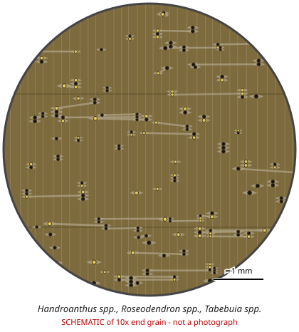

# Handroanthus spp., Roseodendron spp., Tabebuia spp.

**Family:** Bignoniaceae  
**Trade / common names:** Ipê, ipe, lapacho, Brazilian walnut, trumpet tree, guayacán, primavera (Roseodendron)  
**CITES Appendix:** **II**  
**Annotation:** #17 — Logs, sawn wood, veneer sheets, plywood and transformed wood (HS 44.09, e.g. decking, flooring strips).  
**Population covered:** All populations  
**First listed (approx. year in force):** 2024  
**Native range:** Mexico & Caribbean to Argentina (Handroanthus mostly Amazon/Cerrado).

> Always confirm the live listing on [Species+](https://speciesplus.net) before seizure decisions.

## Documents needed for trade

**Appendix II:** **Export permit** from the exporting country (or a **re-export certificate** for re-exports). CITES itself requires no import permit, but many countries (e.g. the EU) do.

The annotation above decides which products need a document at all. Details, validity, codes and a document check: [CITES documents guide](../guides/cites-documents.md).

## 10x end-grain view

| Real photographs (reference specimens) | Schematic |
|---|---|
| See [`photos/ipe-handroanthus-tabebuia-roseodendron/`](../photos/ipe-handroanthus-tabebuia-roseodendron/) and the image links below |  |

## Key diagnostic summary

Very heavy olive-brown wood, small numerous pores with YELLOW deposits that turn red with alkali, storied structure. Common products: decking (HS 4409) - covered by #17.

## Macroscopic features (hand lens, 10x, freshly cut transverse surface)

| Feature | Observation |
|---|---|
| Wood type | hardwood |
| Porosity | diffuse |
| Pore size | small |
| Pore frequency | many |
| Pore arrangement | mixed |
| Pore contents / deposits | YELLOW powder (lapachol) in pores - Handroanthus |
| Axial parenchyma | aliform, confluent |
| Rays | fine |
| Ripple marks (storied structure, tangential face) | yes |
| Resin canals (softwoods) | no |

**Other features:**

- Pores small, numerous, many filled with yellow lapachol
- Winged-aliform parenchyma, often confluent
- Very regular ripple marks (storied rays + parenchyma)
- Field test: a drop of ammonia/alkali (e.g. 10% NaOH) on the yellow deposits turns RED (lapachol test)

## Physical characteristics

- **Heartwood:** Olive-brown to dark brown with greenish/yellowish cast (Handroanthus); Roseodendron & many Tabebuia much paler.
- **Sapwood:** Yellowish-white.
- **Density:** ~950-1,150 kg/m3 for Handroanthus (sinks); Tabebuia/Roseodendron lighter
- **Odour:** None; fine dust is irritant (lapachol).

## Look-alikes (check these before concluding)

- Dipteryx spp. (cumaru - no yellow powder, vanilla scent)
- Tabebuia lighter species
- Diplotropis/ sucupira
- Manilkara (massaranduba - red, no ripple marks)
- Hymenaea (jatoba)

## Confirming beyond the hand lens

Lapachol spot test (field); DNA/MS for species.

## Species included in this listing

| Taxon | Trade name | Range | Notes |
|---|---|---|---|
| *Handroanthus serratifolius* | Ipê amarelo, yellow ipê | Amazon, Cerrado | Major decking species. |
| *Handroanthus impetiginosus* | Ipê roxo, lapacho, pink ipê | Mexico to Argentina | Also bark (pau d'arco) - bark not covered by #17. |
| *Handroanthus chrysotrichus, H. capitatus, H. guayacan, H. heptaphyllus, H. ochraceus and others (c. 30 spp.)* | Ipê, guayacán | Neotropics |  |
| *Tabebuia spp. (c. 70 spp., e.g. T. rosea, T. cassinoides)* | Roble, caixeta | Neotropics | Usually lighter, paler, few or no yellow deposits. |
| *Roseodendron donnell-smithii, R. chryseum* | Primavera, white mahogany | Mexico-Central America, Colombia/Venezuela | Pale yellowish-white light wood. |

## View 10x end-grain photographs (CITESwoodID)

Transverse section at about 10x, from verified reference specimens. Images (c) Thünen Institute - linked, not copied.

- [*Handroanthus spp.* - 10x transverse section](https://www.delta-intkey.com/citeswood/en/www/bigtabe.htm)
- [*Tabebuia spp.* - 10x transverse section](https://www.delta-intkey.com/citeswood/en/www/bigtaros.htm)
- [*Roseodendron donnell-smithii* - 10x transverse section](https://www.delta-intkey.com/citeswood/en/www/bigroseo.htm)

## Other image sources for 10x end-grain photographs

- [Species+ (official CITES listing & annotation)](https://speciesplus.net/species#/taxon_concepts?taxonomy=cites_eu&taxon_concept_query=Handroanthus)
- [The Wood Database (has a 10x end-grain photo per species)](https://www.wood-database.com/?s=Handroanthus)
- [InsideWood (anatomy database, NC State)](https://insidewood.lib.ncsu.edu/search)
- [CITES Timber ID repository (manuals, keys, photo atlases)](https://cites.org/eng/timber/timber-ID-repository)
- [CITESwoodID (Thünen Institute, macroscopic key with images)](https://www.thuenen.de/en/institutes/wood-research/fields-of-activity/wood-identification-and-wood-anatomy)
- [Pl@ntWood (CIRAD, macroscopic photos of tropical timbers)](https://plantwood.cirad.fr)
- [Wikimedia Commons (free-licence images)](https://commons.wikimedia.org/w/index.php?search=Handroanthus+wood&title=Special:MediaSearch&type=image)
- [GBIF (distribution)](https://www.gbif.org/species/search?q=Handroanthus)

---
[← All species](README.md) · [Field procedure](../guides/field-procedure.md) · [CITES documents](../guides/cites-documents.md) · [Feature glossary](../guides/feature-glossary.md)
