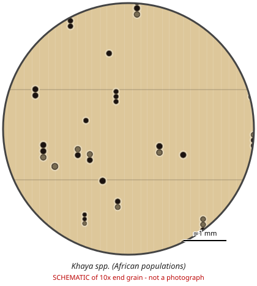

# Khaya spp. (African populations)

**Family:** Meliaceae  
**Trade / common names:** African mahogany, acajou d'Afrique, khaya, lagos mahogany, mbawa  
**CITES Appendix:** **II**  
**Annotation:** #17 — Logs, sawn wood, veneer sheets, plywood and transformed wood (HS 44.09, e.g. decking, flooring strips).  
**Population covered:** Populations of Africa  
**First listed (approx. year in force):** 2023  
**Native range:** Tropical Africa (West, Central, East) and Madagascar.

> Always confirm the live listing on [Species+](https://speciesplus.net) before seizure decisions.

## Documents needed for trade

**Appendix II:** **Export permit** from the exporting country (or a **re-export certificate** for re-exports). CITES itself requires no import permit, but many countries (e.g. the EU) do.

The annotation above decides which products need a document at all. Details, validity, codes and a document check: [CITES documents guide](../guides/cites-documents.md).

## 10x end-grain view

| Real photographs (reference specimens) | Schematic |
|---|---|
| See [`photos/khaya-spp/`](../photos/khaya-spp/) and the image links below |  |

## Key diagnostic summary

Mahogany-type wood without ripple marks and usually with indistinct ring boundaries, interlocked grain. Hand lens: Khaya-group (vs Swietenia ripple marks + marginal lines).

## Macroscopic features (hand lens, 10x, freshly cut transverse surface)

| Feature | Observation |
|---|---|
| Wood type | hardwood |
| Porosity | diffuse |
| Pore size | medium |
| Pore frequency | few |
| Pore arrangement | mixed |
| Pore contents / deposits | dark red-brown gum in some pores |
| Axial parenchyma | vasicentric, scanty |
| Rays | fine |
| Ripple marks (storied structure, tangential face) | no |
| Resin canals (softwoods) | no |

**Other features:**

- Growth ring boundaries often indistinct (no or faint marginal parenchyma)
- Interlocked grain giving ribbon stripe on quartersawn faces
- Woolly surface when sawn

## Physical characteristics

- **Heartwood:** Pale pinkish-brown to reddish-brown; ribbon/stripe figure from interlocked grain.
- **Sapwood:** Creamy to yellowish, not always sharply distinct.
- **Density:** ~500-800 kg/m3
- **Odour:** None.

## Look-alikes (check these before concluding)

- Swietenia spp.
- Entandrophragma spp. (sapele, sipo, tiama, kosipo - NOT listed)
- Lovoa trichilioides
- Carapa procera

## Confirming beyond the hand lens

Microscopy/DNA for species; mass spec.

## Species included in this listing

| Taxon | Trade name | Range | Notes |
|---|---|---|---|
| *Khaya ivorensis* | Lagos / Ivory Coast mahogany | West & Central Africa |  |
| *Khaya grandifoliola* | Large-leaf African mahogany | West to East Africa | Denser. |
| *Khaya anthotheca* | White mahogany, mangona | West to East Africa |  |
| *Khaya senegalensis* | Dry-zone mahogany, caïlcédrat | Sahel / Sudanian savanna | Densest (~800). |
| *Khaya madagascariensis* | Madagascar mahogany | Madagascar |  |
| *Khaya nyasica* | Red mahogany (East Africa) | East & southern Africa | Sometimes merged with K. anthotheca. |
| *Khaya agboensis* | African mahogany | West Africa |  |
| *Khaya euryphylla* | African mahogany | Central Africa |  |

## View 10x end-grain photographs (CITESwoodID)

Transverse section at about 10x, from verified reference specimens. Images (c) Thünen Institute - linked, not copied.

- [*Khaya spp.* - 10x transverse section](https://www.delta-intkey.com/citeswood/en/www/melkhay.htm)

## Other image sources for 10x end-grain photographs

- [Species+ (official CITES listing & annotation)](https://speciesplus.net/species#/taxon_concepts?taxonomy=cites_eu&taxon_concept_query=Khaya)
- [The Wood Database (has a 10x end-grain photo per species)](https://www.wood-database.com/?s=Khaya)
- [InsideWood (anatomy database, NC State)](https://insidewood.lib.ncsu.edu/search)
- [CITES Timber ID repository (manuals, keys, photo atlases)](https://cites.org/eng/timber/timber-ID-repository)
- [CITESwoodID (Thünen Institute, macroscopic key with images)](https://www.thuenen.de/en/institutes/wood-research/fields-of-activity/wood-identification-and-wood-anatomy)
- [Pl@ntWood (CIRAD, macroscopic photos of tropical timbers)](https://plantwood.cirad.fr)
- [Wikimedia Commons (free-licence images)](https://commons.wikimedia.org/w/index.php?search=Khaya+wood&title=Special:MediaSearch&type=image)
- [GBIF (distribution)](https://www.gbif.org/species/search?q=Khaya)

---
[← All species](README.md) · [Field procedure](../guides/field-procedure.md) · [CITES documents](../guides/cites-documents.md) · [Feature glossary](../guides/feature-glossary.md)
