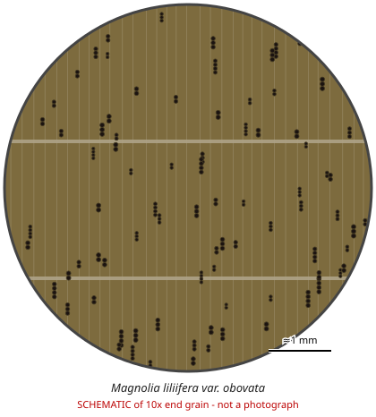

# Magnolia liliifera var. obovata

**Family:** Magnoliaceae  
**Trade / common names:** Champ (Nepal)  
**CITES Appendix:** **III**  
**Annotation:** #1 — All parts and derivatives, except seeds/spores/pollen, seedlings or tissue cultures in vitro, cut flowers of artificially propagated plants (timber, finished goods covered).  
**Population covered:** Population of Nepal (listed by Nepal; App. III #1 per BfN list, Aug 2026)  
**First listed (approx. year in force):** 1975  
**Native range:** Nepal / Eastern Himalaya.

> Always confirm the live listing on [Species+](https://speciesplus.net) before seizure decisions.

## 10x end-grain view

| Real photographs (reference specimens) | Schematic |
|---|---|
| See [`photos/magnolia-liliifera-obovata/`](../photos/magnolia-liliifera-obovata/) and the image links below |  |

## Key diagnostic summary

Fine, even Magnoliaceae wood with marginal parenchyma lines and greenish heartwood. Only Nepal origin listed.

## Macroscopic features (hand lens, 10x, freshly cut transverse surface)

| Feature | Observation |
|---|---|
| Wood type | hardwood |
| Porosity | diffuse |
| Pore size | small |
| Pore frequency | many |
| Pore arrangement | multiples |
| Pore contents / deposits | none noted |
| Axial parenchyma | marginal |
| Rays | fine |
| Ripple marks (storied structure, tangential face) | no |
| Resin canals (softwoods) | no |

**Other features:**

- Distinct pale marginal parenchyma lines (Magnoliaceae)
- Greenish heartwood

## Physical characteristics

- **Heartwood:** Olive-greenish to yellowish-brown.
- **Sapwood:** Pale.
- **Density:** ~500-600 kg/m3
- **Odour:** None.

## Look-alikes (check these before concluding)

- Michelia/ Magnolia spp.
- Liriodendron

## Confirming beyond the hand lens

DNA/origin.

## Other image sources for 10x end-grain photographs

- [Species+ (official CITES listing & annotation)](https://speciesplus.net/species#/taxon_concepts?taxonomy=cites_eu&taxon_concept_query=Magnolia+liliifera+var.+obovata)
- [The Wood Database (has a 10x end-grain photo per species)](https://www.wood-database.com/?s=Magnolia+liliifera+var.+obovata)
- [InsideWood (anatomy database, NC State)](https://insidewood.lib.ncsu.edu/search)
- [CITES Timber ID repository (manuals, keys, photo atlases)](https://cites.org/eng/timber/timber-ID-repository)
- [CITESwoodID (Thünen Institute, macroscopic key with images)](https://www.thuenen.de/en/institutes/wood-research/fields-of-activity/wood-identification-and-wood-anatomy)
- [Pl@ntWood (CIRAD, macroscopic photos of tropical timbers)](https://plantwood.cirad.fr)
- [Wikimedia Commons (free-licence images)](https://commons.wikimedia.org/w/index.php?search=Magnolia+liliifera+var.+obovata+wood&title=Special:MediaSearch&type=image)
- [GBIF (distribution)](https://www.gbif.org/species/search?q=Magnolia+liliifera+var.+obovata)

---
[← All species](README.md) · [Field procedure](../guides/field-procedure.md) · [Feature glossary](../guides/feature-glossary.md)
