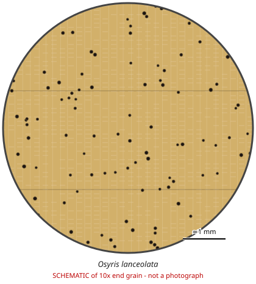

# Osyris lanceolata

**Family:** Santalaceae  
**Trade / common names:** East African sandalwood, African sandalwood  
**CITES Appendix:** **II**  
**Annotation:** #2 — All parts and derivatives except seeds and pollen, and finished products packaged and ready for retail trade.  
**Population covered:** Burundi, Ethiopia, Kenya, Rwanda, Uganda, Tanzania  
**First listed (approx. year in force):** 2013  
**Native range:** East Africa (listed populations); species ranges into southern Africa, Mediterranean, Asia.

> Always confirm the live listing on [Species+](https://speciesplus.net) before seizure decisions.

## 10x end-grain view

| Real photographs (reference specimens) | Schematic |
|---|---|
| See [`photos/osyris-lanceolata/`](../photos/osyris-lanceolata/) and the image links below |  |

## Key diagnostic summary

Small fragrant yellowish logs/roots from East Africa with very fine texture. Smell + origin are key.

## Macroscopic features (hand lens, 10x, freshly cut transverse surface)

| Feature | Observation |
|---|---|
| Wood type | hardwood |
| Porosity | diffuse |
| Pore size | small |
| Pore frequency | many |
| Pore arrangement | solitary |
| Pore contents / deposits | none noted |
| Axial parenchyma | diffuse |
| Rays | fine |
| Ripple marks (storied structure, tangential face) | no |
| Resin canals (softwoods) | no |

**Other features:**

- Very fine, uniform texture; pores barely visible at 10x
- Often smuggled as roots and stem pieces for oil distillation

## Physical characteristics

- **Heartwood:** Yellowish to light brown, oily.
- **Sapwood:** Pale.
- **Density:** ~900 kg/m3
- **Odour:** Sandalwood-like fragrance, weaker than Santalum album.

## Look-alikes (check these before concluding)

- Santalum album (Indian sandalwood - not CITES)
- Santalum spicatum

## Confirming beyond the hand lens

Oil chemistry, DNA.

## View 10x end-grain photographs (CITESwoodID)

Transverse section at about 10x, from verified reference specimens. Images (c) Thünen Institute - linked, not copied.

- [*Osyris lanceolata (as O. quadripartita)* - 10x transverse section](https://www.delta-intkey.com/citeswood/en/www/sanosyqu.htm)

## Other image sources for 10x end-grain photographs

- [Species+ (official CITES listing & annotation)](https://speciesplus.net/species#/taxon_concepts?taxonomy=cites_eu&taxon_concept_query=Osyris+lanceolata)
- [The Wood Database (has a 10x end-grain photo per species)](https://www.wood-database.com/?s=Osyris+lanceolata)
- [InsideWood (anatomy database, NC State)](https://insidewood.lib.ncsu.edu/search)
- [CITES Timber ID repository (manuals, keys, photo atlases)](https://cites.org/eng/timber/timber-ID-repository)
- [CITESwoodID (Thünen Institute, macroscopic key with images)](https://www.thuenen.de/en/institutes/wood-research/fields-of-activity/wood-identification-and-wood-anatomy)
- [Pl@ntWood (CIRAD, macroscopic photos of tropical timbers)](https://plantwood.cirad.fr)
- [Wikimedia Commons (free-licence images)](https://commons.wikimedia.org/w/index.php?search=Osyris+lanceolata+wood&title=Special:MediaSearch&type=image)
- [GBIF (distribution)](https://www.gbif.org/species/search?q=Osyris+lanceolata)

---
[← All species](README.md) · [Field procedure](../guides/field-procedure.md) · [Feature glossary](../guides/feature-glossary.md)
