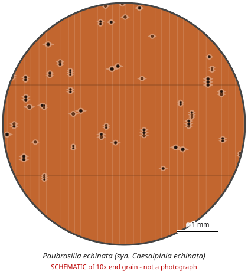

# Paubrasilia echinata (syn. Caesalpinia echinata)

**Family:** Fabaceae  
**Trade / common names:** Pernambuco, pau-brasil, Brazilwood, bois de Pernambouc  
**CITES Appendix:** **II**  
**Annotation:** #10 (amended at CoP20, 2025) — Amended at CoP20 (2025): in principle ALL parts and derivatives (incl. bows, bow blanks, logs, sawn wood), except finished musical instruments, parts and accessories moved NON-commercially (performance, personal use, exhibition, repair etc.) without change of ownership. Check Species+ for the exact text.  
**Population covered:** All populations  
**First listed (approx. year in force):** 2007  
**Native range:** Atlantic coastal forest of eastern Brazil.

> Always confirm the live listing on [Species+](https://speciesplus.net) before seizure decisions.

## 10x end-grain view

| Real photographs (reference specimens) | Schematic |
|---|---|
| See [`photos/paubrasilia-echinata/`](../photos/paubrasilia-echinata/) and the image links below |  |

## Key diagnostic summary

Very heavy, fine-textured orange-red wood (bow blanks!). CoP20 adopted new decisions on traceability of bows, blanks and stockpiles - scrutinise bow-maker consignments.

## Macroscopic features (hand lens, 10x, freshly cut transverse surface)

| Feature | Observation |
|---|---|
| Wood type | hardwood |
| Porosity | diffuse |
| Pore size | small |
| Pore frequency | moderate |
| Pore arrangement | mixed |
| Pore contents / deposits | red-brown deposits |
| Axial parenchyma | vasicentric, aliform |
| Rays | fine |
| Ripple marks (storied structure, tangential face) | variable |
| Resin canals (softwoods) | no |

**Other features:**

- Very fine, even texture
- Red dye (brazilin) - wood shavings colour water/alcohol red-orange
- Main product: violin/cello BOW STICKS and bow blanks

## Physical characteristics

- **Heartwood:** Bright orange to orange-red when fresh, darkening to deep red-brown; lustrous.
- **Sapwood:** Pale yellowish, distinct.
- **Density:** ~1,100-1,300 kg/m3 (very heavy)
- **Odour:** None.

## Look-alikes (check these before concluding)

- Caesalpinia/Biancaea sappan (sappanwood)
- Haematoxylum brasiletto
- Manilkara bidentata (massaranduba - used for cheap bows)
- Handroanthus (ipê - 'pau ferro' bows)
- Pterocarpus spp.

## Confirming beyond the hand lens

DART-TOF MS, NIR and DNA used for bow sticks; fluorescence of extracts.

## View 10x end-grain photographs (CITESwoodID)

Transverse section at about 10x, from verified reference specimens. Images (c) Thünen Institute - linked, not copied.

- [*Paubrasilia echinata* - 10x transverse section](https://www.delta-intkey.com/citeswood/en/www/caecaech.htm)

## Other image sources for 10x end-grain photographs

- [Species+ (official CITES listing & annotation)](https://speciesplus.net/species#/taxon_concepts?taxonomy=cites_eu&taxon_concept_query=Paubrasilia+echinata)
- [The Wood Database (has a 10x end-grain photo per species)](https://www.wood-database.com/?s=Paubrasilia+echinata)
- [InsideWood (anatomy database, NC State)](https://insidewood.lib.ncsu.edu/search)
- [CITES Timber ID repository (manuals, keys, photo atlases)](https://cites.org/eng/timber/timber-ID-repository)
- [CITESwoodID (Thünen Institute, macroscopic key with images)](https://www.thuenen.de/en/institutes/wood-research/fields-of-activity/wood-identification-and-wood-anatomy)
- [Pl@ntWood (CIRAD, macroscopic photos of tropical timbers)](https://plantwood.cirad.fr)
- [Wikimedia Commons (free-licence images)](https://commons.wikimedia.org/w/index.php?search=Paubrasilia+echinata+wood&title=Special:MediaSearch&type=image)
- [GBIF (distribution)](https://www.gbif.org/species/search?q=Paubrasilia+echinata)

---
[← All species](README.md) · [Field procedure](../guides/field-procedure.md) · [Feature glossary](../guides/feature-glossary.md)
