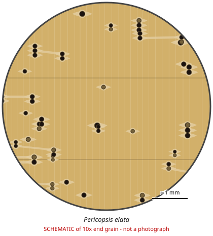

# Pericopsis elata

**Family:** Fabaceae  
**Trade / common names:** Afrormosia, assamela, kokrodua, African teak  
**CITES Appendix:** **II**  
**Annotation:** #17 — Logs, sawn wood, veneer sheets, plywood and transformed wood (HS 44.09, e.g. decking, flooring strips).  
**Population covered:** All populations  
**First listed (approx. year in force):** 1992  
**Native range:** Côte d'Ivoire, Ghana, Cameroon, Rep. Congo, DR Congo, CAR.

> Always confirm the live listing on [Species+](https://speciesplus.net) before seizure decisions.

## 10x end-grain view

| Real photographs (reference specimens) | Schematic |
|---|---|
| See [`photos/pericopsis-elata/`](../photos/pericopsis-elata/) and the image links below |  |

## Key diagnostic summary

Teak-coloured wood that is diffuse porous with storied structure and aliform-confluent parenchyma (teak is semi-ring porous, oily, without ripple marks).

## Macroscopic features (hand lens, 10x, freshly cut transverse surface)

| Feature | Observation |
|---|---|
| Wood type | hardwood |
| Porosity | diffuse |
| Pore size | medium |
| Pore frequency | moderate |
| Pore arrangement | mixed |
| Pore contents / deposits | occasional dark deposits |
| Axial parenchyma | aliform, confluent, vasicentric |
| Rays | fine |
| Ripple marks (storied structure, tangential face) | yes |
| Resin canals (softwoods) | no |

**Other features:**

- Fine ripple marks
- Interlocked grain
- Unlike teak: not ring-porous, not greasy, no leathery smell

## Physical characteristics

- **Heartwood:** Yellowish-brown when fresh, darkening to golden/olive-brown (teak-like), lustrous.
- **Sapwood:** Pale, distinct.
- **Density:** ~650-750 kg/m3
- **Odour:** None.

## Look-alikes (check these before concluding)

- Tectona grandis (teak)
- Milicia excelsa (iroko)
- Afzelia spp.
- Nauclea diderrichii (opepe)

## Confirming beyond the hand lens

DNA/MS.

## Image sources for 10x end-grain photographs

- [Species+ (official CITES listing & annotation)](https://speciesplus.net/species#/taxon_concepts?taxonomy=cites_eu&taxon_concept_query=Pericopsis+elata)
- [The Wood Database (has a 10x end-grain photo per species)](https://www.wood-database.com/?s=Pericopsis+elata)
- [InsideWood (anatomy database, NC State)](https://insidewood.lib.ncsu.edu/search)
- [CITES Timber ID repository (manuals, keys, photo atlases)](https://cites.org/eng/timber/timber-ID-repository)
- [CITESwoodID (Thünen Institute, macroscopic key with images)](https://www.thuenen.de/en/institutes/wood-research/fields-of-activity/wood-identification-and-wood-anatomy)
- [Pl@ntWood (CIRAD, macroscopic photos of tropical timbers)](https://plantwood.cirad.fr)
- [Wikimedia Commons (free-licence images)](https://commons.wikimedia.org/w/index.php?search=Pericopsis+elata+wood&title=Special:MediaSearch&type=image)
- [GBIF (distribution)](https://www.gbif.org/species/search?q=Pericopsis+elata)

---
[← All species](README.md) · [Field procedure](../guides/field-procedure.md) · [Feature glossary](../guides/feature-glossary.md)
