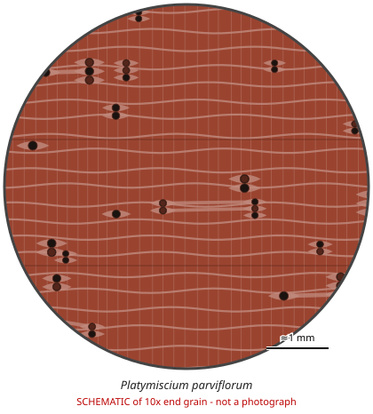

# Platymiscium parviflorum

**Family:** Fabaceae  
**Trade / common names:** Trebol, macacaúba (genus), Panama redwood (genus)  
**CITES Appendix:** **II**  
**Annotation:** #4 — All parts and derivatives except seeds, spores and pollen, seedling/tissue cultures, cut flowers of artificially propagated plants and a few plant-specific items (Vanilla, Opuntia etc.). For timber: logs, sawn wood, veneer, plywood, chips AND finished products ARE covered.  
**Population covered:** All populations  
**First listed (approx. year in force):** 2017  
**Native range:** Central America (Mexico to Panama).

> Always confirm the live listing on [Species+](https://speciesplus.net) before seizure decisions.

## 10x end-grain view

| Real photographs (reference specimens) | Schematic |
|---|---|
| See [`photos/platymiscium-parviflorum/`](../photos/platymiscium-parviflorum/) and the image links below |  |

## Key diagnostic summary

Red striped rosewood-like wood with storied structure. Only P. parviflorum listed - other Platymiscium (macacaúba, P. pinnatum) are not.

## Macroscopic features (hand lens, 10x, freshly cut transverse surface)

| Feature | Observation |
|---|---|
| Wood type | hardwood |
| Porosity | diffuse |
| Pore size | medium |
| Pore frequency | few |
| Pore arrangement | mixed |
| Pore contents / deposits | reddish gum |
| Axial parenchyma | aliform, confluent, banded |
| Rays | fine |
| Ripple marks (storied structure, tangential face) | yes |
| Resin canals (softwoods) | no |

**Other features:**

- Distinct ripple marks
- Rosewood-like appearance

## Physical characteristics

- **Heartwood:** Red to reddish-brown/ purplish with darker stripes.
- **Sapwood:** Pale.
- **Density:** ~850-950 kg/m3
- **Odour:** None.

## Look-alikes (check these before concluding)

- Dalbergia spp.
- Other Platymiscium spp. (not listed)
- Pterocarpus spp.

## Confirming beyond the hand lens

DNA/MS.

## Image sources for 10x end-grain photographs

- [Species+ (official CITES listing & annotation)](https://speciesplus.net/species#/taxon_concepts?taxonomy=cites_eu&taxon_concept_query=Platymiscium+parviflorum)
- [The Wood Database (has a 10x end-grain photo per species)](https://www.wood-database.com/?s=Platymiscium+parviflorum)
- [InsideWood (anatomy database, NC State)](https://insidewood.lib.ncsu.edu/search)
- [CITES Timber ID repository (manuals, keys, photo atlases)](https://cites.org/eng/timber/timber-ID-repository)
- [CITESwoodID (Thünen Institute, macroscopic key with images)](https://www.thuenen.de/en/institutes/wood-research/fields-of-activity/wood-identification-and-wood-anatomy)
- [Pl@ntWood (CIRAD, macroscopic photos of tropical timbers)](https://plantwood.cirad.fr)
- [Wikimedia Commons (free-licence images)](https://commons.wikimedia.org/w/index.php?search=Platymiscium+parviflorum+wood&title=Special:MediaSearch&type=image)
- [GBIF (distribution)](https://www.gbif.org/species/search?q=Platymiscium+parviflorum)

---
[← All species](README.md) · [Field procedure](../guides/field-procedure.md) · [Feature glossary](../guides/feature-glossary.md)
