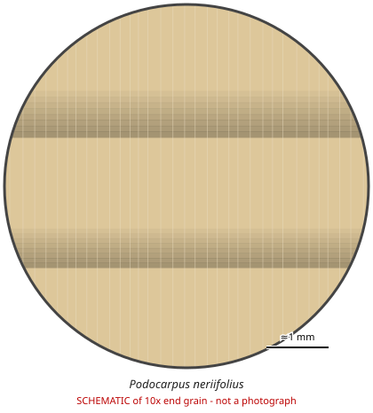

# Podocarpus neriifolius

**Family:** Podocarpaceae  
**Trade / common names:** Oleander podocarp, thitmin  
**CITES Appendix:** **III**  
**Annotation:** #1 — All parts and derivatives, except seeds/spores/pollen, seedlings or tissue cultures in vitro, cut flowers of artificially propagated plants (timber, finished goods covered).  
**Population covered:** Population of Nepal (listed by Nepal)  
**First listed (approx. year in force):** 1975  
**Native range:** Nepal and India to SE Asia, New Guinea, Fiji.

> Always confirm the live listing on [Species+](https://speciesplus.net) before seizure decisions.

## 10x end-grain view

| Real photographs (reference specimens) | Schematic |
|---|---|
| See [`photos/podocarpus-neriifolius/`](../photos/podocarpus-neriifolius/) and the image links below |  |

## Key diagnostic summary

Featureless Podocarpus wood; only Nepal-origin material is listed.

## Macroscopic features (hand lens, 10x, freshly cut transverse surface)

| Feature | Observation |
|---|---|
| Wood type | softwood |
| Porosity | none |
| Pore size | — |
| Pore frequency | — |
| Pore arrangement | — |
| Pore contents / deposits | none noted |
| Axial parenchyma | not visible / none |
| Rays | fine |
| Ripple marks (storied structure, tangential face) | no |
| Resin canals (softwoods) | no |

**Other features:**

- Indistinct growth rings, very uniform texture

## Physical characteristics

- **Heartwood:** Uniform pale yellowish-brown.
- **Sapwood:** Not distinct.
- **Density:** ~500 kg/m3
- **Odour:** None.

## Look-alikes (check these before concluding)

- Other Podocarpus spp.
- Nageia spp.

## Confirming beyond the hand lens

DNA/origin.

## View 10x end-grain photographs (CITESwoodID)

Transverse section at about 10x, from verified reference specimens. Images (c) Thünen Institute - linked, not copied.

- [*Podocarpus spp.* - 10x transverse section](https://www.delta-intkey.com/citeswood/en/www/podpospp.htm)

## Other image sources for 10x end-grain photographs

- [Species+ (official CITES listing & annotation)](https://speciesplus.net/species#/taxon_concepts?taxonomy=cites_eu&taxon_concept_query=Podocarpus+neriifolius)
- [The Wood Database (has a 10x end-grain photo per species)](https://www.wood-database.com/?s=Podocarpus+neriifolius)
- [InsideWood (anatomy database, NC State)](https://insidewood.lib.ncsu.edu/search)
- [CITES Timber ID repository (manuals, keys, photo atlases)](https://cites.org/eng/timber/timber-ID-repository)
- [CITESwoodID (Thünen Institute, macroscopic key with images)](https://www.thuenen.de/en/institutes/wood-research/fields-of-activity/wood-identification-and-wood-anatomy)
- [Pl@ntWood (CIRAD, macroscopic photos of tropical timbers)](https://plantwood.cirad.fr)
- [Wikimedia Commons (free-licence images)](https://commons.wikimedia.org/w/index.php?search=Podocarpus+neriifolius+wood&title=Special:MediaSearch&type=image)
- [GBIF (distribution)](https://www.gbif.org/species/search?q=Podocarpus+neriifolius)

---
[← All species](README.md) · [Field procedure](../guides/field-procedure.md) · [Feature glossary](../guides/feature-glossary.md)
