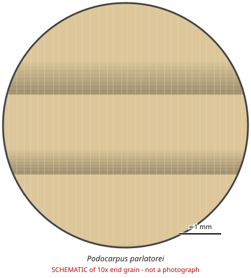

# Podocarpus parlatorei

**Family:** Podocarpaceae  
**Trade / common names:** Parlatore's podocarp, pino del cerro  
**CITES Appendix:** **II**  
**Annotation:** none — No annotation - ALL parts and derivatives are covered (including finished products).  
**Population covered:** All populations. Transferred from Appendix I to Appendix II at CoP20 (in force 5 March 2026) with a ZERO export quota for wild-taken specimens traded for commercial purposes  
**First listed (approx. year in force):** 1975  
**Native range:** Andean Yungas of Argentina and Bolivia.

> Always confirm the live listing on [Species+](https://speciesplus.net) before seizure decisions.

## Documents needed for trade

**Appendix II:** **Export permit** from the exporting country (or a **re-export certificate** for re-exports). CITES itself requires no import permit, but many countries (e.g. the EU) do.

The annotation above decides which products need a document at all. Details, validity, codes and a document check: [CITES documents guide](../guides/cites-documents.md).

## End-grain view

Schematic drawing (not a photograph): 

## Key diagnostic summary

Featureless, uniform yellowish softwood without resin canals and with indistinct rings (typical Podocarpus).

## Macroscopic features (hand lens, 10x, freshly cut transverse surface)

| Feature | Observation |
|---|---|
| Wood type | softwood |
| Porosity | none |
| Pore size | — |
| Pore frequency | — |
| Pore arrangement | — |
| Pore contents / deposits | none noted |
| Axial parenchyma | not visible / none |
| Rays | fine |
| Ripple marks (storied structure, tangential face) | no |
| Resin canals (softwoods) | no |

**Other features:**

- Growth rings indistinct
- Very uniform texture, no resin canals

## Physical characteristics

- **Heartwood:** Uniform pale yellowish-brown.
- **Sapwood:** Not distinct.
- **Density:** ~500 kg/m3
- **Odour:** None.

## Look-alikes (check these before concluding)

- Other Podocarpus spp.
- Prumnopitys spp.

## Confirming beyond the hand lens

DNA for species.

## Listed species covered by this entry (1)

From the Species+ checklist.

| Taxon | Appendix | Annotation | Trade name | Native distribution |
|---|---|---|---|---|
| *Podocarpus parlatorei* | II | none |  | Argentina, Bolivia (Plurinational State of), Peru |

## View 10x end-grain photographs (CITESwoodID)

Transverse section at about 10x, from verified reference specimens. Images (c) Thünen Institute - linked, not copied.

- [*Podocarpus spp.* - 10x transverse section](https://www.delta-intkey.com/citeswood/en/www/podpospp.htm)

## Other image sources for 10x end-grain photographs

- [Species+ (official CITES listing & annotation)](https://speciesplus.net/species#/taxon_concepts?taxonomy=cites_eu&taxon_concept_query=Podocarpus+parlatorei)
- [The Wood Database (has a 10x end-grain photo per species)](https://www.wood-database.com/?s=Podocarpus+parlatorei)
- [InsideWood (anatomy database, NC State)](https://insidewood.lib.ncsu.edu/search)
- [CITES Timber ID repository (manuals, keys, photo atlases)](https://cites.org/eng/timber/timber-ID-repository)
- [CITESwoodID (Thünen Institute, macroscopic key with images)](https://www.thuenen.de/en/institutes/wood-research/fields-of-activity/wood-identification-and-wood-anatomy)
- [Pl@ntWood (CIRAD, macroscopic photos of tropical timbers)](https://plantwood.cirad.fr)
- [Wikimedia Commons (free-licence images)](https://commons.wikimedia.org/w/index.php?search=Podocarpus+parlatorei+wood&title=Special:MediaSearch&type=image)
- [GBIF (distribution)](https://www.gbif.org/species/search?q=Podocarpus+parlatorei)

---
[← All species](README.md) · [Field procedure](../guides/field-procedure.md) · [CITES documents](../guides/cites-documents.md) · [Feature glossary](../guides/feature-glossary.md)
