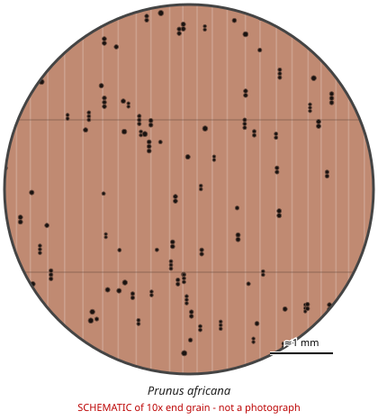

# Prunus africana

**Family:** Rosaceae  
**Trade / common names:** African cherry, pygeum, red stinkwood  
**CITES Appendix:** **II**  
**Annotation:** #4 — All parts and derivatives except seeds, spores and pollen, in-vitro seedling/tissue cultures, cut flowers of artificially propagated plants and a few plant-specific items (certain Vanilla, Cactaceae, Opuntia/Selenicereus stems, finished Euphorbia antisyphilitica products). For timber: logs, sawn wood, veneer, plywood, chips AND finished products ARE covered.  
**Population covered:** All populations  
**First listed (approx. year in force):** 1995  
**Native range:** Afromontane forests of Africa and Madagascar.

> Always confirm the live listing on [Species+](https://speciesplus.net) before seizure decisions.

## Documents needed for trade

**Appendix II:** **Export permit** from the exporting country (or a **re-export certificate** for re-exports). CITES itself requires no import permit, but many countries (e.g. the EU) do.

The annotation above decides which products need a document at all. Details, validity, codes and a document check: [CITES documents guide](../guides/cites-documents.md).

## 10x end-grain view

| Real photographs (reference specimens) | Schematic |
|---|---|
| See [`photos/prunus-africana/`](../photos/prunus-africana/) and the image links below |  |

## Key diagnostic summary

Usually encountered as dried bark chips/powder (prostate medicine) - bitter almond odour. Wood is a fine cherry-like hardwood.

## Macroscopic features (hand lens, 10x, freshly cut transverse surface)

| Feature | Observation |
|---|---|
| Wood type | hardwood |
| Porosity | diffuse |
| Pore size | small |
| Pore frequency | many |
| Pore arrangement | mixed |
| Pore contents / deposits | none noted |
| Axial parenchyma | scanty |
| Rays | medium |
| Ripple marks (storied structure, tangential face) | no |
| Resin canals (softwoods) | no |

**Other features:**

- Mainly traded as BARK (medicinal - pygeum extract), not timber

## Physical characteristics

- **Heartwood:** Pinkish-brown to reddish-brown.
- **Sapwood:** Pale.
- **Density:** ~700-800 kg/m3
- **Odour:** Bitter-almond smell when fresh (hence 'stinkwood').

## Look-alikes (check these before concluding)

- Other Prunus spp.

## Confirming beyond the hand lens

Chemistry of bark; DNA.

## Other image sources for 10x end-grain photographs

- [Species+ (official CITES listing & annotation)](https://speciesplus.net/species#/taxon_concepts?taxonomy=cites_eu&taxon_concept_query=Prunus+africana)
- [The Wood Database (has a 10x end-grain photo per species)](https://www.wood-database.com/?s=Prunus+africana)
- [InsideWood (anatomy database, NC State)](https://insidewood.lib.ncsu.edu/search)
- [CITES Timber ID repository (manuals, keys, photo atlases)](https://cites.org/eng/timber/timber-ID-repository)
- [CITESwoodID (Thünen Institute, macroscopic key with images)](https://www.thuenen.de/en/institutes/wood-research/fields-of-activity/wood-identification-and-wood-anatomy)
- [Pl@ntWood (CIRAD, macroscopic photos of tropical timbers)](https://plantwood.cirad.fr)
- [Wikimedia Commons (free-licence images)](https://commons.wikimedia.org/w/index.php?search=Prunus+africana+wood&title=Special:MediaSearch&type=image)
- [GBIF (distribution)](https://www.gbif.org/species/search?q=Prunus+africana)

---
[← All species](README.md) · [Field procedure](../guides/field-procedure.md) · [CITES documents](../guides/cites-documents.md) · [Feature glossary](../guides/feature-glossary.md)
