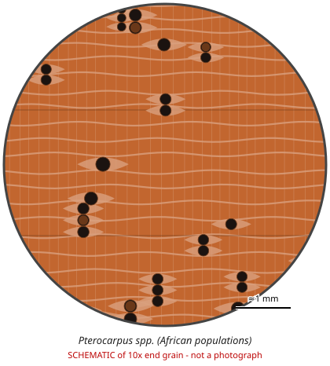

# Pterocarpus spp. (African populations)

**Family:** Fabaceae  
**Trade / common names:** African padauk, muninga, mukwa, kiaat, barwood  
**CITES Appendix:** **II**  
**Annotation:** #17 — Logs, sawn wood, veneer sheets, plywood and transformed wood (HS 44.09, e.g. decking, flooring strips).  
**Population covered:** Populations of Africa only  
**First listed (approx. year in force):** 2023  
**Native range:** Sub-Saharan Africa.

> Always confirm the live listing on [Species+](https://speciesplus.net) before seizure decisions.

## Documents needed for trade

**Appendix II:** **Export permit** from the exporting country (or a **re-export certificate** for re-exports). CITES itself requires no import permit, but many countries (e.g. the EU) do.

The annotation above decides which products need a document at all. Details, validity, codes and a document check: [CITES documents guide](../guides/cites-documents.md).

## End-grain view

Schematic drawing (not a photograph): 

## Key diagnostic summary

Same genus pattern as above. Proposal at CoP20 to remove Central African P. soyauxii was REJECTED - still listed.

## Macroscopic features (hand lens, 10x, freshly cut transverse surface)

| Feature | Observation |
|---|---|
| Wood type | hardwood |
| Porosity | diffuse |
| Pore size | large |
| Pore frequency | few |
| Pore arrangement | mixed |
| Pore contents / deposits | red-brown gum |
| Axial parenchyma | banded, aliform, confluent |
| Rays | fine |
| Ripple marks (storied structure, tangential face) | yes |
| Resin canals (softwoods) | no |

**Other features:**

- Parenchyma in fine wavy bands alternating with pores
- Storied structure

## Physical characteristics

- **Heartwood:** Orange-red (padauk) to golden-brown (kiaat/muninga).
- **Sapwood:** Pale.
- **Density:** ~550-850 kg/m3
- **Odour:** Faint.

## Look-alikes (check these before concluding)

- Dalbergia spp.
- Baphia nitida (camwood)
- Guibourtia spp.

## Confirming beyond the hand lens

DNA / mass spec for species.

## Listed species covered by this entry (22)

From the Species+ checklist.

| Taxon | Appendix | Annotation | Trade name | Native distribution |
|---|---|---|---|---|
| *Pterocarpus albopubescens* | II | #17 |  | Democratic Republic of the Congo |
| *Pterocarpus angolensis* | II | #17 | Muninga, mukwa, kiaat | Angola, Botswana, Congo, Democratic Republic of the Congo, Eswatini, Malawi, Mozambique, Namibia, South Africa, United Republic of Tanzania, Zambia, Zimbabwe |
| *Pterocarpus brenanii* | II | #17 |  | Malawi, Mozambique, Zambia, Zimbabwe |
| *Pterocarpus casteelsii* | II | #17 |  | Democratic Republic of the Congo |
| *Pterocarpus claessensii* | II | #17 |  | Democratic Republic of the Congo |
| *Pterocarpus dalbergioides* | II | #17 |  | India |
| *Pterocarpus gilletii* | II | #17 |  | Democratic Republic of the Congo |
| *Pterocarpus hockii* | II | #17 |  | Democratic Republic of the Congo |
| *Pterocarpus homblei* | II | #17 |  | Democratic Republic of the Congo |
| *Pterocarpus indicus* | II | #17 |  | Cambodia, China, Indonesia, Malaysia, Myanmar, Papua New Guinea, Philippines, Solomon Islands, Taiwan,  Province of China, Thailand, United States of America, Vanuatu, Viet Nam |
| *Pterocarpus lucens* | II | #17 |  | Angola, Botswana, Burkina Faso, Cameroon, Central African Republic, Chad, Congo, Côte d'Ivoire, Democratic Republic of the Congo, Eritrea, Ethiopia, Gambia, Ghana, Guinea, Guinea Bissau, Malawi, Mali, Mauritania, Mozambique, Namibia, Niger, Nigeria, Senegal, South Africa, Sudan, Togo, Uganda, Zambia, Zimbabwe |
| *Pterocarpus marsupium* | II | #17 |  | Bangladesh, India, Nepal, Sri Lanka |
| *Pterocarpus megalocarpus* | II | #17 |  | Mozambique |
| *Pterocarpus mildbraedii* | II | #17 |  | Benin, Cameroon, Central African Republic, Congo, Côte d'Ivoire, Equatorial Guinea, Gabon, Ghana, Liberia, Nigeria, Sierra Leone, United Republic of Tanzania |
| *Pterocarpus mutondo* | II | #17 |  | Democratic Republic of the Congo |
| *Pterocarpus osun* | II | #17 | Camwood/ African padauk | Cameroon, Congo, Democratic Republic of the Congo, Equatorial Guinea, Gabon, Nigeria |
| *Pterocarpus rotundifolius* | II | #17 |  | Angola, Botswana, Democratic Republic of the Congo, Eswatini, Malawi, Mozambique, Namibia, South Africa, United Republic of Tanzania, Zambia, Zimbabwe |
| *Pterocarpus santalinoides* | II | #17 |  | Benin, Burkina Faso, Cameroon, Central African Republic, Congo, Côte d'Ivoire, Democratic Republic of the Congo, Equatorial Guinea, Gabon, Ghana, Guinea, Guinea Bissau, Liberia, Mali, Nigeria, Senegal, Sierra Leone, Togo |
| *Pterocarpus soyauxii* | II | #17 | African padauk | Angola, Cameroon, Central African Republic, Congo, Democratic Republic of the Congo, Equatorial Guinea, Gabon, Nigeria |
| *Pterocarpus tessmannii* | II | #17 |  | Democratic Republic of the Congo, Equatorial Guinea, Gabon |
| *Pterocarpus velutinus* | II | #17 |  | Democratic Republic of the Congo |
| *Pterocarpus zenkeri* | II | #17 |  | Cameroon |

## View 10x end-grain photographs (CITESwoodID)

Transverse section at about 10x, from verified reference specimens. Images (c) Thünen Institute - linked, not copied.

- [*Pterocarpus soyauxii, P. osun* - 10x transverse section](https://www.delta-intkey.com/citeswood/en/www/fabptsoy.htm)
- [*Pterocarpus angolensis* - 10x transverse section](https://www.delta-intkey.com/citeswood/en/www/fabptan.htm)
- [*Pterocarpus erinaceus* - 10x transverse section](https://www.delta-intkey.com/citeswood/en/www/fabpter.htm)
- [*Pterocarpus tinctorius* - 10x transverse section](https://www.delta-intkey.com/citeswood/en/www/fabpttin.htm)

## Other image sources for 10x end-grain photographs

- [Species+ (official CITES listing & annotation)](https://speciesplus.net/species#/taxon_concepts?taxonomy=cites_eu&taxon_concept_query=Pterocarpus)
- [The Wood Database (has a 10x end-grain photo per species)](https://www.wood-database.com/?s=Pterocarpus)
- [InsideWood (anatomy database, NC State)](https://insidewood.lib.ncsu.edu/search)
- [CITES Timber ID repository (manuals, keys, photo atlases)](https://cites.org/eng/timber/timber-ID-repository)
- [CITESwoodID (Thünen Institute, macroscopic key with images)](https://www.thuenen.de/en/institutes/wood-research/fields-of-activity/wood-identification-and-wood-anatomy)
- [Pl@ntWood (CIRAD, macroscopic photos of tropical timbers)](https://plantwood.cirad.fr)
- [Wikimedia Commons (free-licence images)](https://commons.wikimedia.org/w/index.php?search=Pterocarpus+wood&title=Special:MediaSearch&type=image)
- [GBIF (distribution)](https://www.gbif.org/species/search?q=Pterocarpus)

---
[← All species](README.md) · [Field procedure](../guides/field-procedure.md) · [CITES documents](../guides/cites-documents.md) · [Feature glossary](../guides/feature-glossary.md)
