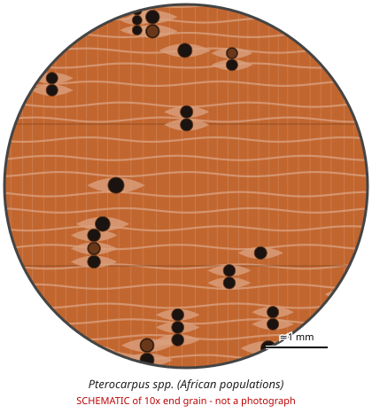

# Pterocarpus spp. (African populations)

**Family:** Fabaceae  
**Trade / common names:** African padauk, muninga, mukwa, kiaat, barwood  
**CITES Appendix:** **II**  
**Annotation:** #17 — Logs, sawn wood, veneer sheets, plywood and transformed wood (HS 44.09, e.g. decking, flooring strips).  
**Population covered:** Populations of Africa only  
**First listed (approx. year in force):** 2023  
**Native range:** Sub-Saharan Africa.

> Always confirm the live listing on [Species+](https://speciesplus.net) before seizure decisions.

## Documents needed for trade

**Appendix II:** **Export permit** from the exporting country (or a **re-export certificate** for re-exports). CITES itself requires no import permit, but many countries (e.g. the EU) do.

The annotation above decides which products need a document at all. Details, validity, codes and a document check: [CITES documents guide](../guides/cites-documents.md).

## 10x end-grain view

| Real photographs (reference specimens) | Schematic |
|---|---|
| See [`photos/pterocarpus-africa/`](../photos/pterocarpus-africa/) and the image links below |  |

## Key diagnostic summary

Same genus pattern as above. Proposal at CoP20 to remove Central African P. soyauxii was REJECTED - still listed.

## Macroscopic features (hand lens, 10x, freshly cut transverse surface)

| Feature | Observation |
|---|---|
| Wood type | hardwood |
| Porosity | diffuse |
| Pore size | large |
| Pore frequency | few |
| Pore arrangement | mixed |
| Pore contents / deposits | red-brown gum |
| Axial parenchyma | banded, aliform, confluent |
| Rays | fine |
| Ripple marks (storied structure, tangential face) | yes |
| Resin canals (softwoods) | no |

**Other features:**

- Parenchyma in fine wavy bands alternating with pores
- Storied structure

## Physical characteristics

- **Heartwood:** Orange-red (padauk) to golden-brown (kiaat/muninga).
- **Sapwood:** Pale.
- **Density:** ~550-850 kg/m3
- **Odour:** Faint.

## Look-alikes (check these before concluding)

- Dalbergia spp.
- Baphia nitida (camwood)
- Guibourtia spp.

## Confirming beyond the hand lens

DNA / mass spec for species.

## Species included in this listing

| Taxon | Trade name | Range | Notes |
|---|---|---|---|
| *Pterocarpus soyauxii* | African padauk | Central Africa | Bright orange-red; large pores visible unaided. |
| *Pterocarpus angolensis* | Muninga, mukwa, kiaat | Southern & East Africa | Golden-brown, lighter. |
| *Pterocarpus osun* | Camwood/ African padauk | West Africa |  |
| *Pterocarpus mildbraedii* |  | West & Central Africa |  |
| *Pterocarpus erinaceus, P. tinctorius* |  |  | See separate entries. |
| *Pterocarpus brenanii* |  | Africa |  |
| *Pterocarpus lucens* |  | Africa |  |
| *Pterocarpus rotundifolius* |  | Africa |  |
| *Pterocarpus santalinoides* |  | Africa / Neotropics |  |
| *Pterocarpus tessmannii* |  | Central Africa |  |

## View 10x end-grain photographs (CITESwoodID)

Transverse section at about 10x, from verified reference specimens. Images (c) Thünen Institute - linked, not copied.

- [*Pterocarpus soyauxii, P. osun* - 10x transverse section](https://www.delta-intkey.com/citeswood/en/www/fabptsoy.htm)
- [*Pterocarpus angolensis* - 10x transverse section](https://www.delta-intkey.com/citeswood/en/www/fabptan.htm)
- [*Pterocarpus erinaceus* - 10x transverse section](https://www.delta-intkey.com/citeswood/en/www/fabpter.htm)
- [*Pterocarpus tinctorius* - 10x transverse section](https://www.delta-intkey.com/citeswood/en/www/fabpttin.htm)

## Other image sources for 10x end-grain photographs

- [Species+ (official CITES listing & annotation)](https://speciesplus.net/species#/taxon_concepts?taxonomy=cites_eu&taxon_concept_query=Pterocarpus)
- [The Wood Database (has a 10x end-grain photo per species)](https://www.wood-database.com/?s=Pterocarpus)
- [InsideWood (anatomy database, NC State)](https://insidewood.lib.ncsu.edu/search)
- [CITES Timber ID repository (manuals, keys, photo atlases)](https://cites.org/eng/timber/timber-ID-repository)
- [CITESwoodID (Thünen Institute, macroscopic key with images)](https://www.thuenen.de/en/institutes/wood-research/fields-of-activity/wood-identification-and-wood-anatomy)
- [Pl@ntWood (CIRAD, macroscopic photos of tropical timbers)](https://plantwood.cirad.fr)
- [Wikimedia Commons (free-licence images)](https://commons.wikimedia.org/w/index.php?search=Pterocarpus+wood&title=Special:MediaSearch&type=image)
- [GBIF (distribution)](https://www.gbif.org/species/search?q=Pterocarpus)

---
[← All species](README.md) · [Field procedure](../guides/field-procedure.md) · [CITES documents](../guides/cites-documents.md) · [Feature glossary](../guides/feature-glossary.md)
