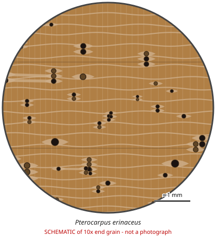

# Pterocarpus erinaceus

**Family:** Fabaceae  
**Trade / common names:** Kosso, African rosewood, vène, barwood, hongmu (part)  
**CITES Appendix:** **II**  
**Annotation:** none — No annotation - ALL parts and derivatives are covered (including finished products).  
**Population covered:** All populations (also covered by the 2023 African Pterocarpus listing)  
**First listed (approx. year in force):** 2016  
**Native range:** West African savanna: Senegal to Cameroon / Central African Republic.

> Always confirm the live listing on [Species+](https://speciesplus.net) before seizure decisions.

## 10x end-grain view

| Real photographs (reference specimens) | Schematic |
|---|---|
| See [`photos/pterocarpus-erinaceus/`](../photos/pterocarpus-erinaceus/) and the image links below |  |

## Key diagnostic summary

Red-purple 'rosewood' with semi-ring-porous tendency, fine wavy parenchyma bands and clear ripple marks. Top species in illegal West African hongmu log trade (round logs, squared beams). No annotation - all parts covered.

## Macroscopic features (hand lens, 10x, freshly cut transverse surface)

| Feature | Observation |
|---|---|
| Wood type | hardwood |
| Porosity | semi-ring |
| Pore size | medium |
| Pore frequency | moderate |
| Pore arrangement | mixed |
| Pore contents / deposits | dark red gum in some pores |
| Axial parenchyma | banded, aliform, confluent |
| Rays | fine |
| Ripple marks (storied structure, tangential face) | yes |
| Resin canals (softwoods) | no |

**Other features:**

- Distinct fine wavy parenchyma bands (Pterocarpus pattern)
- Pores tend to be larger in earlywood (semi-ring porous tendency)
- Ripple marks clear on tangential face

## Physical characteristics

- **Heartwood:** Golden-red to purplish red-brown with darker streaks.
- **Sapwood:** Pale, wide.
- **Density:** ~800-900 kg/m3
- **Odour:** Faint, slightly sweet.

## Look-alikes (check these before concluding)

- Pterocarpus tinctorius
- Pterocarpus santalinus
- Dalbergia spp.
- Pterocarpus soyauxii (padauk)

## Confirming beyond the hand lens

DART-TOF MS and NIR separate P. erinaceus from P. tinctorius/santalinus; DNA.

## Image sources for 10x end-grain photographs

- [Species+ (official CITES listing & annotation)](https://speciesplus.net/species#/taxon_concepts?taxonomy=cites_eu&taxon_concept_query=Pterocarpus+erinaceus)
- [The Wood Database (has a 10x end-grain photo per species)](https://www.wood-database.com/?s=Pterocarpus+erinaceus)
- [InsideWood (anatomy database, NC State)](https://insidewood.lib.ncsu.edu/search)
- [CITES Timber ID repository (manuals, keys, photo atlases)](https://cites.org/eng/timber/timber-ID-repository)
- [CITESwoodID (Thünen Institute, macroscopic key with images)](https://www.thuenen.de/en/institutes/wood-research/fields-of-activity/wood-identification-and-wood-anatomy)
- [Pl@ntWood (CIRAD, macroscopic photos of tropical timbers)](https://plantwood.cirad.fr)
- [Wikimedia Commons (free-licence images)](https://commons.wikimedia.org/w/index.php?search=Pterocarpus+erinaceus+wood&title=Special:MediaSearch&type=image)
- [GBIF (distribution)](https://www.gbif.org/species/search?q=Pterocarpus+erinaceus)

---
[← All species](README.md) · [Field procedure](../guides/field-procedure.md) · [Feature glossary](../guides/feature-glossary.md)
