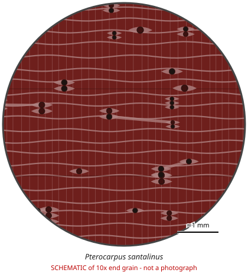

# Pterocarpus santalinus

**Family:** Fabaceae  
**Trade / common names:** Red sanders, red sandalwood, rakta chandana, zitan (part)  
**CITES Appendix:** **II**  
**Annotation:** #7 — Logs, wood chips, powder and extracts.  
**Population covered:** All populations  
**First listed (approx. year in force):** 1995  
**Native range:** Endemic to the southern Eastern Ghats, Andhra Pradesh / Tamil Nadu, India.

> Always confirm the live listing on [Species+](https://speciesplus.net) before seizure decisions.

## 10x end-grain view

| Real photographs (reference specimens) | Schematic |
|---|---|
| See [`photos/pterocarpus-santalinus/`](../photos/pterocarpus-santalinus/) and the image links below |  |

## Key diagnostic summary

Extremely dense, very dark red, non-fragrant wood; parenchyma in fine wavy bands; ripple marks; red dye leaches into water/alcohol. Annotation #7: logs, chips, powder and extracts only.

## Macroscopic features (hand lens, 10x, freshly cut transverse surface)

| Feature | Observation |
|---|---|
| Wood type | hardwood |
| Porosity | diffuse |
| Pore size | medium |
| Pore frequency | few |
| Pore arrangement | mixed |
| Pore contents / deposits | dark red deposits |
| Axial parenchyma | banded, aliform, confluent |
| Rays | fine |
| Ripple marks (storied structure, tangential face) | yes |
| Resin canals (softwoods) | no |

**Other features:**

- Wavy-grain ('wavy red sanders') prized
- Shavings in water give red colour (santalin) - quick field indicator
- Typically traded as billets/logs with bark removed, often smuggled as roots/chips

## Physical characteristics

- **Heartwood:** Very dark blood-red to purplish-black; red pigment (santalin) stains water and fingers.
- **Sapwood:** Whitish, sharply demarcated.
- **Density:** ~1,000-1,200 kg/m3 (sinks in water)
- **Odour:** None (despite the name it is NOT fragrant - unlike true sandalwood Santalum).

## Look-alikes (check these before concluding)

- Pterocarpus tinctorius (mukula)
- Pterocarpus erinaceus
- Dalbergia cochinchinensis
- Adenanthera pavonina
- Caesalpinia sappan (sappanwood)

## Confirming beyond the hand lens

Mass spectrometry and NIR distinguish from P. tinctorius; DNA.

## View 10x end-grain photographs (CITESwoodID)

Transverse section at about 10x, from verified reference specimens. Images (c) Thünen Institute - linked, not copied.

- [*Pterocarpus santalinus* - 10x transverse section](https://www.delta-intkey.com/citeswood/en/www/fabptsa.htm)

## Other image sources for 10x end-grain photographs

- [Species+ (official CITES listing & annotation)](https://speciesplus.net/species#/taxon_concepts?taxonomy=cites_eu&taxon_concept_query=Pterocarpus+santalinus)
- [The Wood Database (has a 10x end-grain photo per species)](https://www.wood-database.com/?s=Pterocarpus+santalinus)
- [InsideWood (anatomy database, NC State)](https://insidewood.lib.ncsu.edu/search)
- [CITES Timber ID repository (manuals, keys, photo atlases)](https://cites.org/eng/timber/timber-ID-repository)
- [CITESwoodID (Thünen Institute, macroscopic key with images)](https://www.thuenen.de/en/institutes/wood-research/fields-of-activity/wood-identification-and-wood-anatomy)
- [Pl@ntWood (CIRAD, macroscopic photos of tropical timbers)](https://plantwood.cirad.fr)
- [Wikimedia Commons (free-licence images)](https://commons.wikimedia.org/w/index.php?search=Pterocarpus+santalinus+wood&title=Special:MediaSearch&type=image)
- [GBIF (distribution)](https://www.gbif.org/species/search?q=Pterocarpus+santalinus)

---
[← All species](README.md) · [Field procedure](../guides/field-procedure.md) · [Feature glossary](../guides/feature-glossary.md)
