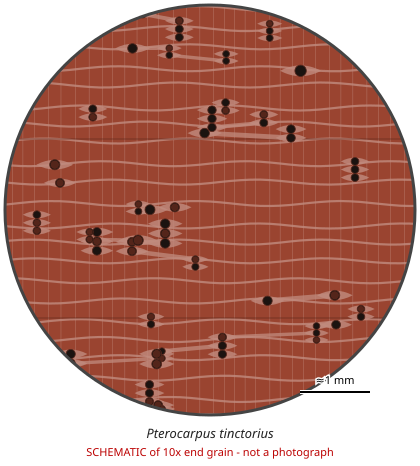

# Pterocarpus tinctorius

**Family:** Fabaceae  
**Trade / common names:** Mukula, African padauk (east/south), mulombe  
**CITES Appendix:** **II**  
**Annotation:** #6 (2019); African populations now also #17 — Logs, sawn wood, veneer sheets and plywood.  
**Population covered:** All populations  
**First listed (approx. year in force):** 2019  
**Native range:** DR Congo (Katanga), Zambia, Tanzania, Malawi, Angola, Mozambique.

> Always confirm the live listing on [Species+](https://speciesplus.net) before seizure decisions.

## 10x end-grain view

| Real photographs (reference specimens) | Schematic |
|---|---|
| See [`photos/pterocarpus-tinctorius/`](../photos/pterocarpus-tinctorius/) and the image links below |  |

## Key diagnostic summary

Red Pterocarpus pattern (banded parenchyma, ripple marks). Shipments of red logs out of southern/eastern Africa to Asia should be treated as suspect mukula/red sanders.

## Macroscopic features (hand lens, 10x, freshly cut transverse surface)

| Feature | Observation |
|---|---|
| Wood type | hardwood |
| Porosity | diffuse |
| Pore size | medium |
| Pore frequency | moderate |
| Pore arrangement | mixed |
| Pore contents / deposits | red gum |
| Axial parenchyma | banded, aliform, confluent |
| Rays | fine |
| Ripple marks (storied structure, tangential face) | yes |
| Resin canals (softwoods) | no |

**Other features:**

- Very similar to P. santalinus; often traded fraudulently as 'red sandalwood'

## Physical characteristics

- **Heartwood:** Bright red to deep red-brown, darkening with exposure.
- **Sapwood:** Pale.
- **Density:** ~700-900 kg/m3
- **Odour:** None distinctive.

## Look-alikes (check these before concluding)

- Pterocarpus santalinus
- Pterocarpus angolensis
- Pterocarpus erinaceus

## Confirming beyond the hand lens

DART-TOF MS / NIR.

## View 10x end-grain photographs (CITESwoodID)

Transverse section at about 10x, from verified reference specimens. Images (c) Thünen Institute - linked, not copied.

- [*Pterocarpus tinctorius* - 10x transverse section](https://www.delta-intkey.com/citeswood/en/www/fabpttin.htm)

## Other image sources for 10x end-grain photographs

- [Species+ (official CITES listing & annotation)](https://speciesplus.net/species#/taxon_concepts?taxonomy=cites_eu&taxon_concept_query=Pterocarpus+tinctorius)
- [The Wood Database (has a 10x end-grain photo per species)](https://www.wood-database.com/?s=Pterocarpus+tinctorius)
- [InsideWood (anatomy database, NC State)](https://insidewood.lib.ncsu.edu/search)
- [CITES Timber ID repository (manuals, keys, photo atlases)](https://cites.org/eng/timber/timber-ID-repository)
- [CITESwoodID (Thünen Institute, macroscopic key with images)](https://www.thuenen.de/en/institutes/wood-research/fields-of-activity/wood-identification-and-wood-anatomy)
- [Pl@ntWood (CIRAD, macroscopic photos of tropical timbers)](https://plantwood.cirad.fr)
- [Wikimedia Commons (free-licence images)](https://commons.wikimedia.org/w/index.php?search=Pterocarpus+tinctorius+wood&title=Special:MediaSearch&type=image)
- [GBIF (distribution)](https://www.gbif.org/species/search?q=Pterocarpus+tinctorius)

---
[← All species](README.md) · [Field procedure](../guides/field-procedure.md) · [Feature glossary](../guides/feature-glossary.md)
