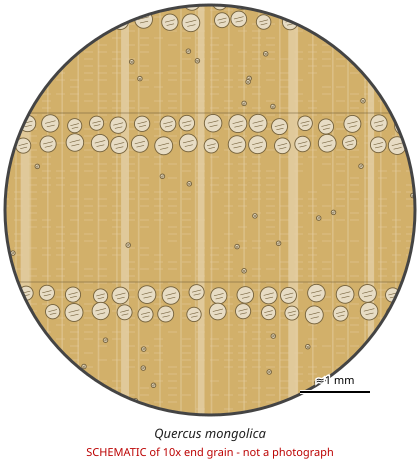

# Quercus mongolica

**Family:** Fagaceae  
**Trade / common names:** Mongolian oak, Japanese oak (mizunara), Manchurian oak  
**CITES Appendix:** **III**  
**Annotation:** #5 — Logs, sawn wood and veneer sheets.  
**Population covered:** Population of the Russian Federation (listed by Russia)  
**First listed (approx. year in force):** 2014  
**Native range:** Russian Far East, NE China, Korea, Japan, Mongolia.

> Always confirm the live listing on [Species+](https://speciesplus.net) before seizure decisions.

## 10x end-grain view

| Real photographs (reference specimens) | Schematic |
|---|---|
| See [`photos/quercus-mongolica/`](../photos/quercus-mongolica/) and the image links below |  |

## Key diagnostic summary

Typical white oak: ring porous, broad rays, tyloses in pores, flame-like latewood pore pattern. Cannot be separated from other white oaks by hand lens - origin (Russia) and documents are key.

## Macroscopic features (hand lens, 10x, freshly cut transverse surface)

| Feature | Observation |
|---|---|
| Wood type | hardwood |
| Porosity | ring |
| Pore size | large |
| Pore frequency | moderate |
| Pore arrangement | solitary |
| Pore contents / deposits | tyloses fill earlywood pores |
| Axial parenchyma | diffuse |
| Rays | broad |
| Ripple marks (storied structure, tangential face) | no |
| Resin canals (softwoods) | no |

**Other features:**

- BROAD MULTISERIATE RAYS clearly visible unaided (oak)
- Earlywood pores large, filled with tyloses (white oak group)
- Latewood pores small, in radial/flame-shaped patches

## Physical characteristics

- **Heartwood:** Light yellowish- to medium brown.
- **Sapwood:** Paler.
- **Density:** ~650-750 kg/m3
- **Odour:** Faint oak/ tannin smell.

## Look-alikes (check these before concluding)

- Quercus robur / Q. petraea (European oak)
- Quercus alba (American white oak)
- Quercus crispula

## Confirming beyond the hand lens

DNA, stable isotopes for origin (Russia vs China/Japan/EU).

## Image sources for 10x end-grain photographs

- [Species+ (official CITES listing & annotation)](https://speciesplus.net/species#/taxon_concepts?taxonomy=cites_eu&taxon_concept_query=Quercus+mongolica)
- [The Wood Database (has a 10x end-grain photo per species)](https://www.wood-database.com/?s=Quercus+mongolica)
- [InsideWood (anatomy database, NC State)](https://insidewood.lib.ncsu.edu/search)
- [CITES Timber ID repository (manuals, keys, photo atlases)](https://cites.org/eng/timber/timber-ID-repository)
- [CITESwoodID (Thünen Institute, macroscopic key with images)](https://www.thuenen.de/en/institutes/wood-research/fields-of-activity/wood-identification-and-wood-anatomy)
- [Pl@ntWood (CIRAD, macroscopic photos of tropical timbers)](https://plantwood.cirad.fr)
- [Wikimedia Commons (free-licence images)](https://commons.wikimedia.org/w/index.php?search=Quercus+mongolica+wood&title=Special:MediaSearch&type=image)
- [GBIF (distribution)](https://www.gbif.org/species/search?q=Quercus+mongolica)

---
[← All species](README.md) · [Field procedure](../guides/field-procedure.md) · [Feature glossary](../guides/feature-glossary.md)
