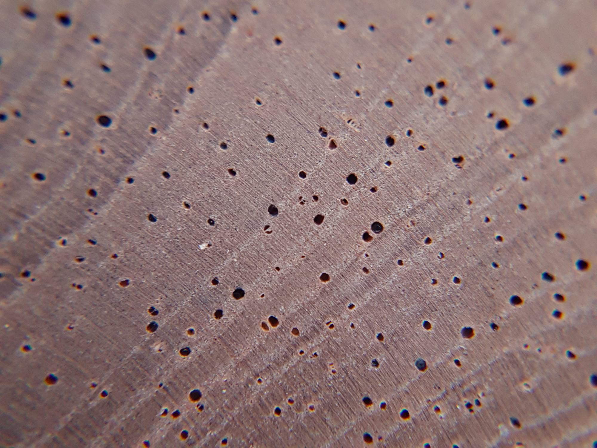
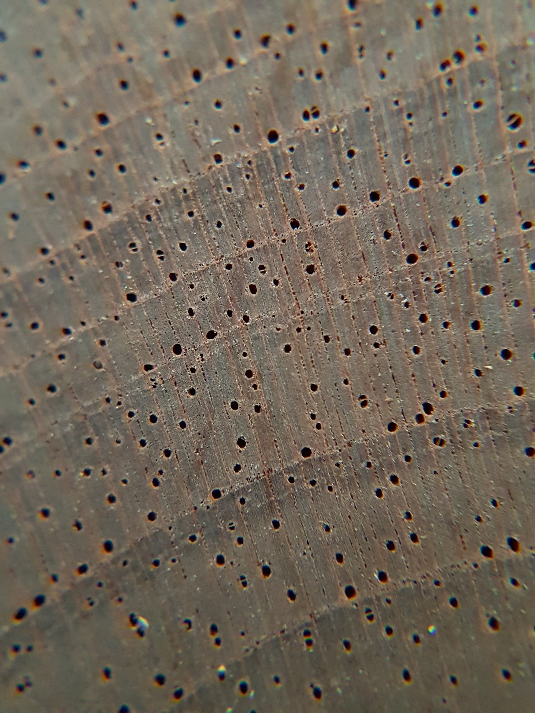
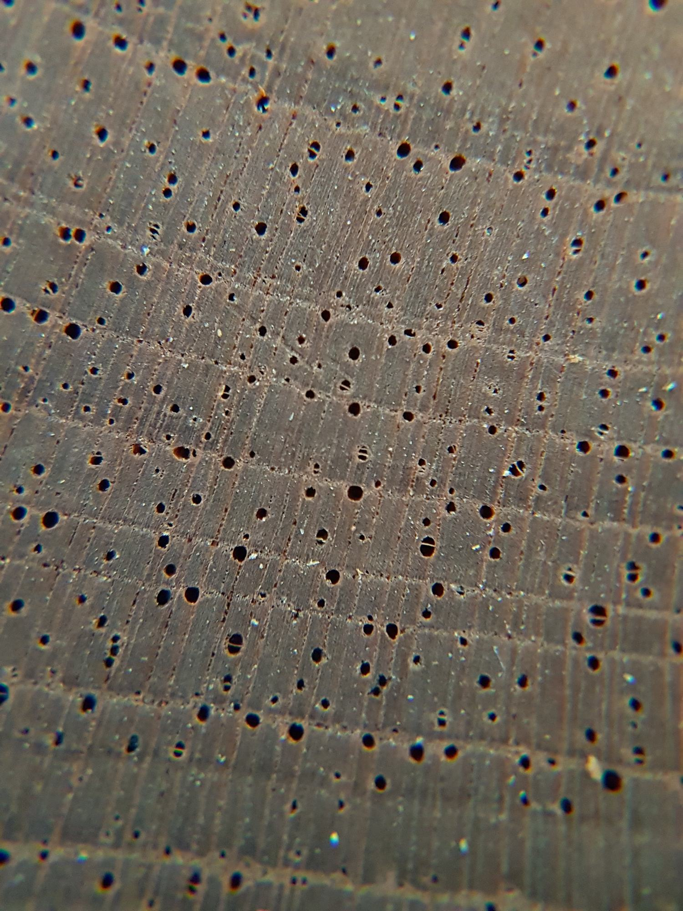
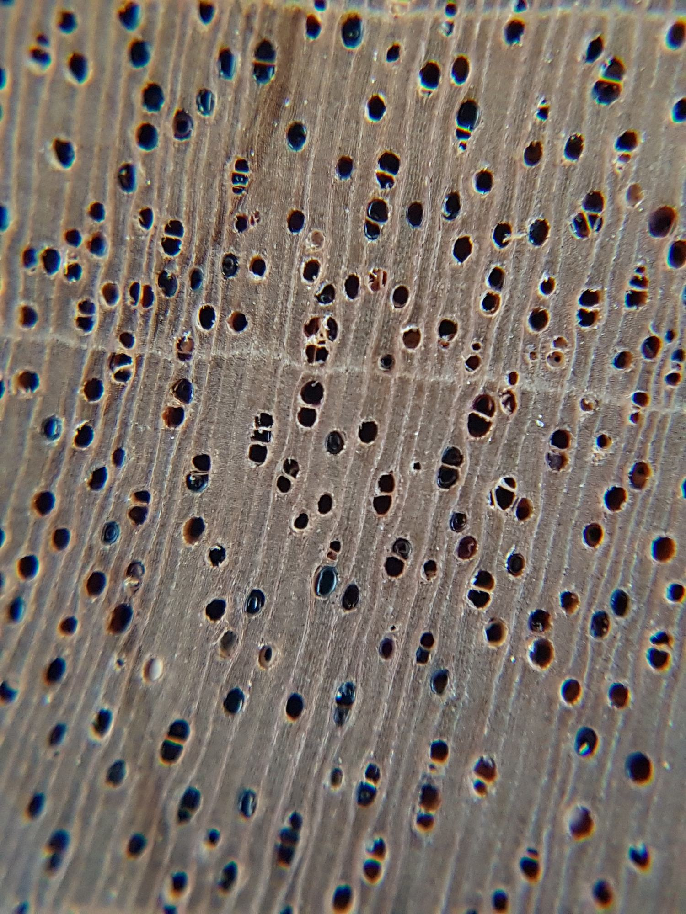
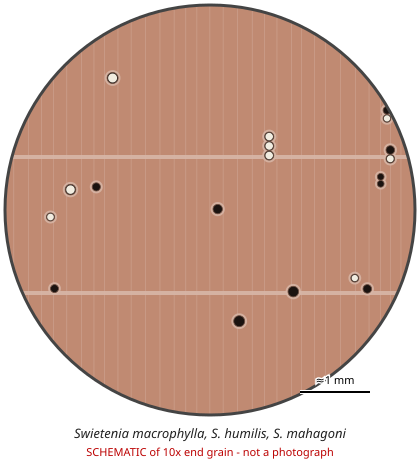

# Swietenia macrophylla, S. humilis, S. mahagoni

**Family:** Meliaceae  
**Trade / common names:** Big-leaf mahogany, Honduras mahogany, genuine mahogany, caoba, Cuban mahogany, Pacific coast mahogany  
**CITES Appendix:** **II**  
**Annotation:** S. macrophylla #6 (Neotropical populations); S. humilis #4; S. mahagoni #5 — see species table below.  
**Population covered:** S. macrophylla: Neotropics only (plantations in Asia/Fiji not covered)  
**First listed (approx. year in force):** 1992  
**Native range:** Mexico through Central America to the Amazon (S. macrophylla); Pacific dry forest of Mexico-Costa Rica (S. humilis); Caribbean & Florida (S. mahagoni).

> Always confirm the live listing on [Species+](https://speciesplus.net) before seizure decisions.

## Documents needed for trade

**Appendix II:** **Export permit** from the exporting country (or a **re-export certificate** for re-exports). CITES itself requires no import permit, but many countries (e.g. the EU) do.

The annotation above decides which products need a document at all. Details, validity, codes and a document check: [CITES documents guide](../guides/cites-documents.md).

## End-grain view

  
*Swietenia humilis* - transverse (end grain), phone camera + 24x macro lens. GOIMAI, CC BY-SA 4.0.

  
*Swietenia humilis* - transverse (end grain), phone camera + 24x macro lens. GOIMAI, CC BY-SA 4.0.

  
*Swietenia humilis* - transverse (end grain), phone camera + 24x macro lens. GOIMAI, CC BY-SA 4.0.

  
*Swietenia macrophylla* - transverse (end grain), phone camera + 24x macro lens. GOIMAI, CC BY-SA 4.0.

Schematic drawing (not a photograph): 

## Key diagnostic summary

Diffuse-porous reddish wood with medium pores (solitary + short radial multiples), white or dark gum deposits, distinct marginal parenchyma lines and frequent ripple marks.

## Macroscopic features (hand lens, 10x, freshly cut transverse surface)

| Feature | Observation |
|---|---|
| Wood type | hardwood |
| Porosity | diffuse |
| Pore size | medium |
| Pore frequency | few |
| Pore arrangement | mixed |
| Pore contents / deposits | dark red-brown gum and/or white deposits in some pores |
| Axial parenchyma | marginal, vasicentric |
| Rays | fine |
| Ripple marks (storied structure, tangential face) | variable |
| Resin canals (softwoods) | no |

**Other features:**

- Distinct pale lines of marginal (terminal) parenchyma delimit growth rings
- Ripple marks frequently present on tangential face
- Rays visible at 10x, reddish

## Physical characteristics

- **Heartwood:** Light pinkish to deep reddish-brown, darkening; lustrous with ribbon figure.
- **Sapwood:** Yellowish-white.
- **Density:** ~500-650 kg/m3 (S. mahagoni up to ~800)
- **Odour:** None to faint.

## Look-alikes (check these before concluding)

- Khaya spp. (African mahogany - usually no ripple marks, often no marginal lines)
- Carapa guianensis (andiroba)
- Cedrela spp.
- Entandrophragma spp. (sapele, sipo)
- Toona spp.

## Confirming beyond the hand lens

Microscopy separates Swietenia from Khaya (ray structure, crystals); DNA/MS for species.

## Listed species covered by this entry (3)

From the Species+ checklist.

| Taxon | Appendix | Annotation | Trade name | Native distribution |
|---|---|---|---|---|
| *Swietenia humilis* | II | #4 | Pacific coast mahogany | Belize, Costa Rica, El Salvador, Guatemala, Honduras, Mexico, Nicaragua, Panama |
| *Swietenia macrophylla* | II | #6 | Big-leaf / Brazilian / Honduras mahogany | Belize, Bolivia (Plurinational State of), Brazil, Colombia, Costa Rica, Dominica, Ecuador, El Salvador, French Guiana [FR], Guadeloupe, Guatemala, Guyana, Honduras, Jamaica, Mexico, Nicaragua, Panama, Peru, Trinidad and Tobago, Venezuela (Bolivarian Republic of) |
| *Swietenia mahagoni* | II | #5 | Cuban / West Indian mahogany | Anguilla (United Kingdom), Antigua and Barbuda, Bahamas, Barbados, Cayman Islands (United Kingdom), Colombia, Cuba, Dominica, Dominican Republic, Grenada, Guadeloupe, Jamaica, Martinique, Montserrat (United Kingdom), Peru, Saint Kitts and Nevis, Saint Lucia, Saint Vincent and the Grenadines, Trinidad and Tobago, Turks and Caicos Islands (United Kingdom), United States of America, Venezuela (Bolivarian Republic of) |

## View 10x end-grain photographs (CITESwoodID)

Transverse section at about 10x, from verified reference specimens. Images (c) Thünen Institute - linked, not copied.

- [*Swietenia spp.* - 10x transverse section](https://www.delta-intkey.com/citeswood/en/www/melswie.htm)

## Other image sources for 10x end-grain photographs

- [Species+ (official CITES listing & annotation)](https://speciesplus.net/species#/taxon_concepts?taxonomy=cites_eu&taxon_concept_query=Swietenia+macrophylla)
- [The Wood Database (has a 10x end-grain photo per species)](https://www.wood-database.com/?s=Swietenia+macrophylla)
- [InsideWood (anatomy database, NC State)](https://insidewood.lib.ncsu.edu/search)
- [CITES Timber ID repository (manuals, keys, photo atlases)](https://cites.org/eng/timber/timber-ID-repository)
- [CITESwoodID (Thünen Institute, macroscopic key with images)](https://www.thuenen.de/en/institutes/wood-research/fields-of-activity/wood-identification-and-wood-anatomy)
- [Pl@ntWood (CIRAD, macroscopic photos of tropical timbers)](https://plantwood.cirad.fr)
- [Wikimedia Commons (free-licence images)](https://commons.wikimedia.org/w/index.php?search=Swietenia+macrophylla+wood&title=Special:MediaSearch&type=image)
- [GBIF (distribution)](https://www.gbif.org/species/search?q=Swietenia+macrophylla)

---
[← All species](README.md) · [Field procedure](../guides/field-procedure.md) · [CITES documents](../guides/cites-documents.md) · [Feature glossary](../guides/feature-glossary.md)
