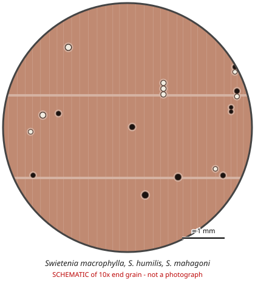

# Swietenia macrophylla, S. humilis, S. mahagoni

**Family:** Meliaceae  
**Trade / common names:** Big-leaf mahogany, Honduras mahogany, genuine mahogany, caoba, Cuban mahogany, Pacific coast mahogany  
**CITES Appendix:** **II**  
**Annotation:** S. macrophylla #6 (Neotropical populations); S. humilis #4; S. mahagoni #5 — see species table below.  
**Population covered:** S. macrophylla: Neotropics only (plantations in Asia/Fiji not covered)  
**First listed (approx. year in force):** 1992  
**Native range:** Mexico through Central America to the Amazon (S. macrophylla); Pacific dry forest of Mexico-Costa Rica (S. humilis); Caribbean & Florida (S. mahagoni).

> Always confirm the live listing on [Species+](https://speciesplus.net) before seizure decisions.

## 10x end-grain view

| Real photographs (reference specimens) | Schematic |
|---|---|
| See [`photos/swietenia-spp/`](../photos/swietenia-spp/) and the image links below |  |

## Key diagnostic summary

Diffuse-porous reddish wood with medium pores (solitary + short radial multiples), white or dark gum deposits, distinct marginal parenchyma lines and frequent ripple marks.

## Macroscopic features (hand lens, 10x, freshly cut transverse surface)

| Feature | Observation |
|---|---|
| Wood type | hardwood |
| Porosity | diffuse |
| Pore size | medium |
| Pore frequency | few |
| Pore arrangement | mixed |
| Pore contents / deposits | dark red-brown gum and/or white deposits in some pores |
| Axial parenchyma | marginal, vasicentric |
| Rays | fine |
| Ripple marks (storied structure, tangential face) | variable |
| Resin canals (softwoods) | no |

**Other features:**

- Distinct pale lines of marginal (terminal) parenchyma delimit growth rings
- Ripple marks frequently present on tangential face
- Rays visible at 10x, reddish

## Physical characteristics

- **Heartwood:** Light pinkish to deep reddish-brown, darkening; lustrous with ribbon figure.
- **Sapwood:** Yellowish-white.
- **Density:** ~500-650 kg/m3 (S. mahagoni up to ~800)
- **Odour:** None to faint.

## Look-alikes (check these before concluding)

- Khaya spp. (African mahogany - usually no ripple marks, often no marginal lines)
- Carapa guianensis (andiroba)
- Cedrela spp.
- Entandrophragma spp. (sapele, sipo)
- Toona spp.

## Confirming beyond the hand lens

Microscopy separates Swietenia from Khaya (ray structure, crystals); DNA/MS for species.

## Species included in this listing

| Taxon | Trade name | Range | Notes |
|---|---|---|---|
| *Swietenia macrophylla* | Big-leaf / Brazilian / Honduras mahogany | Mexico to Bolivia & Brazil | Annotation #6; plantations outside Neotropics excluded. |
| *Swietenia humilis* | Pacific coast mahogany | Pacific Mexico to Costa Rica | Annotation #4. |
| *Swietenia mahagoni* | Cuban / West Indian mahogany | Caribbean, S Florida | Annotation #5; denser, finer. |

## Image sources for 10x end-grain photographs

- [Species+ (official CITES listing & annotation)](https://speciesplus.net/species#/taxon_concepts?taxonomy=cites_eu&taxon_concept_query=Swietenia+macrophylla)
- [The Wood Database (has a 10x end-grain photo per species)](https://www.wood-database.com/?s=Swietenia+macrophylla)
- [InsideWood (anatomy database, NC State)](https://insidewood.lib.ncsu.edu/search)
- [CITES Timber ID repository (manuals, keys, photo atlases)](https://cites.org/eng/timber/timber-ID-repository)
- [CITESwoodID (Thünen Institute, macroscopic key with images)](https://www.thuenen.de/en/institutes/wood-research/fields-of-activity/wood-identification-and-wood-anatomy)
- [Pl@ntWood (CIRAD, macroscopic photos of tropical timbers)](https://plantwood.cirad.fr)
- [Wikimedia Commons (free-licence images)](https://commons.wikimedia.org/w/index.php?search=Swietenia+macrophylla+wood&title=Special:MediaSearch&type=image)
- [GBIF (distribution)](https://www.gbif.org/species/search?q=Swietenia+macrophylla)

---
[← All species](README.md) · [Field procedure](../guides/field-procedure.md) · [Feature glossary](../guides/feature-glossary.md)
