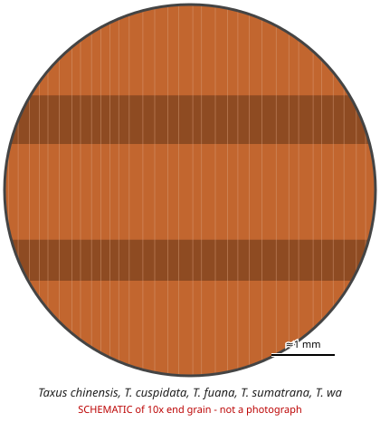

# Taxus chinensis, T. cuspidata, T. fuana, T. sumatrana, T. wallichiana (and their infraspecific taxa)

**Family:** Taxaceae  
**Trade / common names:** Asian yews, Chinese yew, Japanese yew, Himalayan yew  
**CITES Appendix:** **II**  
**Annotation:** #2 — All parts and derivatives except seeds and pollen, and finished products packaged and ready for retail trade.  
**Population covered:** All populations of the listed species  
**First listed (approx. year in force):** 1995  
**Native range:** Himalaya, China, Russian Far East, Japan, Korea, Southeast Asia.

> Always confirm the live listing on [Species+](https://speciesplus.net) before seizure decisions.

## Documents needed for trade

**Appendix II:** **Export permit** from the exporting country (or a **re-export certificate** for re-exports). CITES itself requires no import permit, but many countries (e.g. the EU) do.

The annotation above decides which products need a document at all. Details, validity, codes and a document check: [CITES documents guide](../guides/cites-documents.md).

## 10x end-grain view

| Real photographs (reference specimens) | Schematic |
|---|---|
| See [`photos/taxus-spp/`](../photos/taxus-spp/) and the image links below |  |

## Key diagnostic summary

Dense orange-red softwood without resin canals, very narrow rings and thin white sapwood. Species not separable by wood - origin/DNA.

## Macroscopic features (hand lens, 10x, freshly cut transverse surface)

| Feature | Observation |
|---|---|
| Wood type | softwood |
| Porosity | none |
| Pore size | — |
| Pore frequency | — |
| Pore arrangement | — |
| Pore contents / deposits | none noted |
| Axial parenchyma | not visible / none |
| Rays | fine |
| Ripple marks (storied structure, tangential face) | no |
| Resin canals (softwoods) | no |

**Other features:**

- NO resin canals
- Narrow, wavy growth rings; dense latewood
- Spiral thickenings in tracheids (microscope) - diagnostic for Taxus
- Mainly traded for taxanes (paclitaxel) from bark/needles

## Physical characteristics

- **Heartwood:** Orange-red to purplish brown.
- **Sapwood:** Thin, creamy white, sharply demarcated.
- **Density:** ~600-700 kg/m3 (heavy for a softwood)
- **Odour:** None.

## Look-alikes (check these before concluding)

- Taxus baccata (European yew - not listed)
- Taxus brevifolia (Pacific yew)
- Torreya spp.

## Confirming beyond the hand lens

Microscopy (spiral thickenings), DNA.

## Species included in this listing

| Taxon | Trade name | Range | Notes |
|---|---|---|---|
| *Taxus chinensis* | Chinese yew | China |  |
| *Taxus cuspidata* | Japanese yew | Japan, Korea, Russian Far East, NE China |  |
| *Taxus fuana* | Himalayan yew | W Himalaya |  |
| *Taxus sumatrana* | Sumatran yew | SE Asia |  |
| *Taxus wallichiana* | Himalayan yew | Himalaya to SE Asia |  |

## View 10x end-grain photographs (CITESwoodID)

Transverse section at about 10x, from verified reference specimens. Images (c) Thünen Institute - linked, not copied.

- [*Taxus spp.* - 10x transverse section](https://www.delta-intkey.com/citeswood/en/www/taxtaspp.htm)

## Other image sources for 10x end-grain photographs

- [Species+ (official CITES listing & annotation)](https://speciesplus.net/species#/taxon_concepts?taxonomy=cites_eu&taxon_concept_query=Taxus+chinensis)
- [The Wood Database (has a 10x end-grain photo per species)](https://www.wood-database.com/?s=Taxus+chinensis)
- [InsideWood (anatomy database, NC State)](https://insidewood.lib.ncsu.edu/search)
- [CITES Timber ID repository (manuals, keys, photo atlases)](https://cites.org/eng/timber/timber-ID-repository)
- [CITESwoodID (Thünen Institute, macroscopic key with images)](https://www.thuenen.de/en/institutes/wood-research/fields-of-activity/wood-identification-and-wood-anatomy)
- [Pl@ntWood (CIRAD, macroscopic photos of tropical timbers)](https://plantwood.cirad.fr)
- [Wikimedia Commons (free-licence images)](https://commons.wikimedia.org/w/index.php?search=Taxus+chinensis+wood&title=Special:MediaSearch&type=image)
- [GBIF (distribution)](https://www.gbif.org/species/search?q=Taxus+chinensis)

---
[← All species](README.md) · [Field procedure](../guides/field-procedure.md) · [CITES documents](../guides/cites-documents.md) · [Feature glossary](../guides/feature-glossary.md)
