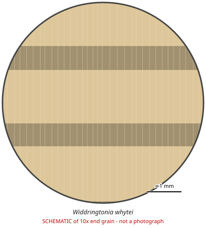

# Widdringtonia whytei

**Family:** Cupressaceae  
**Trade / common names:** Mulanje cedar  
**CITES Appendix:** **II**  
**Annotation:** none — No annotation - ALL parts and derivatives are covered (including finished products).  
**Population covered:** All populations  
**First listed (approx. year in force):** 2019  
**Native range:** Mount Mulanje, Malawi (endemic).

> Always confirm the live listing on [Species+](https://speciesplus.net) before seizure decisions.

## 10x end-grain view

| Real photographs (reference specimens) | Schematic |
|---|---|
| See [`photos/widdringtonia-whytei/`](../photos/widdringtonia-whytei/) and the image links below |  |

## Key diagnostic summary

Aromatic reddish cypress-family softwood from Malawi; curios, planks. Origin key.

## Macroscopic features (hand lens, 10x, freshly cut transverse surface)

| Feature | Observation |
|---|---|
| Wood type | softwood |
| Porosity | none |
| Pore size | — |
| Pore frequency | — |
| Pore arrangement | — |
| Pore contents / deposits | none noted |
| Axial parenchyma | not visible / none |
| Rays | fine |
| Ripple marks (storied structure, tangential face) | no |
| Resin canals (softwoods) | no |

**Other features:**

- No resin canals; distinct growth rings; fine even texture

## Physical characteristics

- **Heartwood:** Pale reddish- to pinkish-brown.
- **Sapwood:** Pale.
- **Density:** ~450-500 kg/m3
- **Odour:** Strong aromatic cedar scent.

## Look-alikes (check these before concluding)

- Widdringtonia nodiflora / W. cedarbergensis
- Juniperus procera (African pencil cedar)

## Confirming beyond the hand lens

DNA.

## View 10x end-grain photographs (CITESwoodID)

Transverse section at about 10x, from verified reference specimens. Images (c) Thünen Institute - linked, not copied.

- [*Widdringtonia whytei* - 10x transverse section](https://www.delta-intkey.com/citeswood/en/www/cupwidwh.htm)

## Other image sources for 10x end-grain photographs

- [Species+ (official CITES listing & annotation)](https://speciesplus.net/species#/taxon_concepts?taxonomy=cites_eu&taxon_concept_query=Widdringtonia+whytei)
- [The Wood Database (has a 10x end-grain photo per species)](https://www.wood-database.com/?s=Widdringtonia+whytei)
- [InsideWood (anatomy database, NC State)](https://insidewood.lib.ncsu.edu/search)
- [CITES Timber ID repository (manuals, keys, photo atlases)](https://cites.org/eng/timber/timber-ID-repository)
- [CITESwoodID (Thünen Institute, macroscopic key with images)](https://www.thuenen.de/en/institutes/wood-research/fields-of-activity/wood-identification-and-wood-anatomy)
- [Pl@ntWood (CIRAD, macroscopic photos of tropical timbers)](https://plantwood.cirad.fr)
- [Wikimedia Commons (free-licence images)](https://commons.wikimedia.org/w/index.php?search=Widdringtonia+whytei+wood&title=Special:MediaSearch&type=image)
- [GBIF (distribution)](https://www.gbif.org/species/search?q=Widdringtonia+whytei)

---
[← All species](README.md) · [Field procedure](../guides/field-procedure.md) · [Feature glossary](../guides/feature-glossary.md)
